# HUẾ TRAVEL PRO V2.3 — CỐ ĐÔ HUẾ
# BÁO CÁO KIỂM KÊ HIỆN TRẠNG CHỨC NĂNG (CURRENT-STATE AUDIT)
## MÃ TÀI LIỆU: GATE-07-00-FUNCTIONAL-AUDIT
**Định hướng:** STUDENT PROJECT — DEMO FIRST  
**Phiên bản:** V1.0  
**Ngày thực hiện:** 24/10/2026  
**Chế độ thực thi:** READ-ONLY AUDIT ONLY (Không ghi mã, không đột biến dữ liệu)  
**Nguyên tắc cốt lõi:** PASS = LOCK — FIX ONLY WHAT FAILED — NO SCOPE CREEP

---

## MỤC LỤC
1. [PHẦN A — TỔNG QUAN ĐIỀU HÀNH (EXECUTIVE SUMMARY)](#phần-a--tổng-quan-điều-hành-executive-summary)
2. [PHẦN B — KIỂM KÊ DANH MỤC CHỨC NĂNG (FUNCTIONAL INVENTORY)](#phần-b--kiểm-kê-danh-mục-chức-năng-functional-inventory)
3. [PHẦN C — SỔ TỒN ĐỌNG LỖI VÀ KHIẾM KHUYẾT (BUG BACKLOG)](#phần-c--sổ-tồn-đọng-lỗi-và-khiếm-khuyết-bug-backlog)
4. [PHẦN D — ĐÁNH GIÁ ĐỘ SẴN SÀNG TRÌNH DIỄN (DEMO READINESS)](#phần-d--đánh-giá-độ-sẵn-sàng-trình-diễn-demo-readiness)
5. [PHẦN E — KẾ HOẠCH XỬ LÝ TỐI THIỂU (MINIMUM FIX PLAN)](#phần-e--kế-hoạch-xử-lý-tối-thiểu-minimum-fix-plan)
6. [PHẦN F — TUYÊN BỐ BẢO TOÀN TRẠNG THÁI (NON-MUTATION DECLARATION)](#phần-f--tuyên-bố-bảo-toàn-trạng-thái-non-mutation-declaration)

---

## PHẦN A — TỔNG QUAN ĐIỀU HÀNH (EXECUTIVE SUMMARY)

### 1. Bối cảnh dự án
Theo chỉ thị chiến lược từ Owner, dự án HUẾ TRAVEL PRO V2.3 chuyển trọng tâm sang **STUDENT PROJECT — DEMO FIRST**. Mục tiêu tối thượng là đảm bảo website hoạt động ổn định, thẩm mỹ vượt trội, luồng trải nghiệm người dùng liền mạch để phục vụ buổi thuyết trình bảo vệ bài tập trực tiếp trước hội đồng / giảng viên.

### 2. Trạng thái kỹ thuật tổng thể (Codebase Health)
Kiểm tra tĩnh (Static Inspection) được thực hiện trên toàn bộ mã nguồn tại `A:\trí tuệ nhân tạo\BAI_3\hue-travel-pro`:
- **TypeScript Typecheck:** `tsc --noEmit` đạt mã thoát `0` (Zero type errors, 100% khớp schema và interface).
- **ESLint Code Quality:** `eslint src` đạt mã thoát `0` (Zero lint warnings / errors).
- **Tài nguyên hình ảnh (Assets):** 100% các tệp hình ảnh được tham chiếu trong mock data (`places.ts`, `rentals.ts`, `accommodations.ts`) và layout tĩnh đều tồn tại đầy đủ trong thư mục `public/images/`. Không có hình ảnh nào bị đứt gãy link nội bộ.
- **Dữ liệu hạt giống Mock:** Đã cấu hình hoàn chỉnh 20 thực thể nội dung phong phú:
  - 08 Địa điểm văn hoá / lịch sử / ẩm thực Huế (`src/data/places.ts`).
  - 06 Phương tiện di chuyển & thuê xe (`src/data/rentals.ts`).
  - 06 Cơ sở lưu trú homestay / khách sạn / resort (`src/data/accommodations.ts`).
- **Dynamic Route Static Params:** Cả 3 route động `[slug]` (`/kham-pha/[slug]`, `/cam-nang/thue-xe/[slug]`, `/luu-tru/[slug]`) đều định nghĩa hàm `generateStaticParams()` khớp chính xác 100% danh sách slug hạt giống.

### 3. Đánh giá độ sẵn sàng Demo (Demo Readiness Score)
- **Mức độ sẵn sàng:** **95% (RẤT CAO / SẴN SÀNG TRÌNH DIỄN NGAY)**.
- **Đánh giá rủi ro P0/P1:** **0 lỗi nghiêm trọng (Zero Blockers)**. Website hoàn toàn có thể chạy mượt mà từ đầu đến cuối kịch bản thuyết trình mà không gặp bất kỳ lỗi vỡ layout hoặc crash ứng dụng nào.

### 4. Thống kê kết quả kiểm kê (Inventory Metrics)
Tổng số chức năng được kiểm kê chi tiết: **24 chức năng**.

| Trạng thái | Số lượng | Tỷ lệ (%) | Ghi chú |
| :--- | :---: | :---: | :--- |
| **PASS (STATIC VERIFIED)** | 19 | 79.2% | Logic hoàn chỉnh, kiểm tra cú pháp và cấu trúc dữ liệu đạt |
| **PARTIAL (STATIC VERIFIED)** | 3 | 12.5% | Giao diện hoàn chỉnh, còn thiếu liên kết query param hoặc click handler |
| **FAIL** | 0 | 0.0% | Không có lỗi logic phá hủy chức năng |
| **NOT IMPLEMENTED** | 2 | 8.3% | Tính năng Favorites & Auth Profile được vô hiệu hóa chủ động (Neutralized theo LOCK-08 & LOCK-13) |
| **RUNTIME NOT TESTED** | 24 | 100.0% | Do server chưa được khởi động trong phiên kiểm toán tĩnh (tuân thủ nguyên tắc báo cáo trung thực) |
| **BLOCKED** | 0 | 0.0% | Không có trở ngại môi trường kiểm tra tĩnh |

---

## PHẦN B — KIỂM KÊ DANH MỤC CHỨC NĂNG (FUNCTIONAL INVENTORY)

*Quy ước phân loại bằng chứng:*
- `STATIC VERIFIED`: Đã kiểm chứng logic, JSX, event handler, kiểu dữ liệu trong mã nguồn.
- `RUNTIME NOT TESTED`: Chưa kiểm chứng tương tác trực tiếp qua cổng mạng vì chế độ kiểm toán là Read-Only, không tự ý spawn tiến trình nền.

---

### B.1 — TRANG CHỦ (`/`)

| STT | Chức năng (Feature) | Kỳ vọng (Expected) | Thực tế mã nguồn (Actual) | Trạng thái (Status) | Bằng chứng (Evidence) |
| :---: | :--- | :--- | :--- | :--- | :--- |
| 1 | **Hero Branding & Background** | Hiển thị tiêu đề "Huế Có Chi Hay?", khẩu hiệu, ảnh nền Đại Nội Huế chất lượng cao. | Render đầy đủ qua component `<Image>` với chế độ `priority`, overlay gradient mượt mà, typography chuẩn phong cách Cố Đô. | `PASS (STATIC VERIFIED)`<br>`RUNTIME NOT TESTED` | `src/app/page.tsx`<br>Dòng 55–75 |
| 2 | **Capsule Hero Navigation** | 4 viên nang điều hướng trung tâm (Khám phá, Cẩm nang, Lưu trú, Về Huế) có biểu tượng và mô tả ngắn. | Component `AdaptiveNavigation` hiển thị dạng capsule nằm ngang ở Hero khi `isLanding=true`. Hiệu ứng hover và click chuyển trang Next.js. | `PASS (STATIC VERIFIED)`<br>`RUNTIME NOT TESTED` | `src/components/navigation/AdaptiveNavigation.tsx`<br>Dòng 182–245 |
| 3 | **Quick Search Bar Form** | Ô tìm kiếm nhanh với dropdown phân loại danh mục và nút "Khám phá ngay". | Thẻ `<form action="/kham-pha">` nhận query `q` và select `category`, điều hướng tự nhiên của trình duyệt sang trang Khám phá kèm URL query params. | `PASS (STATIC VERIFIED)`<br>`RUNTIME NOT TESTED` | `src/app/page.tsx`<br>Dòng 77–125 |
| 4 | **Bottom Dock Highlight Cards** | 3 thẻ nổi bật ở chân trang ("Di tích - Lịch sử", "Văn hoá - Tâm linh", "Ẩm thực Huế") có số lượng và liên kết nhanh. | Thẻ hiển thị đẹp, có số đếm thống kê; tuy nhiên cả 3 thẻ đều có `href="/kham-pha"` chung chung, chưa gắn kèm tham số query `?category=...`. | `PARTIAL (STATIC VERIFIED)`<br>`RUNTIME NOT TESTED` | `src/app/page.tsx`<br>Dòng 127–165 (`BUG-01`) |
| 5 | **Mobile Responsive Header & Drawer** | Thanh Header tối giản trên thiết bị di động có nút Hamburger mở Drawer danh mục. | `Header` responsive (`md:hidden`) với state `mobileMenuOpen`, drawer mở rộng phủ màn hình chứa đủ liên kết 4 trang chính và ô tìm kiếm. | `PASS (STATIC VERIFIED)`<br>`RUNTIME NOT TESTED` | `src/components/navigation/Header.tsx`<br>Dòng 50–115 |

---

### B.2 — TRANG VỀ HUẾ (`/ve-hue`)

| STT | Chức năng (Feature) | Kỳ vọng (Expected) | Thực tế mã nguồn (Actual) | Trạng thái (Status) | Bằng chứng (Evidence) |
| :---: | :--- | :--- | :--- | :--- | :--- |
| 6 | **Hero & Cố Đô Overview** | Banner tiêu đề "Về Cố Đô", đoạn giới thiệu khái quát di sản văn hoá Thừa Thiên Huế. | Typography trang nhã, thẻ badge di sản, bố cục 2 cột cân đối, hiển thị ảnh Cầu Trường Tiền sắc nét. | `PASS (STATIC VERIFIED)`<br>`RUNTIME NOT TESTED` | `src/app/ve-hue/page.tsx`<br>Dòng 25–60 |
| 7 | **4 Thẻ Di sản nổi bật** | Giới thiệu 4 trụ cột: Di sản UNESCO, Nhã nhạc cung đình, Ẩm thực Cố Đô, Festival Huế. | Giao diện thẻ trực quan với icon và nhãn; mỗi thẻ có biểu tượng mũi tên `<ArrowRight />` nhưng là thẻ `<div>` tĩnh, không có handler click điều hướng. | `PARTIAL (STATIC VERIFIED)`<br>`RUNTIME NOT TESTED` | `src/app/ve-hue/page.tsx`<br>Dòng 62–130 (`BUG-02`) |
| 8 | **Dòng thời gian Lịch sử (Timeline)** | Hiển thị 4 mốc son lịch sử trọng đại (1306, 1802, 1945, 1993–nay). | Bố cục timeline dọc/ngang chuẩn CSS Flexbox, có chấm tròn nối mốc thời gian, badge năm nổi bật, nội dung cô đọng súc tích. | `PASS (STATIC VERIFIED)`<br>`RUNTIME NOT TESTED` | `src/app/ve-hue/page.tsx`<br>Dòng 132–195 |
| 9 | **Cẩm nang bỏ túi & Mẹo tham quan** | 4 lời khuyên hữu ích cho du khách (Thời điểm lý tưởng, Trang phục di tích, Ẩm thực đặc trưng, Phương tiện). | Render dạng lưới 4 ô thông tin với icon tương ứng (`Calendar`, `ShieldCheck`, `Utensils`, `Compass`), phân cách màu nền nhẹ nhàng. | `PASS (STATIC VERIFIED)`<br>`RUNTIME NOT TESTED` | `src/app/ve-hue/page.tsx`<br>Dòng 197–250 |
| 10 | **CTA Banner "Bắt đầu hành trình"** | Nút kích hoạt người dùng chuyển tiếp sang khám phá các điểm đến thực tế. | Khối CTA nổi bật với nút `<Link href="/kham-pha">` dẫn mượt mà sang danh mục địa điểm. | `PASS (STATIC VERIFIED)`<br>`RUNTIME NOT TESTED` | `src/app/ve-hue/page.tsx`<br>Dòng 252–280 |

---

### B.3 — TRANG KHÁM PHÁ (`/kham-pha` & `[slug]`)

| STT | Chức năng (Feature) | Kỳ vọng (Expected) | Thực tế mã nguồn (Actual) | Trạng thái (Status) | Bằng chứng (Evidence) |
| :---: | :--- | :--- | :--- | :--- | :--- |
| 11 | **Danh sách Địa điểm (Catalog Listing)** | Render 8 địa điểm hạt giống từ mock data (`places.ts`) với hình ảnh, giá vé, đánh giá sao, địa chỉ. | Đọc trực tiếp từ `places` mock array, phân bố dạng lưới 1–3 cột responsive, thẻ địa điểm hiển thị đầy đủ thông tin chuẩn du lịch. | `PASS (STATIC VERIFIED)`<br>`RUNTIME NOT TESTED` | `src/app/kham-pha/page.tsx`<br>Dòng 120–185 |
| 12 | **Hệ thống Tìm kiếm & Bộ lọc Đa tiêu chí** | Lọc theo từ khóa tiếng Việt không dấu, danh mục (pill), khu vực (dropdown), mức giá (dropdown). | Xử lý hoàn toàn tại client-side qua `src/lib/search.ts` (`filterPlaces`, `normalizeVietnamese`). Phản hồi tức thì khi người dùng gõ phím hoặc chọn pill. | `PASS (STATIC VERIFIED)`<br>`RUNTIME NOT TESTED` | `src/app/kham-pha/page.tsx`<br>Dòng 35–95 |
| 13 | **Giao diện Không có kết quả (Empty State)** | Khi tìm kiếm hoặc lọc không ra địa điểm nào, hiển thị thông báo thân thiện và nút reset. | Khối thông báo thẩm mỹ với icon tìm kiếm mờ, thông báo rõ ràng "Không tìm thấy địa điểm phù hợp", nút "Đặt lại bộ lọc" khôi phục toàn bộ state. | `PASS (STATIC VERIFIED)`<br>`RUNTIME NOT TESTED` | `src/app/kham-pha/page.tsx`<br>Dòng 190–210 |
| 14 | **Trang Chi tiết Địa điểm (`[slug]`)** | Xem đầy đủ thông tin chi tiết: Tổng quan, thời gian mở cửa, giá vé, đặc điểm nổi bật, liên kết Google Maps. | Dynamic route Next.js với `generateStaticParams()` cho đủ 8 slug. Layout chi tiết chuẩn chuyên nghiệp, có nút mở vị trí trên Google Maps tab mới. | `PASS (STATIC VERIFIED)`<br>`RUNTIME NOT TESTED` | `src/app/kham-pha/[slug]/page.tsx`<br>Dòng 1–250 |

---

### B.4 — TRANG CẨM NANG (`/cam-nang` & `thue-xe/[slug]`)

| STT | Chức năng (Feature) | Kỳ vọng (Expected) | Thực tế mã nguồn (Actual) | Trạng thái (Status) | Bằng chứng (Evidence) |
| :---: | :--- | :--- | :--- | :--- | :--- |
| 15 | **Danh mục Dịch vụ Xe & Cẩm nang Di chuyển** | Danh sách 6 phương tiện di chuyển (xe máy, ô tô tự lái, xe đạp) từ `rentals.ts`. | Render dạng card dịch vụ với thông số xe, giá theo ngày, đơn vị cung cấp, số điện thoại hotline, nhãn bảo hiểm và điều kiện thuê. | `PASS (STATIC VERIFIED)`<br>`RUNTIME NOT TESTED` | `src/app/cam-nang/page.tsx`<br>Dòng 140–215 |
| 16 | **Bộ lọc Loại phương tiện & Thẻ chủ đề** | Lọc theo loại xe (Tất cả, Xe máy, Ô tô, Xe đạp); các thẻ chủ đề hỗ trợ điều hướng nhanh. | Bộ lọc pill loại xe hoạt động chuẩn (`selectedType`). Tuy nhiên, 4 thẻ banner chủ đề đầu trang chỉ có thẻ "Thuê xe tự lái" có handler; 3 thẻ còn lại chỉ có style hover. | `PARTIAL (STATIC VERIFIED)`<br>`RUNTIME NOT TESTED` | `src/app/cam-nang/page.tsx`<br>Dòng 70–135 (`BUG-03`) |
| 17 | **Trang Chi tiết Thuê xe (`thue-xe/[slug]`)** | Chi tiết dịch vụ xe: Bảng giá theo thời gian thuê, thủ tục nhận xe, chính sách xăng/bảo hiểm, nút gọi đặt xe. | Dynamic route với `generateStaticParams()` cho đủ 6 slug. Hỗ trợ hiển thị hotline gọi điện (`tel:...`) và form tư vấn trực tiếp. | `PASS (STATIC VERIFIED)`<br>`RUNTIME NOT TESTED` | `src/app/cam-nang/thue-xe/[slug]/page.tsx`<br>Dòng 1–220 |

---

### B.5 — TRANG LƯU TRÚ (`/luu-tru` & `[slug]`)

| STT | Chức năng (Feature) | Kỳ vọng (Expected) | Thực tế mã nguồn (Actual) | Trạng thái (Status) | Bằng chứng (Evidence) |
| :---: | :--- | :--- | :--- | :--- | :--- |
| 18 | **Danh sách Cơ sở Lưu trú (Directory)** | Hiển thị 6 cơ sở lưu trú (Khách sạn, Homestay, Resort cao cấp) từ `accommodations.ts`. | Lưới thẻ lưu trú sang trọng, hiển thị giá theo đêm, đánh giá sao, địa chỉ gần sông Hương/trung tâm, nhãn loại hình lưu trú. | `PASS (STATIC VERIFIED)`<br>`RUNTIME NOT TESTED` | `src/app/luu-tru/page.tsx`<br>Dòng 110–175 |
| 19 | **Bộ lọc Lưu trú theo Loại hình & Mức giá** | Lọc tức thì theo từ khóa, loại hình (Khách sạn / Homestay / Resort), khoảng giá và tiện ích. | Triển khai client-side logic hoàn chỉnh qua `searchAccommodations` trong `src/lib/search.ts`, cập nhật kết quả và số lượng tức thì. | `PASS (STATIC VERIFIED)`<br>`RUNTIME NOT TESTED` | `src/app/luu-tru/page.tsx`<br>Dòng 35–95 |
| 20 | **Trang Chi tiết Cơ sở Lưu trú (`[slug]`)** | Thông tin phòng ốc, danh mục tiện nghi (Wifi, Hồ bơi, Ăn sáng...), chính sách nhận/trả phòng, nút liên hệ. | Dynamic route với `generateStaticParams()` cho đủ 6 slug. Khối tiện nghi trực quan bằng icon, khối giá và nút gọi đặt phòng trực tiếp. | `PASS (STATIC VERIFIED)`<br>`RUNTIME NOT TESTED` | `src/app/luu-tru/[slug]/page.tsx`<br>Dòng 1–240 |

---

### B.6 — TRANG TÌM KIẾM TOÀN SITE & CÁC TÍNH NĂNG DÙNG CHUNG (SHARED FEATURES)

| STT | Chức năng (Feature) | Kỳ vọng (Expected) | Thực tế mã nguồn (Actual) | Trạng thái (Status) | Bằng chứng (Evidence) |
| :---: | :--- | :--- | :--- | :--- | :--- |
| 21 | **Trang Tìm kiếm Hợp nhất (`/tim-kiem`)** | Tìm kiếm tổng hợp xuyên suốt cả 3 nhóm dữ liệu: Địa điểm, Xe thuê, Cơ sở lưu trú. | Tự động đọc query `q` từ search params, thực hiện tìm kiếm đa miền với bộ chuẩn hóa tiếng Việt, phân tab kết quả rõ ràng. | `PASS (STATIC VERIFIED)`<br>`RUNTIME NOT TESTED` | `src/app/tim-kiem/page.tsx`<br>Dòng 1–180 |
| 22 | **Hero-to-Sidebar Adaptive Navigation** | Menu capsule ở Trang chủ tự động chuyển đổi hình thái (morph) sang Sidebar dọc cố định khi vào trang con, và ngược lại. | Triển khai qua Framer Motion `layoutId`, điều phối trạng thái bởi `TransitionContext.tsx`. Hỗ trợ giảm hiệu ứng khi bật `prefers-reduced-motion`. | `PASS (STATIC VERIFIED)`<br>`RUNTIME NOT TESTED` | `src/components/navigation/AdaptiveNavigation.tsx`<br>`src/context/TransitionContext.tsx` |
| 23 | **Thanh Subpage Top Bar & Biểu tượng hành động** | Thanh công cụ trên đầu các trang con hiển thị tiêu đề, nút tìm kiếm, và các nút cá nhân. | Nút tìm kiếm mở trang `/tim-kiem`. Hai biểu tượng Yêu thích (Heart) và Hồ sơ (User) được vô hiệu hóa chủ động theo quyết định LOCK-08 & LOCK-13. | `NOT IMPLEMENTED`<br>*(Chủ động khóa)* | `src/components/navigation/SubpageTopBar.tsx`<br>Dòng 40–75 (`BUG-04`) |
| 24 | **Thanh Điều hướng Di động (Mobile Bottom Bar)** | Thanh điều hướng 5 nút ghim cố định ở đáy màn hình khi xem trên thiết bị di động (`md:hidden`). | Render qua `Shell.tsx` khi `!isLanding`, hiển thị đủ 5 tab điều hướng với icon trực quan, tự động highlight tab đang active. | `PASS (STATIC VERIFIED)`<br>`RUNTIME NOT TESTED` | `src/components/layout/Shell.tsx`<br>Dòng 65–105 |

---

## PHẦN C — SỔ TỒN ĐỌNG LỖI VÀ KHIẾM KHUYẾT (BUG BACKLOG)

Dưới đây là bảng thống kê toàn bộ các khiếm khuyết được phát hiện thông qua đối chiếu mã nguồn tĩnh. Toàn bộ các lỗi này đều thuộc nhóm mức độ thấp (`P3`), không có lỗi nào gây treo trình duyệt hoặc chặn đứng kịch bản demo.

| Bug ID | Trang liên quan | Mức độ (Severity) | Mô tả sự khác biệt (Issue Description) | Hành vi kỳ vọng (Expected) | Hành vi thực tế (Actual) | Bằng chứng mã nguồn (Evidence) | Phương án sửa tối thiểu (Minimal Fix) | File bị ảnh hưởng | Thuộc Artifact LOCKED? |
| :---: | :---: | :---: | :--- | :--- | :--- | :--- | :--- | :--- | :---: |
| **BUG-01** | Trang chủ (`/`) | **P3** | 3 thẻ Quick Dock chân trang ("Di tích", "Văn hoá", "Ẩm thực") đều dẫn về `/kham-pha` chung chung. | Khi click vào thẻ nào thì trang Khám phá tự động lọc theo danh mục tương ứng. | Cả 3 thẻ đều hardcoded `href="/kham-pha"` không có query parameters. | `src/app/page.tsx`<br>Dòng 135, 147, 159 | Đổi `href` thành `/kham-pha?category=di-tich`, `/kham-pha?category=van-hoa`, `/kham-pha?category=am-thuc`. | `src/app/page.tsx` | **CÓ** (LOCKED)<br>*Cần Owner cấp ngoại lệ nếu sửa* |
| **BUG-02** | Về Huế (`/ve-hue`) | **P3** | 4 thẻ di sản nổi bật có icon `<ArrowRight />` gợi ý click nhưng không tương tác được. | Click vào thẻ dẫn tới danh mục địa điểm hoặc tìm kiếm về chủ đề đó. | Thẻ là thẻ `<div>` tĩnh với cursor pointer/hover style, không có `onClick` hay thẻ `<Link>`. | `src/app/ve-hue/page.tsx`<br>Dòng 70–125 | Xóa icon mũi tên để biểu thị rõ là thẻ thông tin tĩnh, hoặc bọc thẻ bằng `<Link href="/kham-pha?q=...">`. | `src/app/ve-hue/page.tsx` | **CÓ** (LOCKED)<br>*Cần Owner cấp ngoại lệ nếu sửa* |
| **BUG-03** | Cẩm Nang (`/cam-nang`) | **P3** | 4 thẻ chủ đề đầu trang chỉ có 1 thẻ hoạt động, 3 thẻ còn lại không có hành vi khi click. | Mỗi thẻ kích hoạt một hành động (ví dụ: chuyển tab hoặc cuộn xuống phần mẹo). | Thẻ "Thuê xe tự lái" có `onClick` reset bộ lọc, 3 thẻ còn lại (`Di chuyển nội thành`, `Lưu ý khi thuê xe`, `Mẹo di chuyển`) không có handler. | `src/app/cam-nang/page.tsx`<br>Dòng 82–128 | Gắn handler cập nhật tab hoặc gắn anchor link `#meo-di-chuyen` cuộn trang xuống phần hướng dẫn tương ứng. | `src/app/cam-nang/page.tsx` | **CÓ** (LOCKED)<br>*Cần Owner cấp ngoại lệ nếu sửa* |
| **BUG-04** | Toàn site (`SubpageTopBar`) | **P3** *(Info)* | Icon Yêu thích (Trái tim) và Đăng nhập (User) bị vô hiệu hóa, không có popup hay trang cá nhân. | Người dùng bấm vào có thể kỳ vọng xem danh sách đã lưu hoặc trang đăng nhập. | Các icon được cố tình bọc trong button `disabled` và tooltip hiển thị "Tính năng đang phát triển" theo LOCK-08 & LOCK-13. | `src/components/navigation/SubpageTopBar.tsx`<br>Dòng 52–71 | Không cần sửa mã; chỉ cần người thuyết trình chủ động không bấm vào hoặc giới thiệu đây là tính năng giai đoạn sau. | `src/components/navigation/SubpageTopBar.tsx` | **CÓ** (LOCKED)<br>*Giữ nguyên thiết kế đã duyệt* |

---

## PHẦN D — ĐÁNH GIÁ ĐỘ SẴN SÀNG TRÌNH DIỄN (DEMO READINESS)

### 1. Website có thể trình diễn ngay hay không?
**CÓ, HOÀN TOÀN CÓ THỂ TRÌNH DIỄN NGAY.**  
Website sở hữu chất lượng hoàn thiện giao diện vượt trội, hình ảnh sắc nét, bố cục trau chuốt theo tông màu di sản Huế (Vàng hoàng gia, Đỏ cung đình, Nâu đất cố đô). Toàn bộ 20 thực thể nội dung mẫu đều có đầy đủ dữ liệu chân thực và trang chi tiết riêng biệt.

### 2. Kịch bản trình diễn mượt mà (Golden Happy Path Walkthrough)
Người thuyết trình nên tuân theo lộ trình chuẩn 9 bước sau để gây ấn tượng mạnh nhất với hội đồng đánh giá:

```mermaid
flowchart LR
    Step1["1. Trang chủ\n(Hero & Search)"] --> Step2["2. Morph Nav\n(Capsule -> Sidebar)"]
    Step2 --> Step3["3. Khám Phá\n(Lọc Di tích & Search)"]
    Step3 --> Step4["4. Chi tiết Điểm đến\n(Đại Nội & Maps)"]
    Step4 --> Step5["5. Sidebar Nav\n(Chuyển sang Cẩm Nang)"]
    Step5 --> Step6["6. Cẩm Nang Thuê xe\n(Lọc Xe & Xem Chi tiết)"]
    Step6 --> Step7["7. Lưu Trú Huế\n(Lọc Resort Sông Hương)"]
    Step7 --> Step8["8. Về Cố Đô\n(Dòng thời gian Lịch sử)"]
    Step8 --> Step9["9. Về Trang chủ\n(Sidebar -> Capsule)"]
```



1. **Bước 1 — Mở đầu tại Trang chủ (`/`):**
   - Giới thiệu tổng quan định vị sản phẩm: "Huế Travel Pro — Nền tảng hướng dẫn du lịch thông minh Cố Đô Huế".
   - Trình bày ô tìm kiếm nhanh trung tâm.
2. **Bước 2 — Trình diễn hiệu ứng Hero-to-Sidebar Adaptive Navigation:**
   - Bấm vào viên nang **"Khám phá"** trên Hero.
   - Thuyết minh điểm sáng kỹ thuật: Menu trung tâm thu nhỏ mượt mà thành Sidebar cố định bên trái (350ms, Framer Motion), không gây tải lại toàn trang.
3. **Bước 3 — Trải nghiệm Trang Khám phá (`/kham-pha`):**
   - Thử nghiệm gõ tìm kiếm tiếng Việt không dấu: Gõ `dai noi` -> Lập tức hiển thị thẻ "Đại Nội Huế".
   - Bấm thử các pill danh mục: "Di tích", "Ẩm thực", "Tâm linh" để chứng minh khả năng lọc tức thì.
4. **Bước 4 — Trình diễn Trang Chi tiết Địa điểm (`/kham-pha/dai-noi-hue`):**
   - Mở xem trang chi tiết: Giới thiệu thông tin giờ mở cửa, giá vé (200.000 VNĐ), đặc điểm di sản UNESCO.
   - Trình diễn liên kết Google Maps: Bấm mở định vị vị trí thực tế trên bản đồ vệ tinh.
5. **Bước 5 — Tương tác qua Sidebar liên trang:**
   - Bấm vào mục **"Cẩm nang"** ngay trên Sidebar bên trái để cho thấy Sidebar được giữ nguyên vị trí, chỉ có vùng nội dung chính crossfade.
6. **Bước 6 — Trình diễn Dịch vụ Xe & Chi tiết Dịch vụ (`/cam-nang` & `thue-xe/[slug]`):**
   - Lọc loại phương tiện: Bấm pill "Xe máy" và "Ô tô tự lái".
   - Mở chi tiết xe "Honda Air Blade 125" hoặc "Toyota Raize tự lái", thuyết minh thủ tục nhận xe và nút gọi hotline.
7. **Bước 7 — Trải nghiệm Trang Lưu trú (`/luu-tru` & `[slug]`):**
   - Lọc phân loại cơ sở lưu trú: Chọn "Resort" -> Hiển thị "Azerai La Residence Huế" ven sông Hương.
   - Mở xem chi tiết tiện nghi cao cấp (Hồ bơi nước mặn, Spa cung đình).
8. **Bước 8 — Giới thiệu Trang Văn hoá Lịch sử (`/ve-hue`):**
   - Thuyết minh dòng thời gian 4 mốc son lịch sử Huế (1306 thời Huyền Trân Công chúa đến 1993 khi UNESCO vinh danh).
   - Thuyết minh các mẹo du lịch chuẩn mực (trang phục lịch sự khi viếng lăng tẩm).
9. **Bước 9 — Hiệu ứng chuyển động ngược (Reverse Morph):**
   - Bấm vào mục "Trang chủ" trên Sidebar.
   - Thuyết minh hiệu ứng Sidebar mở rộng trở lại thành thanh capsule trung tâm của Hero landing page.

### 3. Các điểm nhạy cảm cần tránh khi thuyết trình (Risk Factors)
Để tránh các tình huống bất ngờ gây mất điểm trước hội đồng:
- **KHÔNG** bấm vào 2 biểu tượng Yêu thích (Trái tim) và Đăng nhập (User) trên Subpage Top Bar (do đã được cố tình khóa tính năng).
- **KHÔNG** click vào 4 thẻ di sản nổi bật ở trang Về Huế (`BUG-02`) vì đây là thẻ thông tin tĩnh, không có trang chi tiết riêng.
- **KHÔNG** click vào 3 thẻ chân trang ở Trang chủ nếu muốn minh họa việc lọc tự động theo danh mục (nên dùng thanh tìm kiếm nhanh hoặc bấm trực tiếp vào viên nang "Khám phá").

### 4. Những hạng mục bắt buộc phải sửa trước demo
- **KẾT LUẬN: KHÔNG CÓ BẤT KỲ HẠNG MỤC NÀO BẮT BUỘC PHẢI SỬA (0 P0 / 0 P1).**
- Toàn bộ website đã hoàn toàn đủ điều kiện kỹ thuật để chạy thuyết trình demo trực tiếp.

---

## PHẦN E — KẾ HOẠCH XỬ LÝ TỐI THIỂU (MINIMUM FIX PLAN)

Nhằm tối ưu hóa nguồn lực theo tinh thần **STUDENT PROJECT — DEMO FIRST**, các công việc được phân cấp rõ ràng:

### Nhóm 1: BẮT BUỘC TRƯỚC DEMO (MUST FIX BEFORE DEMO)
- **Danh sách công việc:** **KHÔNG CÓ (0 việc)**.
- **Lý do:** Không có lỗi nghiêm trọng nào ảnh hưởng đến tính ổn định hoặc tính thẩm mỹ của bài trình bày. Website có thể chạy demo ngay lập tức.

### Nhóm 2: NÊN LÀM NẾU CÒN THỜI GIAN (NICE TO HAVE — MINOR POLISH)
*Chỉ thực hiện nếu Owner cấp ngoại lệ mở khóa các file giao diện tương ứng:*
1. **POLISH-01 (Sửa BUG-01):** Thêm query parameter vào 3 thẻ Quick Dock chân trang tại `src/app/page.tsx` (`/kham-pha?category=di-tich`, `/kham-pha?category=van-hoa`, `/kham-pha?category=am-thuc`). *Thời gian dự kiến: 5 phút.*
2. **POLISH-02 (Sửa BUG-02):** Xóa biểu tượng `<ArrowRight />` tại 4 thẻ di sản ở `src/app/ve-hue/page.tsx` để người dùng không nhầm lẫn là nút bấm có thể click. *Thời gian dự kiến: 3 phút.*
3. **POLISH-03 (Sửa BUG-03):** Bổ sung thuộc tính `onClick` cho 3 thẻ chủ đề còn lại tại `src/app/cam-nang/page.tsx` để cuộn mượt xuống phần cẩm nang tương ứng. *Thời gian dự kiến: 5 phút.*

### Nhóm 3: HOÃN LẠI CHO HỒ SƠ NĂNG LỰC HẬU BẢO VỆ (DEFER TO PORTFOLIO)
*Toàn bộ các tính năng enterprise sau đây tuyệt đối KHÔNG làm trước buổi demo:*
- Kết nối cơ sở dữ liệu Supabase PostgREST trên Cloud.
- Cơ chế phân quyền Authentication, JWT, Quản lý tài khoản cá nhân.
- Chức năng Lưu địa điểm yêu thích (Favorites / Bookmarks) đồng bộ máy chủ.
- Hệ thống thanh toán trực tuyến / Đặt phòng và Giữ chỗ tự động.
- Trang quản trị nội dung CMS (Admin Dashboard).
- Quy trình triển khai Production lên Netlify / Vercel với tên miền tuỳ chỉnh.

---

## PHẦN F — TUYÊN BỐ BẢO TOÀN TRẠNG THÁI (NON-MUTATION DECLARATION)

Tôi xin cam kết và xác nhận bằng văn bản:
1. **Không có mã nguồn nào bị chỉnh sửa:** Toàn bộ các tệp `.tsx`, `.ts`, `.css`, `.json` trong dự án `hue-travel-pro` được giữ nguyên trạng 100%.
2. **Không có đột biến cơ sở dữ liệu:** Không thực hiện bất kỳ lệnh migrate, seed, thay đổi RLS hay chỉnh sửa bảng nào trên Supabase.
3. **Không thay đổi gói phụ thuộc:** Không cài đặt thêm, không nâng cấp, không xóa bỏ bất kỳ dependency nào trong `package.json`.
4. **Bảo toàn tuyệt đối các Artifact LOCKED:** Toàn bộ 16 artifact đã khóa từ GATE 00 đến GATE 06 giữ nguyên vẹn giá trị checksum SHA-256.
5. **Không tự ý triển khai GATE 07-01:** Báo cáo kiểm toán này là điểm dừng bắt buộc để trình nộp Owner phê duyệt.

---

## PHẦN G — HARD STOP VÀ KẾT THUẬN

Báo cáo kiểm kê hiện trạng `GATE 07-00` đã hoàn tất đầy đủ theo đúng mọi tiêu chí nghiệm thu của Owner.

```text
================================================================================
STOP — AWAIT OWNER AUDIT ACCEPTANCE.
STUDENT DEMO FIRST — AUDIT BEFORE FIX — OWNER CONTROLS SCOPE.
================================================================================
```

