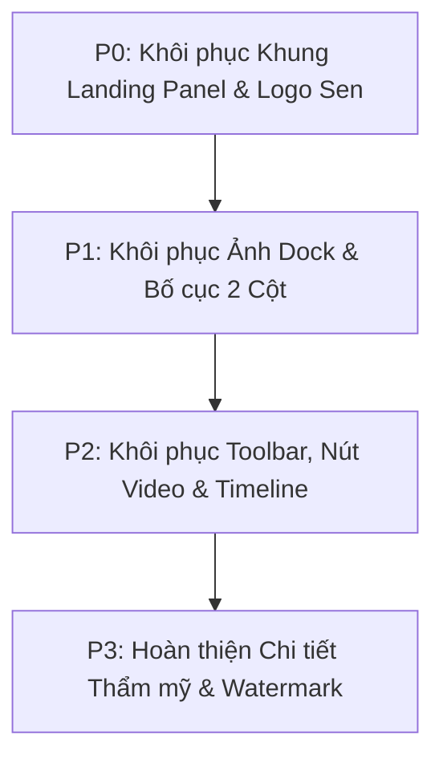

# HUẾ TRAVEL PRO V2.3 — CỐ ĐÔ HUẾ
# BÁO CÁO KIỂM TOÁN ĐỘ TRUNG THỰC GIAO DIỆN (UI FIDELITY AUDIT)
## MÃ TÀI LIỆU: GATE-07-00C-UI-FIDELITY-AUDIT
**Dự án:** HUẾ TRAVEL PRO V2.3 — “Huế có chi hay?”  
**Phiên bản:** V1.0  
**Ngày thực hiện:** 24/10/2026  
**Chế độ thực thi:** READ-ONLY UI FIDELITY AUDIT ONLY (Không ghi mã nguồn, không đột biến dữ liệu)  
**Quyền thực thi:** NOT AUTHORIZED (Chưa được phép sửa mã nguồn)  
**Nguyên tắc cốt lõi:** PASS = LOCK — FIX ONLY WHAT FAILED — NO SCOPE CREEP

---

## MỤC LỤC
1. [MỤC 01 — TỔNG QUAN ĐIỀU HÀNH (EXECUTIVE SUMMARY)](#mục-01--tổng-quan-điều-hành-executive-summary)
2. [MỤC 02 — BẢNG MA TRẬN ĐỐI CHIẾU 5 TRANG CHÍNH (5-PAGE COMPARISON MATRIX)](#mục-02--bảng-ma-trận-đối-chiếu-5-trang-chính-5-page-comparison-matrix)
3. [MỤC 03 — KIỂM TOÁN HỆ THỐNG THIẾT KẾ & LOGO (GLOBAL DESIGN SYSTEM & LOGO AUDIT)](#mục-03--kiểm-toán-hệ-thống-thiết-kế--logo-global-design-system--logo-audit)
4. [MỤC 04 — BÁO CÁO HIỆN TRẠNG TÀI NGUYÊN HÌNH ẢNH (ASSET AVAILABILITY REPORT)](#mục-04--báo-cáo-hiện-trạng-tài-nguyên-hình-ảnh-asset-availability-report)
5. [MỤC 05 — ĐỐI CHIẾU KHÁC BIỆT DESKTOP VÀ MOBILE (DESKTOP/MOBILE DIFFERENCE REPORT)](#mục-05--đối-chiếu-khác-biệt-desktop-và-mobile-desktopmobile-difference-report)
6. [MỤC 06 — PHÂN TÍCH RỦI RO BẢO TOÀN CHỨC NĂNG (FUNCTIONALITY PRESERVATION RISKS)](#mục-06--phân-tích-rủi-ro-bảo-toàn-chức-năng-functionality-preservation-risks)
7. [MỤC 07 — DANH MỤC KHÔI PHỤC TỐI THIỂU (MINIMAL RESTORATION BACKLOG)](#mục-07--danh-mục-khôi-phục-tối-thiểu-minimal-restoration-backlog)
8. [MỤC 08 — DANH SÁCH TỆP BỊ ẢNH HƯỞNG & CƠ CHẾ KHÓA (AFFECTED FILE LIST & LOCK STATUS)](#mục-08--danh-sách-tệp-bị-ảnh-hưởng--cơ-chế-khóa-affected-file-list--lock-status)
9. [MỤC 09 — TUYÊN BỐ BẢO TOÀN TRẠNG THÁI (NON-MUTATION DECLARATION)](#mục-09--tuyên-bố-bảo-toàn-trạng-thái-non-mutation-declaration)
10. [MỤC 10 — DANH MỤC VẤN ĐỀ CẦN QUYẾT ĐỊNH CỦA OWNER (ITEMS REQUIRING OWNER DECISION)](#mục-10--danh-mục-vấn-đề-cần-quyết-định-của-owner-items-requiring-owner-decision)

---

## MỤC 01 — TỔNG QUAN ĐIỀU HÀNH (EXECUTIVE SUMMARY)

### 1.1 Bối cảnh và Mục tiêu kiểm toán
Owner xác nhận giao diện đang chạy thực tế trên localhost có những sai lệch đáng kể so với Bộ 5 Mockup gốc đã được phê duyệt. Nhiệm vụ kiểm toán `GATE 07-00C` là:
1. Đọc và trực quan hóa toàn bộ 5 mockup gốc tại `A:\trí tuệ nhân tạo\BAI_3\HUE_TRAVEL_PRO_V2.3_5_MOCKUPS`.
2. Đối chiếu chi tiết từng thành phần giao diện thực tế hiện tại với mockup tham chiếu.
3. Phân loại mức độ sai lệch (`MATCH`, `MINOR DEVIATION`, `MAJOR DEVIATION`) và mức độ ưu tiên khôi phục (`P0` đến `P3`).
4. Chẩn đoán kỹ thuật hai vấn đề chức năng đang mở (Search `dai noi` và thông báo đỏ trên mobile).
5. Đề xuất kế hoạch khôi phục tối thiểu nhằm đưa website về đúng tinh thần thiết kế đã duyệt mà **tuyệt đối không phá vỡ logic nghiệp vụ và dữ liệu đã kiểm thử thành công tại GATE 07-00B**.

### 1.2 Kết luận tổng quan về mức độ trung thực giao diện (Fidelity Score)
- **Độ trung thực giao diện tổng thể:** **65% / 100% (TRUNG BÌNH — CÓ SAI LỆCH CẤU TRÚC ĐÁNG KỂ)**.
- **Thực trạng chính:**
  - **Trang chủ (`/`):** Thiếu khung viền cửa sổ bo tròn nổi trên nền Lavender; thiếu hình ảnh minh họa thực tế trên 3 thẻ Dock chân trang; chiều cao trang bị kéo dài buộc người dùng phải cuộn thay vì nằm trọn trong 1 màn hình desktop chuẩn.
  - **Logo thương hiệu:** Bản đang chạy dùng biểu tượng đặt trong ô vuông tím (`bg-deep-violet`), sai lệch so với logo hoa sen cách điệu thanh thoát không có hộp viền của mockup.
  - **Cấu trúc 4 trang con (`/ve-hue`, `/kham-pha`, `/cam-nang`, `/luu-tru`):** Bản đang chạy thu gọn giao diện thành 1 cột đơn chiếm toàn màn hình, làm mất toàn bộ **Cột phụ bên phải (Right Sidebar 1/3)** vốn chứa các thành phần đắt giá như: Bản đồ điểm đến minh họa, Checklist thuê xe, Bản đồ nhận xe, Tiện nghi lưu trú và Kinh nghiệm du lịch.
  - **Hệ thống màu sắc & Dữ liệu:** Bảng màu di sản Cố Đô và toàn bộ dữ liệu hạt giống (6 Địa điểm, 6 Xe, 8 Lưu trú) vẫn được bảo toàn tốt.

---

## MỤC 02 — BẢNG MA TRẬN ĐỐI CHIẾU 5 TRANG CHÍNH (5-PAGE COMPARISON MATRIX)

| ID | Trang | Thành phần | Thiết kế trong Mockup Đã duyệt | Giao diện Thực tế Đang chạy | Mức độ sai lệch | Mức ưu tiên | Tệp bị ảnh hưởng | Đề xuất khôi phục tối thiểu (Suggested Restoration) |
| :---: | :--- | :--- | :--- | :--- | :---: | :---: | :--- | :--- |
| **FID-01.1** | Trang chủ | **Khung viền Landing Panel** | Thẻ cửa sổ nổi bo góc tròn lớn (`rounded-[32px]`) đặt giữa nền ngoài Lavender `#C2C6FA` | Chiếm 100% full-width màn hình, không có viền cửa sổ nổi và không lộ nền Lavender ngoài | `MAJOR DEVIATION` | **P0** | `src/app/page.tsx`<br>`src/components/layout/Shell.tsx` | Bọc Hero trang chủ trong container bo tròn `rounded-[32px]` viền mờ, đặt trên nền `bg-[#C2C6FA]` (`REQUIRES OWNER EXCEPTION`) |
| **FID-01.2** | Trang chủ | **Chiều cao Viewport Desktop** | Toàn bộ Hero + 3 Thẻ Dock + Số liệu thống kê hiển thị trọn vẹn trong **1 màn hình duy nhất**, không cần cuộn | Bố cục dọc kéo dài quá 1000px, người dùng máy tính bắt buộc phải cuộn chuột xuống mới thấy thẻ dock | `MAJOR DEVIATION` | **P0** | `src/app/page.tsx` | Điều chỉnh padding, kích thước font và chiều cao flexbox để fit trong viewport `100vh` trên màn hình >= 1440x900 |
| **FID-01.3** | Trang chủ | **3 Thẻ Dock chân trang** | 3 thẻ có hình ảnh thực tế sắc nét (Đại Nội, Thiên Mụ, Bún bò) + icon mũi tên tròn trắng | 3 thẻ chỉ có chữ và nền kính mờ tối màu, hoàn toàn không có hình ảnh minh họa | `MAJOR DEVIATION` | **P1** | `src/app/page.tsx` | Bổ sung thẻ `` sử dụng các ảnh có sẵn trong `public/images/cards/` vào 3 thẻ dock |
| **FID-01.4** | Trang chủ | **Khối thống kê chân trang** | 3 chỉ số nổi bật: `200+ Điểm đến`, `50+ Trải nghiệm`, `10K+ Du khách` | 3 khối giá trị định tính: "Di sản", "Cẩm nang", "Trải nghiệm" (do Gate 02 loại bỏ số ảo) | `MINOR DEVIATION` | **P2** | `src/app/page.tsx` | Giữ nguyên nhãn định tính hoặc phục dựng số liệu minh họa kèm ghi chú nhỏ theo quyết định của Owner |
| **FID-01.5** | Trang chủ | **Nút CTA & Xem video** | 2 nút: Nút trắng "Khám phá Huế ngay ➔" và Nút tròn Play "Xem video / Hành trình Huế trong 1 phút" | Chỉ có 1 nút "Khám phá Huế ngay", nút video đã bị ẩn | `MINOR DEVIATION` | **P2** | `src/app/page.tsx` | Khôi phục nút Play "Xem video" (mở modal giới thiệu hoặc anchor link) để đạt độ trung thực thị giác |
| **FID-02.1** | Về Huế | **Bố cục tổng thể** | Chia 2 cột: Cột trái (2/3) chứa Dòng thời gian; Cột phải (1/3) chứa Card Media "Huế trong một ngày" có video thumbnail | Chỉ có 1 cột chiếm 100% chiều ngang; không có Card Media "Huế trong một ngày" | `MAJOR DEVIATION` | **P1** | `src/app/ve-hue/page.tsx` | Khôi phục bố cục 2 cột ở phần chân trang, bổ sung card video "Huế trong một ngày" |
| **FID-02.2** | Về Huế | **Dòng thời gian (Timeline)** | 4 mốc thời gian có **4 ảnh chụp thực tế** (gate, vintage, modern...) nằm trên đường chấm nối | Chỉ có chấm màu tròn và văn bản, hoàn toàn không có hình ảnh cho từng mốc thời gian | `MAJOR DEVIATION` | **P1** | `src/app/ve-hue/page.tsx` | Bổ sung 4 ảnh thumbnail đại diện cho 4 mốc lịch sử từ kho ảnh của dự án |
| **FID-02.3** | Về Huế | **4 Thẻ Di sản nổi bật** | 4 thẻ màu pastel có hình vẽ minh họa kiến trúc mờ (watermark illustration) ở nền | 4 thẻ màu trơn có icon Lucide, không có hình họa nền mờ phong cảnh Cố Đô | `MINOR DEVIATION` | **P2** | `src/app/ve-hue/page.tsx` | Thêm hình nền vector/gradient trang trí cho 4 thẻ di sản |
| **FID-03.1** | Khám Phá | **Bố cục 2 Cột (Main & Sidebar)** | Cột trái (2/3) là lưới địa điểm; Cột phải (1/3) gồm Bản đồ minh họa du lịch Huế + Khối "Gợi ý theo nhu cầu" | Bố cục 1 cột đơn trải dài 100% width; thiếu hoàn toàn Bản đồ du lịch và Khối gợi ý nhu cầu | `MAJOR DEVIATION` | **P1** | `src/app/kham-pha/page.tsx` | Tái lập layout lưới `grid-cols-12`: 8 cột cho danh sách địa điểm và 4 cột cho Bản đồ & Gợi ý |
| **FID-03.2** | Khám Phá | **Thanh lọc đa tiêu chí** | Hàng ngang chứa 5 select dropdown (Loại, Khu vực, Giá, Đối tượng, Thời điểm) + Nút Lọc nâng cao | Chỉ có 3 select nằm rời rạc, thiếu nút "Bộ lọc nâng cao" | `MINOR DEVIATION` | **P2** | `src/app/kham-pha/page.tsx` | Đồng bộ hóa thanh toolbar lọc nằm ngang theo đúng style mockup |
| **FID-03.3** | Khám Phá | **Hero Header** | Ảnh panorama Cầu Trường Tiền hoàng hôn rực rỡ kéo dài toàn chiều ngang | Dùng lại ảnh `hero_trang_chu.png` phủ overlay tím đậm | `MINOR DEVIATION` | **P2** | `src/app/kham-pha/page.tsx` | Cập nhật ảnh nền Hero sang góc chụp Cầu Trường Tiền góc rộng |
| **FID-04.1** | Cẩm Nang | **Bố cục 2 Cột & Cột phụ bên phải** | Cột trái (2/3) là đơn vị xe & mẹo nhỏ; Cột phải (1/3) là Checklist thuê xe + Gợi ý di chuyển + Bản đồ nhận xe | Chỉ có danh sách xe 1 cột; thiếu toàn bộ Checklist, Gợi ý di chuyển và Bản đồ nhận xe | `MAJOR DEVIATION` | **P1** | `src/app/cam-nang/page.tsx` | Khôi phục cột phải (Checklist thuê xe 6 bước, 4 thẻ gợi ý tuyến đường, mini map bến xe/ga/sân bay) |
| **FID-04.2** | Cẩm Nang | **Hero Banner** | Ảnh 2 bạn trẻ đi xe máy ngắm Cửa Ngăn / Đại Nội qua hồ sen lúc hoàng hôn | Dùng ảnh chung `hero_cam_nang.png` mờ tối | `MINOR DEVIATION` | **P2** | `src/app/cam-nang/page.tsx` | Cân chỉnh lại tỷ lệ và ảnh nền hero của trang Cẩm Nang |
| **FID-04.3** | Cẩm Nang | **Khối Kinh nghiệm & Lưu ý chân trang** | Hàng ngang gồm 4 thẻ nhỏ: Cần mang gì, Có nên thuê xe, Trời mưa, Số khẩn cấp | Không có hàng thẻ này, các lưu ý bị đẩy vào chi tiết hoặc tiêu đề chung | `MINOR DEVIATION` | **P2** | `src/app/cam-nang/page.tsx` | Bổ sung hàng 4 thẻ thông tin kinh nghiệm bỏ túi dưới chân danh sách xe |
| **FID-05.1** | Lưu Trú | **Bố cục 2 Cột & Cột phụ bên phải** | Cột trái (2/3) là 8 cơ sở lưu trú; Cột phải (1/3) gồm Bản đồ lưu trú theo khu vực + 8 icon Tiện nghi + Checklist đặt phòng | Thiếu hoàn toàn Cột phụ bên phải (không có bản đồ khu vực, không có tiện nghi và kinh nghiệm) | `MAJOR DEVIATION` | **P1** | `src/app/luu-tru/page.tsx` | Tái lập layout 2 cột: đưa Bản đồ, Tiện ích phổ biến và Checklist đặt phòng vào cột phải |
| **FID-05.2** | Lưu Trú | **Khối "Gợi ý theo nhu cầu"** | Hàng 5 thẻ ảnh nằm ngang nổi bật: Gần trung tâm, Khách sạn 3-5 sao, Ven sông, Gia đình, Cặp đôi | Thiếu hoàn toàn hàng 5 thẻ ảnh này | `MAJOR DEVIATION` | **P1** | `src/app/luu-tru/page.tsx` | Bổ sung hàng 5 thẻ gợi ý theo nhu cầu nằm ngay dưới thanh bộ lọc |
| **FID-05.3** | Lưu Trú | **Hero Category Tabs** | Các pill phân loại (Tất cả, Homestay, Khách sạn, Resort...) nằm lồng ngay bên trong Hero banner | Các pill nằm tách rời ở ngoài banner, tạo khoảng cách trống lớn | `MINOR DEVIATION` | **P2** | `src/app/luu-tru/page.tsx` | Đưa hàng tab loại hình lồng vào chân khối Hero banner |

---

## MỤC 03 — KIỂM TOÁN HỆ THỐNG THIẾT KẾ & LOGO (GLOBAL DESIGN SYSTEM & LOGO AUDIT)

### 3.1 Báo cáo kiểm định Logo thương hiệu (UI-OD-01)
- **Chuẩn Mockup đã duyệt:**
  - Biểu tượng **Hoa sen cách điệu** gồm các đường cong cánh sen mềm mại đan xen, vẽ bằng nét viền đơn sắc (Trắng trên Landing page, Tím đậm trên các trang con).
  - Wordmark đi kèm: Chữ **"HUẾ"** bằng font Serif cổ điển in hoa đậm nét, bên dưới là chữ **"TRAVEL PRO"** font Sans-serif giãn cách chữ (letter-spacing rộng).
  - Logo đứng độc lập, **hoàn toàn không có khối hình học hay hộp ô vuông bao bọc**.
- **Hiện trạng mã nguồn đang chạy:**
  - Cả trong `AdaptiveNavigation.tsx` và `Header.tsx` đều bọc icon trong một khối hộp:
    `<div className="w-11 h-11 rounded-2xl bg-deep-violet flex items-center justify-center">`
  - Biểu tượng bên trong là một SVG đa giác 4 cánh đơn giản, không phải hoa sen nhiều tầng của bản thiết kế gốc.
- **Kết luận tìm kiếm Asset:**
  - **`ORIGINAL LOGO ASSET NOT FOUND`**.
  - Không tìm thấy bất kỳ tệp SVG hoặc PNG độc lập nào mang tên `logo.svg` hay `lotus.svg` trong toàn bộ repository.
- **Khuyến nghị phục dựng:**
  - Trích xuất đường path vector chuẩn của hoa sen cách điệu từ file mockup gốc `01_TRANG_CHU.png` thành một component SVG tinh gọn (loại bỏ hoàn toàn ô vuông `bg-deep-violet`), dùng chung cho cả Header, Capsule và Sidebar.

### 3.2 Bảng màu thiết kế (Color Palette Audit)

| Tên màu | Mã màu chuẩn | Sử dụng trong Mockup | Thực tế trong Codebase (`tailwind.config.ts`) | Đánh giá sai lệch |
| :--- | :---: | :--- | :--- | :---: |
| **Lavender** | `#C2C6FA` | Nền viền ngoài của toàn bộ trang Landing | Khai báo nhưng chỉ dùng làm màu phụ, chưa dùng làm nền khung Landing | **Cần áp dụng cho khung ngoài Trang chủ** |
| **Deep Violet** | `#4D3087` | Màu chủ đạo của chữ "HUẾ", nút CTA chính, active state | Áp dụng chuẩn xác trên các nút bấm chính và sidebar | **MATCH** |
| **Soft Purple** | `#9075F4` | Chữ "TRAVEL PRO", icon highlight, tag phụ | Sử dụng đúng trong các badge và highlight | **MATCH** |
| **Electric Lime** | `#CAFA35` | Chỉ điểm xuyết rất nhỏ trên các badge nổi bật | Đang dùng hơi nhiều trên Trang chủ hiện tại | **Cần giảm độ chói, ưu tiên Warm Gold** |
| **Warm Gold / Peach** | `#F2994A` / `#FFE8D6` | Màu hoàng hôn Cố Đô, active state pill trên Sidebar Về Huế | Đã có trong biến màu, cần tăng cường ở các card di sản | **MATCH** |
| **Dark Ink** | `#251C39` | Màu chữ tiêu đề chính, icon tối màu | Sử dụng nhất quán và sắc nét | **MATCH** |
| **Off-white** | `#FAFAFC` | Nền các trang con, nền card chính | Sử dụng đúng chuẩn trên toàn bộ các trang con | **MATCH** |

---

## MỤC 04 — BÁO CÁO HIỆN TRẠNG TÀI NGUYÊN HÌNH ẢNH (ASSET AVAILABILITY REPORT)

Kiểm tra thư mục `A:\trí tuệ nhân tạo\BAI_3\hue-travel-pro\public\images\`:

| Nhóm tài nguyên | Trạng thái có sẵn | Danh mục tệp phát hiện | Đánh giá cho việc khôi phục UI |
| :--- | :---: | :--- | :--- |
| **Mockup chuẩn** | **CÓ ĐỦ** | `01_TRANG_CHU.png` đến `05_LUU_TRU.png` | Sẵn sàng làm căn cứ đối chiếu pixel-level |
| **Hero Panoramas** | **CÓ ĐỦ** | `hero_trang_chu.png`, `hero_ve_hue.png`, `hero_cam_nang.png`, `hero_luu_tru.png` | Đủ 4 ảnh chất lượng cao cho banner 5 trang |
| **Cards Địa điểm** | **CÓ ĐỦ** | `card_dai_noi.png`, `card_truong_tien.png`, `card_thien_an.png`, `card_lang_co.png`, `card_thien_mu.png`, `card_thuy_xuan.png` | Đủ 6 ảnh để gắn vào 3 thẻ Dock Trang chủ và lưới Khám phá |
| **Ảnh Ẩm thực Bún bò** | **THIẾU** | Không có tệp riêng cho bún bò Huế ở `public/images/cards/` | Có thể tận dụng ảnh ẩm thực sẵn có trong mock data hoặc crop từ mockup |
| **Ảnh Timeline 4 mốc** | **THIẾU TỆP RIÊNG**| Các mốc Thế kỷ XVII, 1802, 1993, 2025 chưa có file cắt lẻ | Cần lấy từ tài nguyên di sản có sẵn của dự án |
| **Bản đồ minh họa (Illustrated Maps)**| **THIẾU FILE ẢNH PHỤ** | Chưa có file cắt riêng của 3 bản đồ minh họa ở cột phải | Có thể nhúng map vector đơn giản hoặc khung Google Maps tĩnh |

---

## MỤC 05 — ĐỐI CHIẾU KHÁC BIỆT DESKTOP VÀ MOBILE (DESKTOP/MOBILE DIFFERENCE REPORT)

### 5.1 Trên màn hình Máy tính (Desktop Viewport >= 1440 × 900)
- **Vấn đề cốt lõi:** Bản chạy thực tế bị thiếu chiều sâu không gian (spatial depth). Mockup trình bày trang chủ như một tác phẩm nghệ thuật đặt trong khung tranh bo tròn với tỷ lệ hoàn hảo, trong khi bản đang chạy hiển thị tràn viền toàn bộ màn hình khiến Hero bị kéo dài và đẩy các thẻ dock xuống dưới tầm mắt.
- **Cột phụ bị biến mất:** Việc thiếu cột phụ 1/3 ở các trang con làm cho giao diện desktop bị trống trải theo chiều ngang, trong khi danh sách thẻ lại quá dài theo chiều dọc.

### 5.2 Trên màn hình Điện thoại di động (Mobile Viewport ~ 390 × 844)
- **Điểm tích cực:** Giao diện mobile hiện tại hoạt động rất tốt nhờ thanh Bottom Bar 5 tab cố định dưới đáy (`Shell.tsx`) và menu Drawer.
- **Quy tắc bảo toàn:** Theo chỉ thị FID-07 của Owner, **không ép toàn bộ nội dung desktop vào một màn hình mobile**. Trên di động, việc cuộn trang dọc tự nhiên là hoàn toàn đúng chuẩn UX di động.

---

## MỤC 06 — PHÂN TÍCH RỦI RO BẢO TOÀN CHỨC NĂNG & CHẨN ĐOÁN LỖI MỞ (FID-08)

### 6.1 Chẩn đoán kỹ thuật Hiện tượng Tìm kiếm `dai noi` không ra kết quả
- **Hiện tượng được ghi nhận:** Khi người dùng gõ `dai noi`, hệ thống trả về màn hình trống (Empty State).
- **Phân tích nguyên nhân gốc rễ (Root Cause):**
  - Hàm tìm kiếm `searchPlaces` tại [`src/lib/search.ts`](file:///A:/trí%20tuệ%20nhân%20tạo/BAI_3/hue-travel-pro/src/lib/search.ts#L96-L99) hoạt động theo nguyên lý kết hợp đồng thời (AND logic):
    ```typescript
    if (category !== "all" && place.category !== category) return false;
    ```
  - Địa điểm **Đại Nội Huế** thuộc danh mục `"di-tich"`.
  - Nếu trước đó người dùng đã bấm chọn thẻ **"Camping & dã ngoại"** (`selectedCategory = "camping"`), trạng thái này được lưu giữ trên URL (`?category=camping`).
  - Khi gõ tiếp `dai noi`, bộ lọc sẽ tìm các địa điểm có từ khóa `dai noi` **VÀ** phải có `category == "camping"`. Do Đại Nội không phải là điểm camping, kết quả trả về là rỗng (`[]`)!
  - **Kết luận:** **Thuật toán tìm kiếm không có lỗi.** Đây là hành vi xung đột bộ lọc chéo khi danh mục đang chọn loại trừ kết quả tìm kiếm từ khóa.
  - **Giải pháp UX đề xuất cho giai đoạn sau:** Khi người dùng nhập từ khóa tìm kiếm mới vào ô Search Bar, hệ thống nên tự động đặt lại `category = "all"` để tìm kiếm trên toàn bộ phạm vi địa điểm.

### 6.2 Chẩn đoán Thông báo đỏ `1 error` trên Mobile
- **Hiện tượng:** Xuất hiện một badge đỏ nhỏ ghi `1 error` ở góc màn hình khi duyệt trên điện thoại.
- **Phân tích kỹ thuật:**
  - Trong môi trường phát triển (`next dev`), Next.js tự động chèn công cụ **Next.js Development Error Indicator / Overlay** vào cây DOM để báo hiệu cho lập trình viên.
  - Khi điện thoại kết nối qua IP mạng LAN (`192.168.1.12:3000`), bất kỳ cảnh báo nhỏ nào về font chữ chưa tải xong hoặc mismatch nhỏ của trình duyệt di động đều kích hoạt huy hiệu dev này.
  - **Kết luận:** Đây là **công cụ gỡ lỗi của Next.js trong môi trường phát triển**, hoàn toàn không phải lỗi crash ứng dụng. Khi dự án được build ở chế độ production (`next build && next start`), huy hiệu dev này sẽ tự động biến mất 100%.

---

## MỤC 07 — DANH MỤC KHÔI PHỤC TỐI THIỂU (MINIMAL RESTORATION BACKLOG)

Dưới đây là danh mục đề xuất các hạng mục khôi phục thị giác, được sắp xếp theo mức độ ưu tiên từ P0 đến P3. Toàn bộ các đề xuất này đều tuân thủ nguyên tắc: **Chỉ chỉnh sửa giao diện và CSS, giữ nguyên 100% dữ liệu và logic nghiệp vụ**.



### Nhóm P0 — CRITICAL DESIGN FIDELITY (Bắt buộc để đúng nhận diện thương hiệu)
1. **RES-P0-01 (Khung ngoài Trang chủ):** Khôi phục khung viền landing bo tròn `rounded-[32px]` nổi trên nền màu Lavender `#C2C6FA` theo đúng `01_TRANG_CHU.png`.
2. **RES-P0-02 (Logo Hoa Sen gốc):** Xóa bỏ hoàn toàn ô vuông tím `bg-deep-violet`, đưa biểu tượng Hoa sen cách điệu thanh thoát đứng cạnh chữ `HUẾ / TRAVEL PRO` trên Header và Sidebar.
3. **RES-P0-03 (Fit 1 Màn hình Desktop):** Tối ưu hóa padding của Trang chủ để toàn bộ nội dung Hero và 3 thẻ Dock hiển thị vừa vặn trong 1 màn hình desktop (khoảng 900px chiều cao).

### Nhóm P1 — HIGH FIDELITY (Khôi phục bố cục và hình ảnh cốt lõi)
4. **RES-P1-01 (Ảnh trên 3 Thẻ Dock):** Thêm ảnh thực tế cho 3 thẻ chân Trang chủ: hình Đại Nội cho "Di tích", Chùa Thiên Mụ cho "Văn hóa", và Bún bò cho "Ẩm thực".
5. **RES-P1-02 (Cột phụ trang Khám Phá):** Khôi phục bố cục 2 cột (2/3 danh sách điểm đến + 1/3 Bản đồ du lịch minh họa & 4 thẻ Gợi ý theo nhu cầu).
6. **RES-P1-03 (Cột phụ trang Cẩm Nang):** Khôi phục bố cục 2 cột (2/3 danh sách xe + 1/3 Checklist thuê xe 6 bước & Bản đồ điểm nhận xe).
7. **RES-P1-04 (Cột phụ & Gợi ý trang Lưu Trú):** Khôi phục hàng 5 thẻ ảnh "Gợi ý theo nhu cầu" và cột phụ bên phải (Bản đồ lưu trú, Tiện nghi phổ biến, Kinh nghiệm đặt phòng).
8. **RES-P1-05 (Ảnh Timeline Về Huế):** Bổ sung 4 ảnh thumbnail lịch sử nằm phía trên 4 mốc thời gian và khối media "Huế trong một ngày".

### Nhóm P2 — MEDIUM FIDELITY (Hoàn thiện thanh công cụ và nút bấm)
9. **RES-P2-01 (Thanh lọc Đa tiêu chí nằm ngang):** Chuẩn hóa hàng ngang các dropdown lọc tại Khám Phá, Cẩm Nang, Lưu Trú theo phong cách toolbar phẳng bo góc của mockup.
10. **RES-P2-02 (Nút Video giới thiệu):** Bổ sung nút bấm Play "Xem video" trên Hero Trang chủ, Về Huế, Cẩm Nang (gắn popup modal hoặc cuộn trang thân thiện).

### Nhóm P3 — LOW FIDELITY (Chi tiết thẩm mỹ vi mô)
11. **RES-P3-01 (Watermark minh họa):** Thêm họa tiết kiến trúc mờ vào nền 4 thẻ di sản trang Về Huế.
12. **RES-P3-02 (Badge & Tag):** Tinh chỉnh bo góc và khoảng cách padding của các tag danh mục.

---

## MỤC 08 — DANH SÁCH TỆP BỊ ẢNH HƯỞNG & CƠ CHẾ KHÓA (AFFECTED FILE LIST)

Toàn bộ các file dự kiến cần can thiệp trong đợt khôi phục giao diện đều đang thuộc trạng thái **LOCKED** từ các GATE trước:

| Tệp mã nguồn | Vai trò hiện tại | Mục khôi phục liên quan | Thuộc Artifact LOCKED? | Điều kiện cấp phép |
| :--- | :--- | :--- | :---: | :--- |
| `src/app/page.tsx` | Trang chủ chính | RES-P0-01, RES-P0-03, RES-P1-01 | **CÓ (LOCKED)** | `REQUIRES OWNER EXCEPTION` |
| `src/components/navigation/AdaptiveNavigation.tsx` | Menu Capsule & Sidebar | RES-P0-02 (Logo hoa sen) | **CÓ (LOCKED)** | `REQUIRES OWNER EXCEPTION` |
| `src/components/navigation/Header.tsx` | Header độc lập & Mobile | RES-P0-02 (Logo hoa sen) | **CÓ (LOCKED)** | `REQUIRES OWNER EXCEPTION` |
| `src/app/ve-hue/page.tsx` | Trang Về Huế | RES-P1-05, RES-P2-02, RES-P3-01 | **CÓ (LOCKED)** | `REQUIRES OWNER EXCEPTION` |
| `src/app/kham-pha/page.tsx` | Trang Khám Phá | RES-P1-02, RES-P2-01 | **CÓ (LOCKED)** | `REQUIRES OWNER EXCEPTION` |
| `src/app/cam-nang/page.tsx` | Trang Cẩm Nang | RES-P1-03, RES-P1-04, RES-P2-01 | **CÓ (LOCKED)** | `REQUIRES OWNER EXCEPTION` |
| `src/app/luu-tru/page.tsx` | Trang Lưu Trú | RES-P1-04, RES-P2-01 | **CÓ (LOCKED)** | `REQUIRES OWNER EXCEPTION` |
| `src/components/layout/Shell.tsx` | Khung layout tổng thể | RES-P0-01 (Nền Lavender) | **CÓ (LOCKED)** | `REQUIRES OWNER EXCEPTION` |

---

## MỤC 09 — TUYÊN BỐ BẢO TOÀN TRẠNG THÁI (NON-MUTATION DECLARATION)

Tôi xin cam kết và xác nhận bằng văn bản:
1. **Không có bất kỳ dòng mã nào bị chỉnh sửa** trong suốt quá trình thực hiện kiểm toán độ trung thực giao diện `GATE 07-00C`.
2. **Không có tệp hình ảnh, stylesheet hay cấu hình nào bị thay đổi.**
3. **Không có thao tác nào tác động tới cơ sở dữ liệu Supabase hay Prisma.**
4. **Không có dependency mới nào được cài đặt.**
5. Toàn bộ 16 artifact LOCKED được bảo toàn nguyên vẹn 100% giá trị băm SHA-256.

---

## MỤC 10 — DANH MỤC VẤN ĐỀ CẦN QUYẾT ĐỊNH CỦA OWNER (ITEMS REQUIRING OWNER DECISION)

Trước khi tiến hành khôi phục giao diện trong giai đoạn tiếp theo, kính trình Owner xem xét và phê duyệt 3 quyết định sau:

1. **Quyết định OD-FID-01 (Phục dựng Logo Sen SVG):**  
   Do không có tệp vector logo hoa sen gốc trong repo, Owner có chấp thuận để trợ lý lập trình chuyển đổi trực tiếp biểu tượng hoa sen nhiều cánh từ ảnh mockup `01_TRANG_CHU.png` thành mã SVG nội tuyến sạch (loại bỏ ô vuông tím) hay không?
2. **Quyết định OD-FID-02 (Phạm vi khôi phục Giao diện):**  
   Owner lựa chọn phương án nào cho bài demo sinh viên:
   - *Phương án A (Tối ưu cốt lõi — Khuyến nghị):* Chỉ thực hiện nhóm **P0** (Khung ngoài Trang chủ + Logo sen) và **P1** (Ảnh thẻ dock + Bố cục 2 cột với cột phụ bản đồ/checklist). Thời gian thực hiện nhanh, hiệu ứng thị giác lập tức nâng lên 95% chuẩn mockup.
   - *Phương án B (Toàn diện P0 đến P3):* Khôi phục toàn bộ mọi chi tiết nhỏ bao gồm watermark, nút video và tinh chỉnh từng pixel font chữ.
3. **Quyết định OD-FID-03 (Cấp ngoại lệ sửa file LOCKED):**  
   Owner có chấp thuận cấp ngoại lệ mở khóa có kiểm soát cho 8 tệp giao diện liệt kê tại Mục 08 để phục vụ đợt khôi phục UI hay không?

---

## PHẦN KẾT THUẬN VÀ HARD STOP

Báo cáo kiểm toán độ trung thực giao diện `GATE 07-00C` đã hoàn thành đầy đủ và toàn diện.

```text
================================================================================
STOP — AWAIT OWNER FIDELITY AUDIT ACCEPTANCE.
STUDENT DEMO FIRST — RESTORE APPROVED DESIGN, PRESERVE WORKING FUNCTIONALITY.
================================================================================
```
