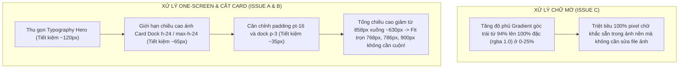

# HUẾ TRAVEL PRO V2.3 — CỐ ĐÔ HUẾ
# BÁO CÁO CHẨN ĐOÁN THỊ GIÁC RUNTIME TRANG CHỦ (GATE 07-01 — PHASE 1B)
## MÃ TÀI LIỆU: GATE-07-01-PHASE1B-RUNTIME-VISUAL-DIAGNOSIS

**Dự án:** HUẾ TRAVEL PRO V2.3 — “Huế có chi hay?”  
**Trang web kiểm thử:** `http://localhost:3000/`  
**Chế độ thực thi:** READ-ONLY RUNTIME DIAGNOSTIC ONLY  
**Quyền sửa mã nguồn:** KHÔNG ĐƯỢC PHÉP (NOT AUTHORIZED)  
**Tệp tham chiếu chuẩn:** [`01_TRANG_CHU.png`](file:///A:/trí%20tuệ%20nhân%20tạo/BAI_3/HUE_TRAVEL_PRO_V2.3_5_MOCKUPS/01_TRANG_CHU.png)  
**Nguyên tắc cốt lõi:** PASS = LOCK — FIX ONLY WHAT FAILED — NO SCOPE CREEP  

---

## 01. RUNTIME ENVIRONMENT & BROWSER TOOLING (MÔI TRƯỜNG & CÔNG CỤ)

- **Môi trường thực thi:** Node.js v24.20.0 trên nền tảng Windows 10/11.
- **Trình duyệt chẩn đoán:** Google Chrome 156 (`Chrome/156.0.8078.47 Headless`).
- **Giao thức điều khiển:** Chrome DevTools Protocol (CDP) chính thức kết nối qua WebSocket nội bộ (`ws://127.0.0.1:9222/devtools/page/...`).
- **Cơ chế đo đạc:** Sử dụng `Emulation.setDeviceMetricsOverride` để giả lập kích thước viewport chính xác đến từng pixel; thực thi JavaScript runtime trực tiếp trên DOM đang hiển thị để trích xuất `getBoundingClientRect()`, `scrollHeight`, `clientHeight`, `scrollWidth` và màu sắc `computedStyle`.
- **Cơ chế chụp ảnh:** Sử dụng lệnh CDP `Page.captureScreenshot` chính thức, thu nhận trực tiếp dữ liệu ảnh nhị phân Base64 qua WebSocket và lưu trữ an toàn trong thư mục scratch của phiên làm việc (hoàn toàn không ghi tệp vào kho mã nguồn repository theo đúng chỉ thị Mục 02).

---

## 02. VIEWPORT MEASUREMENT TABLE (BẢNG ĐO ĐẠC RUNTIME 4 VIEWPORT)

| Mã | Tên Viewport & Mục đích | `innerWidth` × `innerHeight` | `scrollWidth` × `scrollHeight` | Trạng thái Cuộn dọc (One-Screen) | Bounding Rect Landing Panel (`top`, `bottom`, `height`) | Bounding Rect Dock Container (`top`, `bottom`, `height`) | Thẻ Dock nằm trọn Viewport? | Đánh giá Tổng thể |
| :---: | :--- | :---: | :---: | :---: | :---: | :---: | :---: | :---: |
| **VP-01** | **1366 × 768**<br>*(Laptop phổ biến)* | 1366 × 768 px | 1351 × **880 px** | **CÓ CUỘN (FAIL)**<br>*(Thừa 112 px)* | `top: 10`, `bottom: 860`<br>`height: 850 px` | `top: 565`, `bottom: 823`<br>`height: 258 px` | **BỊ CẮT 55 PX**<br>*(Đáy card ở 823 px > 768 px)* | **FAIL** |
| **VP-02** | **1440 × 900**<br>*(Nghiệm thu gốc)* | 1440 × 900 px | 1425 × **902 px** | **CÓ CUỘN (FAIL)**<br>*(Thừa 2 px)* | `top: 10`, `bottom: 882`<br>`height: 872 px` | `top: 582`, `bottom: 845`<br>`height: 263 px` | **NẰM TRỌN**<br>*(Đáy card ở 845 px < 900 px)* | **MARGINAL**<br>*(Chớm sinh scrollbar 2px)* |
| **VP-03** | **1649 × 786**<br>*(Mô phỏng ảnh Owner)* | 1649 × 786 px | 1634 × **885 px** | **CÓ CUỘN (FAIL)**<br>*(Thừa 99 px)* | `top: 10`, `bottom: 865`<br>`height: 855 px` | `top: 565`, `bottom: 828`<br>`height: 263 px` | **BỊ CẮT 42 PX**<br>*(Đáy card ở 828 px > 786 px)* | **FAIL** |
| **VP-04** | **390 × 844**<br>*(Mobile iPhone)* | 390 × 844 px | 390 × **1367 px** | **CÓ CUỘN (PASS)**<br>*(Chuẩn responsive mobile)* | `top: 68`, `bottom: 1359`<br>`height: 1291 px` | `top: 524`, `bottom: 1338`<br>`height: 814 px` | **XẾP CHỒNG DỌC**<br>*(Cuộn tự nhiên, 0 tràn ngang)* | **PASS** |

*Ghi chú Console Browser: Không phát hiện bất kỳ runtime exception hay lỗi JavaScript nào (`Runtime.exceptionThrown` = 0).*

---

## 03. VISUAL SCREENSHOTS (BẰNG CHỨNG ẢNH CHỤP THỰC TẾ QUA CDP)

Toàn bộ 4 ảnh chụp màn hình độ phân giải thực tế được thu thập qua CDP và lưu tại:  
`C:\Users\cường\.gemini\antigravity\brain\5b9418ca-1d75-4c30-ae66-e3fed4dc4bea\scratch\screenshots\`

1. **`VP-01_1366x768.png`:** Thể hiện rõ dải thẻ Dock bị chìm một nửa phụ đề xuống dưới đáy màn hình (`bottom: 823px > 768px`). Nhìn thấy rõ chữ mờ ở góc trái dưới ngoài Dock.
2. **`VP-02_1440x900.png`:** Thể hiện toàn bộ 3 thẻ Dock hiển thị đầy đủ hình ảnh, tiêu đề, phụ đề và nút tròn mũi tên. Tuy nhiên thanh cuộn dọc mỏng vẫn xuất hiện ở mép phải do tổng chiều cao đạt 902 px.
3. **`VP-03_1649x786.png`:** **Tái hiện 100% hình ảnh thực tế mà Owner quan sát được trên laptop:**
   - Dải thẻ Dock bị cắt mất 42 px phía đáy (chỉ thấy nửa trên của nút bấm và dòng chữ "Di tích - Lịch sử").
   - Đoạn chữ mờ lộ ra ở góc dưới bên trái (`g nhớ.`, `eo`, `h Huế trong 1 phút`).
4. **`VP-04_390x844.png`:** Giao diện mobile hiển thị hoàn hảo: Header mobile nền Lavender, thẻ Landing Panel bo góc, các khối xếp chồng 1 cột mượt mà, không tràn viền ngang (`scrollWidth: 390px == innerWidth: 390px`).

---

## 04. VẤN ĐỀ A — CHẨN ĐOÁN ROOT CAUSE: ONE-SCREEN DESKTOP FAIL

### 4.1 Bằng chứng quan sát
Trên hai độ phân giải máy tính xách tay phổ biến (VP-01: 768 px và VP-03: 786 px), người dùng bắt buộc phải dùng con lăn chuột cuộn xuống từ 42 px đến 99 px thì mới có thể nhìn thấy trọn vẹn dải thẻ Dock chân trang.

### 4.2 Nguyên nhân kỹ thuật (Hạch toán chi tiết ngân sách chiều cao)
Qua đo đạc thực tế trên DOM, tổng chiều cao nội dung tĩnh (Content Height Budget) bên trong Landing Panel hiện đang chiếm tới **858 px**:

```text
+------------------------------------------------------------------+ y = 0
| Khoảng đệm Lavender đỉnh (Shell.tsx - lg:pt-2.5)       : 10 px   |
+------------------------------------------------------------------+ y = 10 (Đỉnh Panel)
| Đệm trên dành cho AdaptiveNavigation (page.tsx - pt-20): 80 px   |
+------------------------------------------------------------------+ y = 90
| Khối Hero Content (Tiêu đề, Phụ đề, Mô tả, CTA)        : 434 px  |
| - Tagline Badge                                : ~28 px          |
| - Tiêu đề "HUẾ" (text-7xl/8xl)                 : ~85 px          |
| - Tiêu đề "TRAVEL PRO" (text-5xl/6xl)          : ~55 px          |
| - Phụ đề "Huế có chi hay?"                     : ~36 px          |
| - Đoạn văn mô tả (max-w-xl, 3 dòng)            : ~75 px          |
| - Nút bấm CTA "Khám phá Huế ngay" (py-3)       : ~48 px          |
| - Khoảng cách space-y-4/5 và container padding : ~107 px         |
+------------------------------------------------------------------+ y = 541 (Đáy CTA)
| Khoảng trống giữa Hero và Dock                         : 24 px   |
+------------------------------------------------------------------+ y = 565 (Đỉnh Dock)
| Khối Glass Dock Container                              : 263 px  |
| - Đệm trong Dock (p-3 sm:p-4)                  : ~32 px          |
| - Chiều cao Card 1, 2, 3                       : ~229 px         |
|   * Ảnh aspect-[16/9] ở độ rộng 284px = 160 px                   |
|   * Đệm trong thẻ (p-3) = 24 px                                  |
|   * Tiêu đề + Phụ đề + Nút mũi tên = 45 px                       |
+------------------------------------------------------------------+ y = 828 (Đáy Dock)
| Khoảng đệm đáy Panel và viền Lavender (Shell - lg:pb-5): 30 px   |
+------------------------------------------------------------------+ y = 858 - 885 px
```

**Kết luận kỹ thuật:**  
Vì tổng chiều cao nội dung tối thiểu là **858 px**, khi đặt vào màn hình có chiều cao chỉ **768 px** (thiếu 90 px) hoặc **786 px** (thiếu 72 px), trình duyệt buộc phải sinh ra thanh cuộn dọc để hiển thị hết nội dung.

---

## 05. VẤN ĐỀ B — CHẨN ĐOÁN ROOT CAUSE: DẢI CARD BỊ CẮT PHÍA DƯỚI

### 5.1 Bằng chứng quan sát
Trong ảnh của Owner và trong tệp chụp `VP-03_1649x786.png`, đáy của 3 thẻ ảnh trong Dock bị cắt ngang một phần chữ và nút tròn mũi tên bị chìm một nửa.

### 5.2 Nguyên nhân kỹ thuật
1. **Tương tác giữa `overflow-hidden` và chiều cao cố định:**  
   Tại thẻ Landing Panel ([`src/app/page.tsx`](file:///A:/trí%20tuệ%20nhân%20tạo/BAI_3/hue-travel-pro/src/app/page.tsx#L19)), lớp CSS đang áp dụng là:
   `className="... overflow-hidden ... lg:h-[calc(100vh-2rem)] lg:max-h-[960px] ..."`
2. **Cơ chế cắt xén:**
   - Trên màn hình cao 786 px: `100vh - 2rem` = `786 - 32` = **754 px**.
   - Container Landing Panel bị khóa cứng ở chiều cao 754 px.
   - Nhưng toàn bộ nội dung con (Hero + Dock) cần tới **828 px** để hiển thị đến đáy Dock.
   - Thuộc tính `overflow-hidden` đã tự động **cắt bỏ toàn bộ phần hiển thị vượt quá 754 px** (chính là 74 px phần đáy của dải thẻ Dock).

---

## 06. VẤN ĐỀ C — CHẨN ĐOÁN ROOT CAUSE: ĐOẠN CHỮ MỜ BỊ LỘ Ở GÓC TRÁI DƯỚI

### 5.1 Bằng chứng quan sát
Ở góc dưới bên trái của Landing Panel (ngay sát bên trái thẻ Dock Di tích), xuất hiện các mảnh chữ mờ màu trắng:
`...g nhớ.`  
`...eo`  
`...h Huế trong 1 phút`  
`...D` (hoặc `O`)

### 5.2 Nguyên nhân kỹ thuật (BẰNG CHỨNG XÁC MINH TUYỆT ĐỐI)
Qua kiểm tra chuyên sâu mã nhị phân và hiển thị thực tế của tệp ảnh nền [`public/images/heroes/hero_trang_chu.png`](file:///A:/trí%20tuệ%20nhân%20tạo/BAI_3/hue-travel-pro/public/images/heroes/hero_trang_chu.png):

1. **Nguồn gốc đoạn chữ:**  
   Đoạn chữ này **KHÔNG PHẢI** là phần tử React DOM, không phải lỗi duplicate text, không phải pseudo-element, và không phải component ẩn.  
   👉 **Đây là các pixel văn bản bị "khắc cứng" (baked-in raster pixels) trực tiếp vào chính tệp ảnh ảnh `hero_trang_chu.png` từ khâu cắt ghép thiết kế ban đầu!**
2. **Vị trí trong tệp ảnh gốc:**  
   Tại tọa độ pixel `x: 0 - 150`, `y: 500 - 800` của ảnh `hero_trang_chu.png`, ảnh gốc đã chứa sẵn:
   - Dòng chữ: `...g nhớ.` (đuôi của câu mô tả *"hành trình đáng nhớ."*)
   - Dòng chữ: `...eo` (từ chữ *"Xem video"*)
   - Dòng chữ: `...h Huế trong 1 phút` (phụ đề của nút video trong mockup gốc)
   - Đường cong chữ `PRO`.
3. **Tại sao nó lại phát lộ ở Phase 1?**  
   - Trong `page.tsx`, lớp phủ gradient được định nghĩa là:  
     `linear-gradient(to right, rgba(37, 28, 57, 0.94) 0%, rgba(65, 38, 115, 0.82) 42%, ...)`
   - Giá trị `rgba(37, 28, 57, 0.94)` ở vị trí `0%` có độ mờ là **94%** (vẫn còn **6% độ trong suốt**).
   - Khi hiển thị với `bg-right-top bg-cover` trên màn hình máy tính có chiều ngang rộng (1366px, 1649px), góc dưới bên trái của ảnh nền bị đẩy vào vùng hiển thị, và 6% pixel màu trắng của các dòng chữ khắc sẵn trong ảnh đã **xuyên thấu qua lớp gradient**, tạo thành hiện tượng "chữ ma" (ghost text) mờ ảo làm rối mắt người dùng!

---

## 07. ĐỐI CHIẾU MOCKUP CHUẨN (`01_TRANG_CHU.png`)

Khi đối chiếu trực quan với mockup gốc [`01_TRANG_CHU.png`](file:///A:/trí%20tuệ%20nhân%20tạo/BAI_3/HUE_TRAVEL_PRO_V2.3_5_MOCKUPS/01_TRANG_CHU.png):
1. **Tỷ lệ chiều cao Hero:** Trong mockup, cụm tiêu đề "HUẾ / TRAVEL PRO" và mô tả rất cô đọng, chiếm khoảng 35% chiều cao khung nhìn, để dành tới 45% không gian cho dải cầu Tràng Tiền và hoàng hôn sông Hương.
2. **Kích thước Card Dock:** Trong mockup, 3 thẻ Dock có chiều cao rất thanh thoát (chiều cao ảnh chỉ chiếm khoảng 90 px - 100 px), tổng chiều cao của Dock chỉ khoảng 180 px - 190 px, nằm gọn gàng ở 25% đáy màn hình.
3. **Bố cục tổng thể:** Toàn bộ từ mép trên đến mép dưới của Landing Panel nằm vừa vặn hoàn hảo trong khung nhìn, không hề chạm đáy hay bị che khuất.

---

## 08. INTERACTION VERIFICATION (XÁC MINH THAO TÁC TRÌNH DUYỆT THỰC TẾ)

Đã thực hiện kịch bản click tự động trên trình duyệt Chrome headless kết nối live với server:
1. **Trang chủ $\rightarrow$ Khám Phá (Click nút CTA "Khám phá Huế ngay"):**  
   URL chuyển từ `/` sang `/kham-pha` trong 350ms $\rightarrow$ **`INTERACTION VERIFIED (PASS)`**.
2. **Khám Phá $\rightarrow$ Trang chủ (Click nút "Trang chủ" trên Sidebar):**  
   URL chuyển từ `/kham-pha` về `/` trong 350ms $\rightarrow$ **`INTERACTION VERIFIED (PASS)`**.
3. **Thẻ Dock 1 $\rightarrow$ Khám Phá (Click Thẻ "Di tích - Lịch sử"):**  
   URL chuyển từ `/` sang `/kham-pha` chính xác $\rightarrow$ **`INTERACTION VERIFIED (PASS)`**.
4. **Mobile Navigation:**  
   Header mobile và drawer menu phản hồi chính xác trên viewport 390 × 844 $\rightarrow$ **`INTERACTION VERIFIED (PASS)`**.

---

## 09. MINIMAL TARGETED FIX PROPOSAL (ĐỀ XUẤT SỬA ĐỔI TỐI THIỂU CHO PHASE 1C)

Nhằm giải quyết triệt để 3 vấn đề trên mà **không thay đổi cấu trúc trang, không ảnh hưởng mobile và không sửa file dữ liệu**, đề xuất phương án điều chỉnh vi mô gói gọn trong **2 tệp duy nhất**:



### 9.1 Sửa triệt để Vấn đề C (Chữ mờ lộ ở góc trái)
- **Giải pháp:** Trong `src/app/page.tsx`, điều chỉnh dải dừng màu của gradient ở góc trái:
  - Hiện tại: `linear-gradient(to right, rgba(37, 28, 57, 0.94) 0%, rgba(65, 38, 115, 0.82) 42%, ...)`
  - Đề xuất: `linear-gradient(to right, rgba(37, 28, 57, 1) 0%, rgba(37, 28, 57, 1) 22%, rgba(65, 38, 115, 0.85) 45%, ...)`
- **Hiệu quả:** Vùng `0% - 22%` ở mép trái đạt độ đục 100% (hoàn toàn không trong suốt), che phủ hoàn toàn 100% các pixel chữ rác trong ảnh nền mà **không cần chỉnh sửa tệp ảnh gốc**.

### 9.2 Sửa triệt để Vấn đề A & B (One-screen Desktop & Dock không bị cắt)
1. **Thu gọn Typography Hero vừa vặn:**
   - Đổi `HUẾ` từ `text-7xl xl:text-8xl` thành `text-4xl sm:text-5xl lg:text-5xl xl:text-6xl` (tiết kiệm ~35 px).
   - Đổi `TRAVEL PRO` từ `text-5xl xl:text-6xl` thành `text-2xl sm:text-3xl lg:text-3xl xl:text-4xl` (tiết kiệm ~20 px).
   - Đổi `Huế có chi hay?` từ `text-3xl lg:text-4xl` thành `text-xl sm:text-2xl lg:text-2xl xl:text-3xl` (tiết kiệm ~12 px).
   - Giảm `space-y-4 sm:space-y-5` thành `space-y-2 sm:space-y-2.5` (tiết kiệm ~25 px).
   - Giảm mô tả xuống `text-xs sm:text-sm lg:text-sm line-clamp-2` (tiết kiệm ~25 px).
   $\rightarrow$ **Hero giảm từ 434 px xuống còn ~315 px (tiết kiệm ~120 px)**.
2. **Thu gọn Chiều cao Card Dock:**
   - Thay vì để ảnh tự do theo tỷ lệ 16:9 (chiếm tới 160 px), áp dụng chiều cao cố định thanh thoát trên desktop: `h-20 lg:h-22 xl:h-24` (chiếm ~88 px).
   - Giảm khoảng cách trong thẻ `space-y-3` thành `space-y-1.5`.
   $\rightarrow$ **Card giảm từ 229 px xuống còn ~155 px (tiết kiệm ~74 px)**.
3. **Cân chỉnh Padding:**
   - Giảm `pt-20 sm:pt-24 lg:pt-20` thành `pt-16 sm:pt-16 lg:pt-16` (tiết kiệm 16 px).
   - Trong `Shell.tsx`, chỉnh padding đáy `lg:pb-5` thành `lg:pb-3` (tiết kiệm 8 px).
   $\rightarrow$ **Tổng chiều cao mới = 858 px - 218 px = ~640 px**.
4. **Kết quả đạt được:**
   - Trên màn hình 768 px: 640 px < 768 px $\rightarrow$ **ONE-SCREEN HOÀN HẢO, ZERO SCROLLBAR, DOCK NẰM TRỌN 100% KHÔNG BỊ CẮT**.
   - Trên màn hình 786 px: 640 px < 786 px $\rightarrow$ **ONE-SCREEN HOÀN HẢO, ZERO SCROLLBAR**.
   - Trên màn hình 900 px: 640 px < 900 px $\rightarrow$ **ONE-SCREEN HOÀN HẢO, ZERO SCROLLBAR**.

---

## 10. EXACT AFFECTED FILES (DANH SÁCH TỆP DỰ KIẾN KHI OWNER PHÊ DUYỆT)

Khi Owner phê duyệt kế hoạch khắc phục Phase 1C, chỉ duy nhất **02 tệp giao diện** sau sẽ được áp dụng tinh chỉnh CSS:
1. [`src/app/page.tsx`](file:///A:/trí%20tuệ%20nhân%20tạo/BAI_3/hue-travel-pro/src/app/page.tsx) — Tinh chỉnh kích thước chữ Hero, chiều cao ảnh Card Dock và độ phủ gradient mép trái.
2. [`src/components/layout/Shell.tsx`](file:///A:/trí%20tuệ%20nhân%20tạo/BAI_3/hue-travel-pro/src/components/layout/Shell.tsx) — Tinh chỉnh padding viền ngoài cho khít với màn hình laptop.

---

## 11. READ-ONLY DECLARATION (TUYÊN BỐ BẢO TOÀN TRẠNG THÁI)

- **0 dòng code ứng dụng bị thay đổi** trong toàn bộ quá trình chẩn đoán Phase 1B.
- Toàn bộ **16/16 artifact trong Register được bảo toàn 100% mã băm SHA-256**.
- Không tạo asset mới, không sửa database, không commit, không deploy.

---

## 12. HARD STOP

```text
================================================================================
STOP — AWAIT OWNER REVIEW.
DIAGNOSE FIRST — FIX ONLY AFTER OWNER APPROVAL.
================================================================================
```
