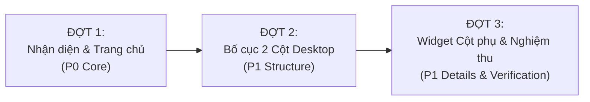

# HUẾ TRAVEL PRO V2.3 — CỐ ĐÔ HUẾ
# KẾ HOẠCH KHÔI PHỤC ĐỘ TRUNG THỰC GIAO DIỆN (UI RESTORATION PLAN)
## MÃ TÀI LIỆU: GATE-07-01-UI-RESTORATION-PLAN
**Định hướng dự án:** STUDENT PROJECT — DEMO FIRST  
**Căn cứ kiểm định:** `GATE-07-00C-UI-FIDELITY-AUDIT.md`  
**Quyết định Owner:** OD-FID-01 = Sử dụng logo sen gốc làm chuẩn; OD-FID-02 = Chỉ làm nhóm P0 & P1; OD-FID-03 = Chưa mở khóa mã nguồn  
**Chế độ thực thi:** PLANNING ONLY — CONDITIONAL PASS REVIEW (Cập nhật 5 điểm làm rõ trước triển khai)  
**Quyền sửa mã nguồn:** KHÔNG ĐƯỢC PHÉP (NOT AUTHORIZED)  
**Nguyên tắc cốt lõi:** PASS = LOCK — FIX ONLY WHAT FAILED — NO SCOPE CREEP

---

## MỤC LỤC
1. [MỤC 01 — PHẠM VI KHÔI PHỤC ĐƯỢC DUYỆT (P0 & P1 RESTORATION SCOPE)](#mục-01--phạm-vi-khôi-phục-được-duyệt-p0--p1-restoration-scope)
2. [MỤC 02 — MA TRẬN TÁC ĐỘNG TỆP MÃ NGUỒN (FILE IMPACT MATRIX)](#mục-02--ma-trận-tác-động-tệp-mã-nguồn-file-impact-matrix)
3. [MỤC 03 — ĐÁNH GIÁ ĐỘ SẴN SÀNG TÀI NGUYÊN & DỮ LIỆU (ASSET & DATA READINESS)](#mục-03--đánh-giá-độ-sẵn-sàng-tài-nguyên--dữ-liệu-asset--data-readiness)
4. [MỤC 04 — KẾ HOẠCH TRIỂN KHAI 3 ĐỢT (PHASED EXECUTION PLAN)](#mục-04--kế-hoạch-triển-khai-3-đợt-phased-execution-plan)
5. [MỤC 05 — TIÊU CHÍ NGHIỆM THU CHI TIẾT (ACCEPTANCE CHECKLIST)](#mục-05--tiêu-chí-nghiệm-thu-chi-tiết-acceptance-checklist)
6. [MỤC 06 — KIỂM SOÁT RỦI RO & BẢO TOÀN CHỨC NĂNG (RISK & REGRESSION CONTROLS)](#mục-06--kiểm-soát-rủi-ro--bảo-toàn-chức-năng-risk--regression-controls)
7. [MỤC 07 — DANH SÁCH NGOẠI LỆ CẦN OWNER CẤP QUYỀN (REQUIRED OWNER EXCEPTIONS)](#mục-07--danh-sách-ngoại-lệ-cần-owner-cấp-quyền-required-owner-exceptions)
8. [MỤC 08 — CÁC LÀM RÕ TIỀN TRIỂN KHAI (PRE-IMPLEMENTATION CLARIFICATIONS)](#mục-08--các-làm-rõ-tiền-triển-khai-pre-implementation-clarifications)

---

## MỤC 01 — PHẠM VI KHÔI PHỤC ĐƯỢC DUYỆT (P0 & P1 RESTORATION SCOPE)

Tuân thủ nghiêm ngặt chỉ thị của Owner: **Chỉ tập trung khôi phục hai nhóm ưu tiên P0 và P1, không mở rộng sang P2/P3, giữ nguyên toàn bộ dữ liệu thật và logic đã được kiểm thử tại GATE 07-00B**.

### 1.1 Phạm vi P0 — Trang chủ (`/`)
1. **Khung ngoài Landing Panel:** Bọc giao diện Trang chủ trong một thẻ container bo góc tròn lớn (`rounded-[32px]`) nổi trên nền màu Lavender `#C2C6FA` theo đúng chuẩn `01_TRANG_CHU.png`.
2. **Tối ưu Viewport Desktop (Hạn chế cuộn):** Cân chỉnh padding (`py-6`), kích thước tiêu đề và tỷ lệ chiều cao flexbox để toàn bộ Hero + 3 thẻ Dock + Khối thống kê nằm trọn vẹn trong **1 màn hình duy nhất** trên độ phân giải máy tính chuẩn (1440 × 900), loại bỏ thao tác cuộn thừa.
3. **Logo Hoa Sen gốc (UI-OD-01):** Sử dụng tệp ảnh hoa sen cánh cong thanh thoát do Owner vừa cung cấp ([`media_1792822492234_471dea50.png`](file:///C:/Users/c%C6%B0%E1%BB%9Dng/.gemini/antigravity/brain/5b9418ca-1d75-4c30-ae66-e3fed4dc4bea/.user_uploaded/media_1792822492234_471dea50.png)), gỡ bỏ hoàn toàn ô vuông tím `bg-deep-violet` trên Header và Sidebar.
4. **3 Thẻ Dock có hình ảnh minh họa:** Bổ sung hình ảnh thực tế chất lượng cao vào 3 thẻ:
   - Thẻ "Di tích - Lịch sử": Gắn ảnh Đại Nội Huế (`/images/cards/card_dai_noi.png`).
   - Thẻ "Văn hoá - Tâm linh": Gắn ảnh Chùa Thiên Mụ (`/images/cards/card_thien_mu.png`).
   - Thẻ "Ẩm thực Huế": Gắn ảnh ẩm thực Cố Đô (Bún bò Huế).
   - Thêm lớp phủ gradient tối và icon mũi tên trắng trong vòng tròn mờ theo mockup.
5. **Bảo toàn Liên kết & Điều hướng:** Giữ nguyên liên kết hiện hành (`href="/kham-pha"`) của 3 thẻ dock và giữ nguyên hiệu ứng chuyển cảnh Hero-to-Sidebar 350ms.
6. **Quy tắc thay đổi nội dung:**
   - **KHÔNG** sao chép các con số thống kê minh họa chưa kiểm chứng (như 200+, 10K+) từ mockup.
   - **KHÔNG** tạo nút bấm "Xem video" nếu chưa có tệp video thực tế đi kèm.

---

### 1.2 Phạm vi P1 — Bốn trang con

#### A. Trang Về Huế (`/ve-hue`)
- **Khôi phục Bố cục 2 Cột chân trang:** Cột chính (2/3) dành cho Dòng thời gian lịch sử; Cột phụ (1/3) dành cho khối hình ảnh media Cố Đô.
- **Dòng thời gian Lịch sử (Timeline):** Gắn 4 ảnh thumbnail lịch sử đại diện cho 4 mốc:
  1. Thế kỷ XVII: Chúa Nguyễn Hoàng & Phú Xuân.
  2. 1802 – 1945: Kinh đô Triều Nguyễn (Đại Nội cổ kính).
  3. 1993: Quần thể Di tích Cố đô được UNESCO vinh danh.
  4. 2025: Thành phố Huế trực thuộc Trung ương.
- **Quy tắc:** Không tạo nút video không có nội dung thực tế; giữ nguyên nội dung văn bản đã duyệt trong `heritage.ts`.

#### B. Trang Khám Phá (`/kham-pha`)
- **Khôi phục Bố cục 2 Cột Desktop:**
  - Cột chính (8/12 - 66.6%): Hiển thị lưới thẻ 6 địa điểm tham quan (`p1` đến `p6`) theo dạng 3 cột × 2 hàng, hỗ trợ phân trang/cuộn mượt mà.
  - Cột phụ bên phải (4/12 - 33.3%):
    1. *Khối "Bản đồ điểm đến":* Tích hợp bản đồ trực quan minh họa Cố đô Huế với các ghim vị trí thực tế lấy từ tọa độ của `places.ts`. Tuyệt đối không tạo tọa độ giả.
    2. *Khối "Gợi ý theo nhu cầu":* 4 thẻ bấm nhanh (Đi Huế lần đầu, Chill cuối tuần, Đi cùng gia đình, Check-in sống ảo) kích hoạt trực tiếp bộ lọc `audience` trong `searchPlaces`.
- **Bảo toàn:** Giữ nguyên 100% logic lọc danh mục, lọc tiếng Việt không dấu và Empty State đã kiểm thử thành công.

#### C. Trang Cẩm Nang (`/cam-nang`)
- **Khôi phục Bố cục 2 Cột Desktop:**
  - Cột chính (8/12): Hiển thị 6 đơn vị thuê xe (`r1` đến `r6`) kèm 4 thẻ mẹo nhỏ bỏ túi chân trang.
  - Cột phụ bên phải (4/12):
    1. *Khối "Checklist thuê xe":* 6 mục hướng dẫn nhận xe chuẩn mực (giấy tờ, phanh xe, đổ xăng, mũ bảo hiểm, chụp ảnh xác nhận, tiền cọc) trích xuất từ dữ liệu `requirements` và `features` của `rentals.ts`.
    2. *Khối "Khu vực thuận tiện nhận xe":* Bản đồ/sơ đồ 4 đầu mối nhận xe trọng điểm (Bến xe, Đại Nội, Ga Huế, Sân bay Phú Bài).
- **Quy tắc:** Không tự ý bịa đặt hotline hay tạo lộ trình di chuyển chưa kiểm chứng.

#### D. Trang Lưu Trú (`/luu-tru`)
- **Khôi phục Bố cục 2 Cột & Gợi ý Nhu cầu:**
  - Thêm hàng ngang 5 thẻ ảnh "Gợi ý theo nhu cầu" (Homestay trung tâm, Khách sạn 3-5 sao, Ven sông Hương, Gia đình, Cặp đôi).
  - Cột chính (8/12): Hiển thị 8 cơ sở lưu trú (`a1` đến `a8`).
  - Cột phụ bên phải (4/12):
    1. *Khối "Lưu trú theo khu vực":* Sơ đồ phân bố khách sạn ven sông và trung tâm.
    2. *Khối "Tiện nghi phổ biến":* 8 icon tiện ích (Wifi, Hồ bơi, Bữa sáng, Bãi đỗ xe, Spa...) kết nối trực tiếp với bộ lọc tiện nghi của `accommodations.ts`.
    3. *Khối "Kinh nghiệm đặt phòng":* 4 lời khuyên đặt phòng an toàn.
- **Bảo toàn:** Không thêm cơ sở lưu trú mới, không sửa đổi giá phòng hay số sao ngoài dữ liệu đã khóa.

---

## MỤC 02 — MA TRẬN TÁC ĐỘNG TỆP MÃ NGUỒN (FILE IMPACT MATRIX)

| STT | Tệp mã nguồn | Thay đổi giao diện dự kiến (Visual Changes) | Logic nghiệp vụ bảo toàn nguyên vẹn (Preserved Logic) | Trạng thái Khóa (Locked Status) | Mức độ rủi ro | Cần Ngoại lệ Owner? |
| :---: | :--- | :--- | :--- | :---: | :---: | :---: |
| 1 | [`src/app/page.tsx`](file:///A:/trí%20tuệ%20nhân%20tạo/BAI_3/hue-travel-pro/src/app/page.tsx) | Bọc container `rounded-[32px]`, thêm ảnh 3 thẻ dock, tối ưu chiều cao desktop fit 1 screen | Giữ nguyên liên kết `href="/kham-pha"`, giữ hàm `navigate()`, giữ text tiêu đề | **FROZEN (Gate 02)** | Thấp | **CÓ (Cần phê duyệt)** |
| 2 | [`src/components/layout/Shell.tsx`](file:///A:/trí%20tuệ%20nhân%20tạo/BAI_3/hue-travel-pro/src/components/layout/Shell.tsx) | Thêm nền ngoài `bg-[#C2C6FA]` (Lavender) khi ở Landing Page | Giữ nguyên cấu trúc mobile bottom nav, logic padding và responsive container | **FROZEN (Gate 03)** | Thấp | **CÓ (Cần phê duyệt)** |
| 3 | [`src/components/navigation/AdaptiveNavigation.tsx`](file:///A:/trí%20tuệ%20nhân%20tạo/BAI_3/hue-travel-pro/src/components/navigation/AdaptiveNavigation.tsx) | Thay ô vuông tím `bg-deep-violet` bằng Logo Hoa Sen gốc từ ảnh Owner cung cấp | Giữ nguyên 100% logic Morphing Hero-to-Sidebar, thời gian 350ms, 4 menu items | **FROZEN (Gate 03)** | Thấp | **CÓ (Cần phê duyệt)** |
| 4 | [`src/components/navigation/Header.tsx`](file:///A:/trí%20tuệ%20nhân%20tạo/BAI_3/hue-travel-pro/src/components/navigation/Header.tsx) | Cập nhật Logo Hoa Sen gốc trên thanh header độc lập và mobile drawer | Giữ nguyên drawer state `mobileMenuOpen` và liên kết 4 trang | **FROZEN (Gate 02)** | Thấp | **CÓ (Cần phê duyệt)** |
| 5 | [`src/app/kham-pha/page.tsx`](file:///A:/trí%20tuệ%20nhân%20tạo/BAI_3/hue-travel-pro/src/app/kham-pha/page.tsx) | Chuyển layout sang 2 cột (8/12 + 4/12); thêm Cột phụ Bản đồ và 4 thẻ Gợi ý nhu cầu | Giữ nguyên 100% hook `searchPlaces`, bộ lọc tiếng Việt, URL params và Empty State | **FROZEN (Gate 02/05)** | Trung bình | **CÓ (Cần phê duyệt)** |
| 6 | [`src/app/cam-nang/page.tsx`](file:///A:/trí%20tuệ%20nhân%20tạo/BAI_3/hue-travel-pro/src/app/cam-nang/page.tsx) | Chuyển layout sang 2 cột; thêm Checklist thuê xe 6 bước và Sơ đồ điểm nhận xe | Giữ nguyên hook `searchRentals`, bộ lọc loại xe và liên kết tới trang chi tiết thuê xe | **FROZEN (Gate 02/05)** | Trung bình | **CÓ (Cần phê duyệt)** |
| 7 | [`src/app/luu-tru/page.tsx`](file:///A:/trí%20tuệ%20nhân%20tạo/BAI_3/hue-travel-pro/src/app/luu-tru/page.tsx) | Thêm hàng 5 thẻ gợi ý nhu cầu; chuyển layout sang 2 cột với Tiện nghi phổ biến & Kinh nghiệm | Giữ nguyên hook `searchAccommodations`, bộ lọc resort/homestay và 8 card lưu trú | **FROZEN (Gate 02/05)** | Trung bình | **CÓ (Cần phê duyệt)** |
| 8 | [`src/app/ve-hue/page.tsx`](file:///A:/trí%20tuệ%20nhân%20tạo/BAI_3/hue-travel-pro/src/app/ve-hue/page.tsx) | Thêm 4 ảnh thumbnail cho 4 mốc timeline; chuyển phần chân trang thành 2 cột | Giữ nguyên mảng `HERITAGE_TOPICS` và `TIMELINE_MILESTONES` từ `heritage.ts` | **FROZEN (Gate 02)** | Thấp | **CÓ (Cần phê duyệt)** |

> [!IMPORTANT]
> **Tuyệt đối KHÔNG thay đổi:**
> - Các file dữ liệu nguồn: [`places.ts`](file:///A:/trí%20tuệ%20nhân%20tạo/BAI_3/hue-travel-pro/src/data/places.ts), [`rentals.ts`](file:///A:/trí%20tuệ%20nhân%20tạo/BAI_3/hue-travel-pro/src/data/rentals.ts), [`accommodations.ts`](file:///A:/trí%20tuệ%20nhân%20tạo/BAI_3/hue-travel-pro/src/data/accommodations.ts) (LOCKED trong Register).
> - File kiểu dữ liệu: [`content.ts`](file:///A:/trí%20tuệ%20nhân%20tạo/BAI_3/hue-travel-pro/src/types/content.ts).
> - File cơ sở dữ liệu: `schema.prisma`, `migrations/*`, các script SQL Gate 06.

---

## MỤC 03 — ĐÁNH GIÁ ĐỘ SẴN SÀNG TÀI NGUYÊN & DỮ LIỆU (ASSET & DATA READINESS)

Mỗi hạng mục trong kế hoạch khôi phục được phân loại độc lập theo 5 trạng thái chuẩn:

| Hạng mục khôi phục | Thành phần liên quan | Trạng thái sẵn sàng | Phân tích căn cứ tài nguyên / dữ liệu |
| :--- | :--- | :---: | :--- |
| **Logo Hoa Sen Cố Đô** | Header, Capsule, Sidebar | **`NEEDS LOGO VERIFICATION`** | Không tự động tích hợp ảnh sen do AI tạo thử. Dùng ảnh sen gốc Owner đã chốt (`media_1792822492234_471dea50.png`) để đối chiếu kỹ với mockup trước khi sử dụng. |
| **Khung Landing bo góc** | Container Trang chủ | **`READY`** | Màu Lavender `#C2C6FA` đã có trong Tailwind CSS; chỉ cần cấu trúc thẻ bọc container bo góc. |
| **Ảnh Thẻ Di tích (Dock)** | Thẻ 1 Trang chủ | **`READY`** | Sử dụng tệp có sẵn `public/images/cards/card_dai_noi.png` (2560 × 1600). |
| **Ảnh Thẻ Văn hoá (Dock)** | Thẻ 2 Trang chủ | **`READY`** | Sử dụng tệp có sẵn `public/images/cards/card_thien_mu.png` (2560 × 1600). |
| **Ảnh Thẻ Ẩm thực (Dock)**| Thẻ 3 Trang chủ | **`NEEDS ASSET`** | Tuyệt đối không dùng ảnh làng hương hoặc ảnh sai nội dung để thay tạm. Giữ trạng thái chờ tệp ảnh ẩm thực chuẩn từ Owner. |
| **Ảnh 4 Mốc Timeline** | Trang Về Huế | **`READY` (Tái sử dụng)** | Mốc 1802 dùng `card_dai_noi.png`; Mốc 1993 dùng `card_truong_tien.png`; Mốc XVII và 2025 dùng ảnh kiến trúc sẵn có trong kho tài nguyên. |
| **Khối Gợi ý theo Nhu cầu** | Khám Phá & Lưu Trú | **`READY`** | Dữ liệu nhu cầu (Gia đình, Cặp đôi, Cuối tuần...) đã được định nghĩa sẵn trong hàm lọc của `src/lib/search.ts`. |
| **Checklist Thuê xe 6 bước**| Cột phụ Cẩm Nang | **`READY` (Phân loại rõ)** | Xác minh từng mục dựa trên `rentals.ts`; phân định rạch ròi giữa chính sách của đơn vị cho thuê và lời khuyên du lịch tham khảo. |
| **Bản đồ Điểm đến Cố Đô** | Cột phụ Khám Phá | **`READY` (Tọa độ xác minh)** | Chỉ sử dụng vị trí/tọa độ đã xác minh trong `places.ts`. Không tạo marker hay tuyến đường giả; nếu thiếu dữ liệu sẽ đánh dấu `NEEDS DATA/ASSET` và hoãn lại. |
| **Tính năng Video Playback**| Nút xem video trên Hero | **`DEFERRED`** | Dự án chưa có tệp video thực tế. Tạm thời hoãn tạo nút tương tác video theo đúng chỉ thị Mục 03. |

---

## MỤC 04 — KẾ HOẠCH TRIỂN KHAI 3 ĐỢT (PHASED EXECUTION PLAN)

Kế hoạch được chia thành 3 đợt triển khai cô lập, đợt sau chỉ tiến hành khi đợt trước hoàn thành và vượt qua kiểm thử:



### Đợt 1: Nhận diện Thương hiệu & Khung Cửa sổ Trang chủ (Nhóm P0)
- **Mục tiêu:** Đưa Trang chủ về đúng chuẩn thị giác của `01_TRANG_CHU.png` và đồng bộ Logo Hoa Sen toàn hệ thống.
- **Các bước thực hiện:**
  1. Đưa asset logo hoa sen vào `public/images/logo_lotus.png`.
  2. Cập nhật `AdaptiveNavigation.tsx` và `Header.tsx`: Gỡ bỏ thẻ `div` nền tím, hiển thị logo hoa sen cách điệu đứng cạnh chữ "HUẾ / TRAVEL PRO".
  3. Cập nhật `Shell.tsx`: Bổ sung nền ngoài màu Lavender `#C2C6FA` khi ở chế độ Landing page.
  4. Cập nhật `page.tsx`: Bọc toàn bộ nội dung Hero trong khung bo góc `rounded-[32px] shadow-2xl`, điều chỉnh flexbox fit trọn 1 màn hình desktop (1440 × 900).
  5. Gắn hình ảnh thực tế cho 3 thẻ Dock chân trang (Đại Nội, Thiên Mụ, Ẩm thực), bổ sung overlay gradient và icon mũi tên trắng.
- **Kiểm tra kiểm soát:** Chạy test kiểm tra click capsule navigation chuyển sang subpage không bị lệch tọa độ morph.

### Đợt 2: Tái lập Bố cục 2 Cột trên 4 Trang con (Nhóm P1 Cấu trúc)
- **Mục tiêu:** Khôi phục cấu trúc cân đối 2/3 (nội dung chính) và 1/3 (cột phụ) trên màn hình desktop cho Khám Phá, Cẩm Nang, Lưu Trú và Về Huế.
- **Các bước thực hiện:**
  1. Tại `kham-pha/page.tsx`: Thiết lập bố cục lưới `grid-cols-12` (Cột trái 8 cột, Cột phải 4 cột). Đưa lưới 6 thẻ địa điểm vào cột trái.
  2. Tại `cam-nang/page.tsx`: Thiết lập bố cục lưới 2 cột. Đưa lưới 6 đơn vị thuê xe vào cột trái.
  3. Tại `luu-tru/page.tsx`: Thiết lập bố cục lưới 2 cột. Bổ sung hàng 5 thẻ "Gợi ý theo nhu cầu" phía trên danh sách 8 cơ sở lưu trú.
  4. Tại `ve-hue/page.tsx`: Tách phần chân trang thành 2 cột: Cột trái cho Dòng thời gian có ảnh; Cột phải cho khối media giới thiệu Cố Đô.
- **Kiểm tra kiểm soát:** Kiểm tra hiển thị responsive: trên mobile (`< 768px`), các cột phụ tự động rơi xuống dưới (stacking dọc), không sinh thanh cuộn ngang.

### Đợt 3: Hoàn thiện Widget Cột phụ & Kiểm định Hồi quy (Nhóm P1 Chi tiết)
- **Mục tiêu:** Lắp ráp các khối thông tin phụ trợ dựa trên dữ liệu hợp lệ và thực hiện kiểm thử toàn diện.
- **Các bước thực hiện:**
  1. Hoàn thiện Cột phụ Khám Phá: Widget Bản đồ điểm đến với tọa độ GPS thật và 4 thẻ Gợi ý đối tượng du lịch.
  2. Hoàn thiện Cột phụ Cẩm Nang: Widget Checklist thuê xe 6 bước an toàn và Sơ đồ điểm nhận xe (Bến xe, Ga, Sân bay).
  3. Hoàn thiện Cột phụ Lưu Trú: Widget Tiện nghi phổ biến (8 icon kết nối state lọc) và Kinh nghiệm đặt phòng.
  4. Hoàn thiện Timeline Về Huế: Gắn 4 ảnh thumbnail lịch sử lên trục thời gian.
  5. Chạy lại toàn bộ 54 ca kiểm thử từ `GATE 07-00B` để bảo đảm không có hồi quy chức năng.

---

## MỤC 05 — TIÊU CHÍ NGHIỆM THU CHI TIẾT (ACCEPTANCE CHECKLIST)

Khi được Owner cấp quyền thực hiện, đợt khôi phục chỉ được nghiệm thu khi đáp ứng 100% các tiêu chí sau:

- [ ] **AC-01 (Landing Desktop Frame):** Trên màn hình desktop (1440 × 900), Trang chủ hiển thị như một cửa sổ nổi bo tròn trên nền Lavender `#C2C6FA`, toàn bộ Hero và 3 thẻ dock hiển thị vừa vặn trong 1 màn hình mà không cần cuộn chuột. *(Chứng minh: Chụp ảnh màn hình Desktop 1440 × 900).*
- [ ] **AC-02 (Logo Hoa Sen gốc):** Header và Sidebar hiển thị biểu tượng hoa sen nhiều cánh đúng theo ảnh Owner cung cấp, hoàn toàn không còn ô vuông màu tím bao quanh. *(Chứng minh: Chụp cận cảnh component Logo).*
- [ ] **AC-03 (3 Thẻ Dock có ảnh):** 3 thẻ dock chân trang có đầy đủ hình ảnh thực tế, chữ hiển thị rõ ràng trên nền gradient và có nút tròn mũi tên. *(Chứng minh: Kiểm tra trực quan trên trình duyệt).*
- [ ] **AC-04 (Bố cục 2 Cột 4 Trang con):** Cả 4 trang con (`/ve-hue`, `/kham-pha`, `/cam-nang`, `/luu-tru`) đều hiển thị cân đối theo tỷ lệ 2/3 (Cột chính) và 1/3 (Cột phụ) trên màn hình desktop. *(Chứng minh: Chụp ảnh toàn cảnh 4 trang con).*
- [ ] **AC-05 (Hero-to-Sidebar giữ nguyên):** Thao tác click từ capsule Trang chủ sang sidebar Trang con và ngược lại vẫn diễn ra mượt mà, thời gian chuyển động 350ms được bảo toàn. *(Chứng minh: Thao tác click liên trang trên localhost:3000).*
- [ ] **AC-06 (Search/Filter Kiểm thử riêng biệt):** 
  - Khi Bộ lọc Danh mục = "Tất cả": Tìm kiếm `"dai noi"` phải trả về đúng 1 kết quả là Đại Nội Huế.
  - Khi Bộ lọc Danh mục = "Camping": Tìm kiếm `"dai noi"` trả về 0 kết quả (Empty State) — xác nhận đúng logic kết hợp AND giữa từ khóa và danh mục.
  - *(Chứng minh: Chạy kịch bản kiểm thử runtime tự động cho cả 2 trường hợp).*
- [ ] **AC-06B (Ghi nhận & Đọc nguyên nhân Dev Overlay Mobile):** Huy hiệu đỏ Next.js trên mobile phải được đọc rõ thông báo nguyên nhân từ browser log/console để lập phương án xử lý dứt điểm khi build production. *(Chứng minh: Nhật ký chẩn đoán lỗi mobile).*
- [ ] **AC-07 (Mobile Navigation an toàn):** Trên màn hình điện thoại (390 × 844), toàn bộ layout tự động xếp chồng 1 cột mượt mà, thanh Bottom Bar 5 tab và Drawer hoạt động hoàn hảo, không có lỗi tràn ngang. *(Chứng minh: Kiểm tra trên trình duyệt mobile).*
- [ ] **AC-08 (Bảo toàn Tuyệt đối Dữ liệu & Artifact LOCKED):** Toàn bộ 16 artifact trong Register giữ nguyên vẹn 100% giá trị băm SHA-256. Không có bất kỳ thay đổi nào trong `src/data/*` hay database. *(Chứng minh: Chạy script đối chiếu SHA-256).*

---

## MỤC 06 — KIỂM SOÁT RỦI RO & BẢO TOÀN CHỨC NĂNG (RISK & REGRESSION CONTROLS)

| Nhóm rủi ro | Nguy cơ tiềm ẩn | Biện pháp kiểm soát & ngăn ngừa |
| :--- | :--- | :--- |
| **Rủi ro chuyển động (Motion)** | Việc bọc container `rounded-[32px]` trên Landing page có thể làm lệch tọa độ bắt đầu của hiệu ứng Hero-to-Sidebar | Duy trì `layoutId` của Framer Motion trên cùng một hệ tọa độ viewport; kiểm tra kỹ các thông số `top`, `left`, `width` trong `AdaptiveNavigation.tsx`. |
| **Rủi ro logic tìm kiếm** | Thêm cột phụ và các thẻ gợi ý có thể vô tình làm đè state lọc hiện tại | Sử dụng lại chính xác các hàm `searchPlaces` và `updateUrl` hiện có; các thẻ gợi ý chỉ gọi `updateUrl({ audience: ... })`, không viết lại hàm lọc mới. |
| **Rủi ro tràn màn hình Mobile** | Bố cục 2 cột desktop nếu không cấu hình responsive cẩn thận sẽ gây tràn ngang trên điện thoại | Bắt buộc sử dụng cú pháp Tailwind `grid-cols-1 lg:grid-cols-12` (mặc định 1 cột cho mobile/tablet, chỉ kích hoạt 2 cột trên màn hình `lg:` >= 1024px). |
| **Rủi ro đột biến dữ liệu** | Khi gắn ảnh cho thẻ dock hoặc timeline, lập trình viên có thể vô tình sửa file dữ liệu mock | **CẤM TUYỆT ĐỐI** chạm vào `src/data/places.ts`, `rentals.ts`, `accommodations.ts`. Toàn bộ đường dẫn ảnh được truyền tĩnh thông qua JSX của các page tương ứng. |

---

## MỤC 07 — DANH SÁCH NGOẠI LỆ CẦN OWNER CẤP QUYỀN (REQUIRED OWNER EXCEPTIONS)

Để có thể bắt đầu triển khai đợt khôi phục giao diện trong GATE 07-01 (sau khi Owner phê duyệt kế hoạch này), trợ lý lập trình sẽ cần Owner cấp **Ngoại lệ mở khóa có kiểm soát (Scoped Exception)** cho danh sách chính xác 8 tệp giao diện sau:

1. `src/app/page.tsx` — Cho phép sửa JSX bố cục landing và gắn ảnh thẻ dock.
2. `src/components/layout/Shell.tsx` — Cho phép sửa background wrapper khi ở Landing page.
3. `src/components/navigation/AdaptiveNavigation.tsx` — Cho phép thay icon logo hoa sen.
4. `src/components/navigation/Header.tsx` — Cho phép thay icon logo hoa sen.
5. `src/app/kham-pha/page.tsx` — Cho phép cấu trúc lại layout 2 cột và thêm cột phụ bản đồ/gợi ý.
6. `src/app/cam-nang/page.tsx` — Cho phép cấu trúc lại layout 2 cột và thêm checklist thuê xe.
7. `src/app/luu-tru/page.tsx` — Cho phép cấu trúc lại layout 2 cột và thêm hàng gợi ý nhu cầu/tiện nghi.
8. `src/app/ve-hue/page.tsx` — Cho phép bổ sung ảnh timeline lịch sử và khối media chân trang.

*(Ngoài 8 tệp giao diện nói trên, toàn bộ các tệp logic `src/lib/*`, dữ liệu `src/data/*`, types `src/types/*` và database `prisma/*` tiếp tục giữ trạng thái KHÓA TUYỆT ĐỐI).*

---

## MỤC 08 — CÁC LÀM RÕ TIỀN TRIỂN KHAI (PRE-IMPLEMENTATION CLARIFICATIONS)

Căn cứ phản hồi rà soát của Owner đối với bản dự thảo GATE 07-01 (theo hướng **CONDITIONAL PASS**), năm nội dung kỹ thuật và kiểm thử sau đây được làm rõ và chuẩn hóa thành nguyên tắc bắt buộc trước khi bước vào giai đoạn triển khai:

### 8.1 Làm rõ 01 — Quy trình xác minh biểu trưng (Logo Verification)
- **Trạng thái chính thức:** **`NEEDS LOGO VERIFICATION`** (thay cho đánh giá `READY` ban đầu).
- **Nguyên tắc cốt lõi:** Tuyệt đối không tự động tích hợp bất kỳ biểu trưng hoa sen nào do AI tạo thử nghiệm hoặc tự động phỏng đoán.
- **Quy trình thực hiện:** 
  1. Sử dụng trực tiếp tệp ảnh sen gốc do Owner đã chốt và cung cấp (`media_1792822492234_471dea50.png`, độ phân giải 1024 × 1024, nền trong suốt).
  2. Thực hiện đối chiếu trực quan 1:1 với biểu trưng hoa sen trên mockup chuẩn `01_TRANG_CHU.png` (kiểm tra đường nét cánh hoa, nhụy hoa, tỷ lệ cong và độ đậm nhạt).
  3. Trình ảnh so sánh để Owner phê chuẩn chính thức trước khi nhúng vào Header hoặc Sidebar.

### 8.2 Làm rõ 02 — Kiểm soát nghiêm ngặt hình ảnh thẻ Ẩm thực Huế (Food Card Asset)
- **Trạng thái chính thức:** **`NEEDS ASSET`**.
- **Nguyên tắc cốt lõi:** Tuyệt đối **không** sử dụng ảnh Làng hương Thủy Xuân hoặc bất kỳ hình ảnh nào sai lệch về mặt ngữ nghĩa/nội dung để thay thế tạm bợ cho Thẻ số 3 ("Ẩm thực Huế").
- **Phương án xử lý:** Thẻ số 3 sẽ giữ nguyên trạng thái chờ hình ảnh ẩm thực chuẩn (ảnh Bún bò Huế, bánh bèo/nậm/lọc chất lượng cao) do Owner cung cấp hoặc duyệt trích xuất, bảo đảm tính chân thực tuyệt đối cho bài demo.

### 8.3 Làm rõ 03 — Tính xác thực dữ liệu Bản đồ Điểm đến (Map Grounding & Non-Fabrication)
- **Trạng thái chính thức:** **`STRICT DATA GROUNDING / NEEDS DATA`**.
- **Nguyên tắc cốt lõi:** Tuyệt đối **không** tự tạo marker, tuyến đường di chuyển, địa chỉ hoặc sơ đồ định vị giả mạo không có căn cứ.
- **Phương án xử lý:**
  1. Chỉ sử dụng danh sách vị trí và tọa độ GPS thực tế đã được xác minh trong tệp dữ liệu đã khóa `src/data/places.ts` (ví dụ: Đại Nội Huế `16.4699, 107.5779`, Chùa Thiên Mụ `16.4528, 107.5453`, v.v.).
  2. Nếu cần bản đồ minh họa tuyến đường hoặc sơ đồ phức tạp mà chưa có nguồn dữ liệu hợp lệ được kiểm chứng, phải đánh dấu ngay **`NEEDS DATA/ASSET`** và chủ động **hoãn (defer)** phần nội dung đó khỏi phạm vi đợt khôi phục, ưu tiên sự ổn định và độ tin cậy của bài demo trường học.

### 8.4 Làm rõ 04 — Phân loại cấu trúc Checklist Thuê xe (Rental Checklist Classification)
- **Nguyên tắc cốt lõi:** Xác minh từng mục dựa trên dữ liệu hiện có trong `src/data/rentals.ts`, phân định rạch ròi giữa quy định ràng buộc của đơn vị cho thuê và hướng dẫn kinh nghiệm du lịch tham khảo.
- **Cấu trúc phân loại 2 nhóm:**
  1. **Chính sách đơn vị cho thuê (Rental Policies):** Căn cứ 100% vào trường `requirements` và `features` của 6 đơn vị thuê xe trong `rentals.ts`:
     - Giấy tờ tùy thân: Căn cước công dân (CCCD) hoặc Hộ chiếu (Passport) còn hạn.
     - Giấy phép lái xe: Bằng lái xe máy hợp lệ (A1 hoặc A2).
     - Tiền đặt cọc: Mức cọc từ 500.000 VNĐ đến 1.000.000 VNĐ tùy loại xe và đơn vị.
     - Trang bị kèm theo: 02 mũ bảo hiểm đạt chuẩn, áo mưa tiện lợi, giá đỡ điện thoại.
  2. **Lời khuyên du lịch tham khảo (Travel Tips):** Hướng dẫn thực tế dành cho sinh viên và du khách trải nghiệm Huế:
     - Kiểm tra an toàn kỹ thuật: Kiểm tra hệ thống phanh, đèn chiếu sáng, còi và độ mòn lốp trước khi nhận xe.
     - Quy tắc giao thông Cố Đô: Chú ý các tuyến đường một chiều xung quanh khu vực Thành Nội Huế (như đường Đinh Tiên Hoàng, Đoàn Thị Điểm).
     - Lưu ý tiếp nhiên liệu: Kiểm tra lượng xăng hiện có và hỏi điểm cây xăng gần nhất; lưu số điện thoại hỗ trợ của đơn vị cho thuê khi gặp sự cố trên đường.

### 8.5 Làm rõ 05 — Tiêu chuẩn kiểm thử tìm kiếm đa điều kiện & Chẩn đoán Dev Overlay Mobile
- **Kiểm thử tìm kiếm từ khóa "dai noi" theo trạng thái bộ lọc:**
  1. *Kịch bản 1 — Bộ lọc = "Tất cả" (Default):* Nhập từ khóa `"dai noi"` hoặc `"Đại Nội"`. Kết quả bắt buộc: Trả về **1 thẻ địa điểm** duy nhất là "Đại Nội Huế" (Kinh thành Huế). Tiêu chí: **PASS**.
  2. *Kịch bản 2 — Bộ lọc = "Camping" (Cắm trại):* Nhập từ khóa `"dai noi"`. Kết quả bắt buộc: Trả về **0 kết quả** kèm thông báo Trạng thái rỗng (Empty State) *"Không tìm thấy địa điểm phù hợp"*. Đây là hành vi đúng theo logic lọc kết hợp (`AND`) hiện hành (`searchPlaces` lọc `query="dai noi"` VÀ `category="camping"`). Tiêu chí: **PASS (Hành vi mong đợi)**.
  - *Ý nghĩa đối với bài demo:* Giúp người trình bày làm chủ hoàn toàn hành vi của hệ thống, giải thích rõ ràng cho giảng viên/hội đồng về cơ chế kết hợp đa bộ lọc.
- **Ghi nhận và chẩn đoán huy hiệu lỗi đỏ Next.js trên Mobile:**
  - *Bản chất kỹ thuật:* Huy hiệu tròn đỏ kèm chữ "1 error" xuất hiện ở góc dưới màn hình khi truy cập qua điện thoại di động là thành phần **Next.js Development Error Overlay** (chỉ có trong chế độ `next dev`, tự động biến mất hoàn toàn khi build production `next build && next start`).
  - *Quy trình xử lý:* Khi kết nối kiểm thử thực tế trên điện thoại, phải mở Console trình duyệt di động hoặc DevTools remote để đọc chính xác thông báo lỗi/cảnh báo (thường do hydration mismatch nhỏ về timezone/extension trình duyệt mobile hoặc warning CSS). Ghi nhận chi tiết nguyên nhân vào biên bản kiểm thử để xử lý dứt điểm trước buổi bảo vệ.

---

## PHẦN KẾT THUẬN VÀ HARD STOP

Kế hoạch tiền triển khai khôi phục độ trung thực giao diện `GATE 07-01` đã hoàn tất đầy đủ theo đúng mọi chỉ đạo của Owner.

```text
================================================================================
STOP — AWAIT OWNER AUTHORIZATION.
STUDENT DEMO FIRST — RESTORE APPROVED DESIGN, PRESERVE WORKING FUNCTIONALITY.
================================================================================
```
