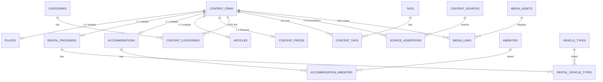

# HUẾ TRAVEL PRO V2.3 — ARCHITECTURE & DATA STATE
## BÁO CÁO HIỆN TRẠNG KIẾN TRÚC & DỮ LIỆU CƠ SỞ DỮ LIỆU ĐÁM MÂY

```
Tài liệu: 04_ARCHITECTURE_AND_DATA_STATE.md
Môi trường mục tiêu: Supabase PostgreSQL DEV (Project ID: rgoqdykpqyedambkrlvr)
Endpoint: db.rgoqdykpqyedambkrlvr.supabase.co:5432
TLS Mode: verify-full (TLSv1.3 qua prod-ca-2021.crt)
Trạng thái Dữ liệu: 260 DÒNG / 17 BẢNG SEED | 5 BẢNG NON-SEED 0 DÒNG
Trạng thái Bảo mật: 22/22 RLS ENABLED | 19 POLICIES | 5 DEFERRED TRIGGERS
```

---

## 1. TỔNG QUAN KIẾN TRÚC HỆ THỐNG

### 1.1 Ngăn xếp Công nghệ Thực tế
- **Frontend Framework:** Next.js 14.2.35 (App Router, Server & Client Components).
- **Core Library:** React 18.3.1, TypeScript 5.x, Tailwind CSS 3.4.x.
- **ORM / Schema Tooling:** Prisma Client & Prisma CLI 5.14.0.
- **Cơ sở Dữ liệu Đám mây:** Supabase PostgreSQL 17.x DEV (`rgoqdykpqyedambkrlvr`).
- **Phương thức Kết nối:** Direct Connection qua SSL `verify-full` với chứng chỉ CA gốc `prod-ca-2021.crt`.

### 1.2 Phân biệt Trạng thái Dữ liệu (Frontend vs Cloud Database)
> [!IMPORTANT]
> **CẢNH BÁO KIẾN TRÚC BẮT BUỘC:**
> - Hiện tại, toàn bộ giao diện người dùng của Next.js (`src/app/*`) đang đọc và hiển thị dữ liệu từ các file TypeScript nguồn cục bộ ([`src/data/places.ts`](file:///A:/tr%C3%AD%20tu%E1%BB%87%20nh%C3%A2n%20t%E1%BA%A1o/BAI_3/hue-travel-pro/src/data/places.ts), [`rentals.ts`](file:///A:/tr%C3%AD%20tu%E1%BB%87%20nh%C3%A2n%20t%E1%BA%A1o/BAI_3/hue-travel-pro/src/data/rentals.ts), [`accommodations.ts`](file:///A:/tr%C3%AD%20tu%E1%BB%87%20nh%C3%A2n%20t%E1%BA%A1o/BAI_3/hue-travel-pro/src/data/accommodations.ts)).
> - Cơ sở dữ liệu đám mây Supabase DEV đã được thiết lập 22 bảng và nạp 20 bản ghi seed chuẩn hóa, nhưng **CHƯA ĐƯỢC TÍCH HỢP VÀO GIAO DIỆN FRONTEND**.
> - Việc kết nối Prisma Client hoặc Supabase SDK vào giao diện Next.js thuộc phạm vi của các GATE tiếp theo khi có lệnh từ Owner.

---

## 2. CẤU TRÚC 22 BẢNG CƠ SỞ DỮ LIỆU (PRISMA SCHEMA V5)

Cơ sở dữ liệu được thiết kế theo mô hình chuẩn hóa 3NF gồm 22 bảng public:



### 2.1 Bảng Kiểm kê Dữ liệu Thực tế trên Supabase DEV
| Nhóm Bảng | Tên Bảng | Vai trò Thực thể | Số dòng Thực tế | Trạng thái Nghiệm thu |
|:---|:---|:---|:---:|:---:|
| **Root Core** | `content_items` | Bảng gốc chứa id, slug, kind, publication_status | **20** | Seed Populated (PASS) |
| **Subtypes (1:1)** | `places` | Thực thể địa điểm tham quan (`p1–p6`) | **6** | Seed Populated (PASS) |
| | `rental_providers` | Thực thể đơn vị thuê xe (`r1–r6`) | **6** | Seed Populated (PASS) |
| | `accommodations` | Thực thể cơ sở lưu trú (`a1–a8`) | **8** | Seed Populated (PASS) |
| | `articles` | Thực thể bài viết cẩm nang | **0** | Non-seed Protected (0 dòng) |
| **Taxonomies** | `areas` | Phân cấp khu vực hành chính | **0** | Non-seed Protected (0 dòng) |
| | `categories` | Danh mục trải nghiệm | **4** | Seed Lookup Populated (PASS) |
| | `tags` | Thẻ phân loại chi tiết | **36** | Seed Lookup Populated (PASS) |
| **Taxonomy Junctions** | `content_categories` | Liên kết Item - Category | **6** | Seed Junction Populated (PASS) |
| | `content_tags` | Liên kết Item - Tag | **36** | Seed Junction Populated (PASS) |
| **Subtype Attributes** | `amenities` | Danh mục tiện ích lưu trú | **15** | Seed Lookup Populated (PASS) |
| | `accommodation_amenities`| Liên kết Accommodation - Amenity | **33** | Seed Junction Populated (PASS) |
| | `vehicle_types` | Phân loại phương tiện thuê | **3** | Seed Lookup Populated (PASS) |
| | `rental_vehicle_types` | Liên kết Rental - VehicleType | **13** | Seed Junction Populated (PASS) |
| **Financial** | `content_prices` | Cấu trúc giá VND (BigInt, strict nullability) | **20** | Seed Populated (PASS) |
| **Provenance** | `content_sources` | Nhà xuất bản & nguồn tin uy tín | **8** | Seed Lookup Populated (PASS) |
| | `source_assertions` | Dẫn chứng kiểm chứng dữ liệu | **20** | Seed Junction Populated (PASS) |
| **Media** | `media_assets` | Tài nguyên media tập trung | **6** | Seed Populated (PASS) |
| | `media_links` | Liên kết Item - MediaAsset | **20** | Seed Junction Populated (PASS) |
| **Audit & RBAC** | `content_revisions` | Lịch sử sửa đổi nội dung | **0** | Non-seed Protected (0 dòng) |
| | `audit_logs` | Nhật ký bảo mật & truy vết | **0** | Non-seed Protected (0 dòng) |
| | `admin_memberships` | Phân quyền quản trị hệ thống | **0** | Non-seed Protected (0 dòng) |
| **TỔNG CỘNG** | **22 Bảng** | — | **260 Dòng** | **17 Bảng có dữ liệu / 5 Bảng 0 dòng** |

---

## 3. CƠ CHẾ RÀNG BUỘC TOÀN VẸN & BẢO MẬT

### 3.1 Khóa Ngoại & Toàn vẹn Tham chiếu (Foreign Keys)
- Tất cả các liên kết khóa ngoại đều thiết lập hành vi: `ON DELETE RESTRICT`.
- Tuyệt đối ngăn chặn hiện tượng xóa lan truyền (cascade delete) làm thất thoát dữ liệu.

### 3.2 Bộ 5 Trigger Hoãn Kiểm tra Đa Subtype (Deferred Subtype Triggers)
Năm trigger PL/pgSQL được định nghĩa ở trạng thái `DEFERRABLE INITIALLY DEFERRED`:
1. `trg_check_subtype_items` trên bảng `content_items`
2. `trg_check_subtype_places` trên bảng `places`
3. `trg_check_subtype_rentals` trên bảng `rental_providers`
4. `trg_check_subtype_accommodations` trên bảng `accommodations`
5. `trg_check_subtype_articles` trên bảng `articles`
*Tác dụng:* Đảm bảo một `content_item` chỉ được phép gắn với đúng 1 bản ghi subtype tương ứng, phát hiện và hủy bỏ giao dịch ngay tại thời điểm `COMMIT` nếu vi phạm.

### 3.3 Hệ thống 19 Chính sách RLS (Row Level Security)
- 22/22 bảng public đều được bật cờ bảo mật RLS (`relrowsecurity = true`).
- 19 chính sách bảo đảm người dùng công khai (`anon`) và người dùng thông thường (`authenticated`) chỉ có thể đọc nội dung khi:
  - `publication_status = 'published'`
  - `is_published = true` (đối với media)
- Hàm bảo mật `internal.fn_is_media_asset_published` được thiết lập `SECURITY DEFINER` với `search_path = public, internal` ngăn chặn leo thang đặc quyền.

---

## 4. QUY ĐỊNH BẢO VỆ DỮ LIỆU NHÁP (DRAFT PRIVACY)

- **Hiện trạng:** 20/20 content items đều có `publication_status = 'draft'`; 6/6 media assets đều có `is_published = false`.
- **Bằng chứng kiểm toán D05:** Dưới vai trò PostgreSQL `anon` và `authenticated`, các lệnh SELECT trả về đúng **0 dòng**.
- **Bằng chứng kiểm toán D06-01:** Dưới giao thức HTTPS REST API gửi kèm `apikey` công khai hợp lệ, cả 6 collection đều trả về **HTTP 200 OK với mảng rỗng `[]` (0 bản ghi bị rò rỉ)**.
- **Nghiêm cấm:** Tuyệt đối không tự ý chạy lệnh UPDATE chuyển trạng thái dữ liệu sang `published` khi chưa có phê duyệt từ Owner.
