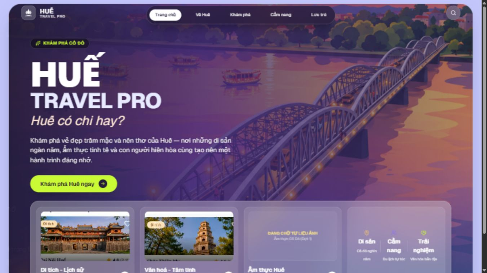
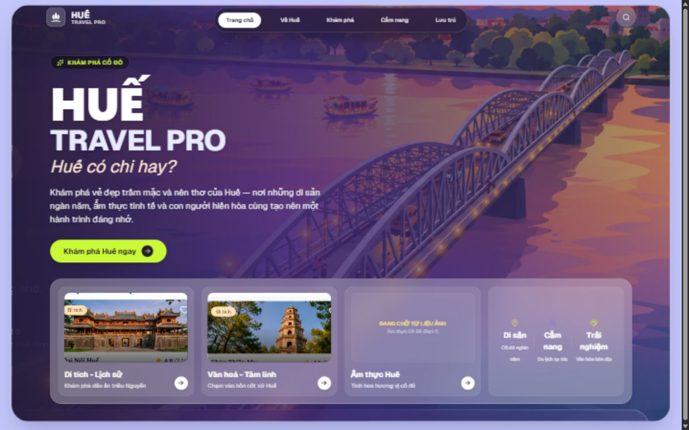
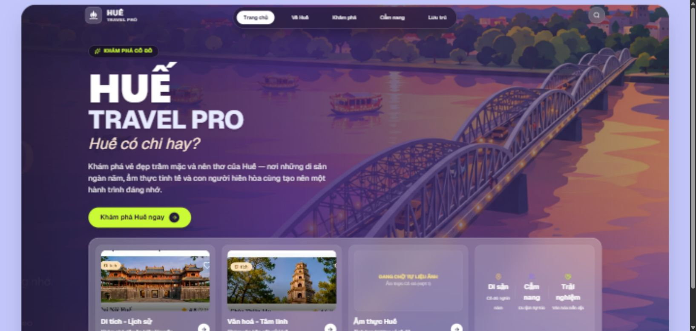
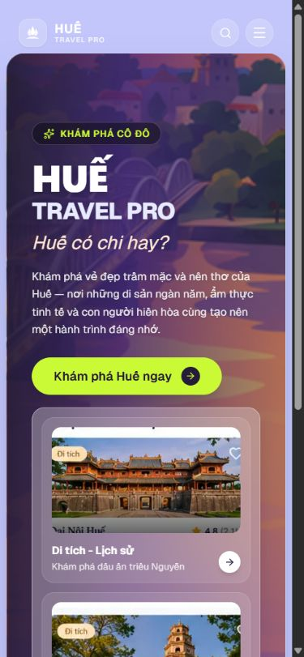

# GATE-07-01-PHASE1B-RUNTIME-VISUAL-DIAGNOSIS

## 1. Project / Gate / Task ID

- Project: HUẾ TRAVEL PRO V2.3 — “Huế có chi hay?”
- Project root: `A:\trí tuệ nhân tạo\BAI_3\hue-travel-pro`.
- Gate: GATE 07-01.
- Task ID: PHASE1B-RUNTIME-VISUAL-DIAGNOSIS.
- Báo cáo được xuất lại từ chẩn đoán đã hoàn thành trong cùng cuộc hội thoại; lần bàn giao tài liệu này không chạy thêm kiểm thử.
- Tên file tuân theo tên cụ thể Owner yêu cầu, là ngoại lệ của mẫu tên mặc định có hậu tố `-REPORT.md`.

## 2. Ngày thực hiện

2026-10-24, múi giờ Asia/Saigon. Ngày kiểm tra giao diện và ngày xuất báo cáo: 2026-10-24.

## 3. Phạm vi Owner cấp phép

Phase 1B: đọc mã nguồn, phân tích bố cục Trang chủ, đối chiếu mockup, kiểm tra runtime tại `http://localhost:3000/`, navigation và search theo AGENTS.md. READ-ONLY / NO SOURCE MODIFICATION.

Lần bàn giao hiện tại chỉ được đọc và bổ sung quy trình báo cáo vào AGENTS.md, tạo thư mục báo cáo, lưu báo cáo này và sao chép evidence đã có. Ngoại lệ chỉ dành cho tài liệu, không mở khóa source code hoặc asset.

Giữ nguyên logo, bốn trang con, navigation, Hero-to-Sidebar/Sidebar-to-Hero, route/card URL, search/filter, dữ liệu và database. Không cài package, không triển khai, không bắt đầu Phase 1C hoặc Phase 2.

## 4. Executive Summary

VERIFIED: Trang chủ desktop còn vượt chiều cao viewport. Ở 1366×768 và 1650×786, phần dưới dock nằm ngoài vùng nhìn thấy. Ở 1440×900, dock hiển thị đủ nhưng trang dư 2 px. Hai nguyên nhân phối hợp là chiều cao landing không khớp padding Shell và chiều cao nội dung hero/dock vượt ngân sách màn hình thấp.

VERIFIED: Chữ mờ góc trái dưới có sẵn trong asset `public/images/heroes/hero_trang_chu.png`; gradient nền làm phần chữ sót hiện mờ. Không có bằng chứng cần sửa navigation để giải quyết hiện tượng này.

Các tương tác đã thực sự bấm và kiểm tra: Home → Về Huế → Home, cả ba card Trang chủ, mobile drawer và bottom navigation; hai tổ hợp tìm kiếm `dai noi` với all/camping cho kết quả đúng điều kiện đã thử. Badge Next.js `1 error` trước đây chưa tái hiện, chưa xác định nguyên nhân cũ.

Chưa sửa code. Chẩn đoán đã hoàn tất; giao diện desktop vẫn FAIL/PENDING REWORK, chưa được Owner nghiệm thu.

## 5. Công việc đã thực hiện

1. Đọc AGENTS.md ở gốc dự án và các quy định Owner/LOCKED.
2. Đọc `src/app/page.tsx`, `src/components/layout/Shell.tsx`, `Container.tsx`, `Card.tsx`, `src/app/layout.tsx`, `src/app/globals.css`, `tailwind.config.ts`, AdaptiveNavigation và TransitionContext để truy nguyên bố cục/transition. Đọc phần mã search liên quan để đối chiếu hành vi, không sửa.
3. Tìm thấy mockup tại `public/images/01_TRANG_CHU.png`, mở trực tiếp mockup và asset hero để đối chiếu.
4. Dùng trình duyệt tích hợp qua công cụ browser automation để chụp ảnh, đo DOM và thực sự bấm các tương tác trong phạm vi kiểm thử.
5. Kiểm tra các viewport được yêu cầu; đã khôi phục override viewport sau kiểm tra.
6. Xuất báo cáo này, bổ sung quy trình báo cáo bắt buộc vào AGENTS.md và sao chép các screenshot đã có vào thư mục evidence. Không tạo screenshot mới trong lần xuất tài liệu.

## 6. Kết quả kiểm tra và bằng chứng

### 6.1. Bố cục runtime

Các giá trị sau lấy từ số đo DOM và screenshot thực tế, không suy ra từ HTTP 200. Số đo được ghi sau khi bố cục ổn định; số lẻ của bounding box được làm tròn khi trình bày. `scrollHeight` nguyên có thể khác khoảng 1 px so với bounding box.

| Viewport thực đo | clientHeight | scrollHeight | Landing y / height / bottom (px) | Hero container height | Dock container height | Kết quả |
|---|---:|---:|---|---:|---:|---|
| 1366×768 | Chưa ghi riêng; innerHeight=768 | 878 | 10 / 848.69 / 858.69 | 465.60 | 273.49 | FAIL — khung trang khoảng 878.69 px, dư khoảng 111 px; phần dưới card ngoài viewport |
| 1440×900 | Chưa ghi riêng; innerHeight=900 | 902 | 10 / 872 / 882 | 465.60 | 278.33 | FAIL — dư 2 px; card hiển thị đủ |
| 1650×786 | 786 | 883 | 10 / 853.53 / 863.53 | 465.60 | 278.33 | FAIL — dư 97 px theo scrollHeight; phần dưới card ngoài viewport |
| 390×844 | 844 | 1341 | 68 / 1264.75 / 1332.75 | 366.10 | 801.05 | Cuộn dọc theo bố cục một cột; không FAIL chỉ vì không One-Screen |

Yêu cầu 1649×786 được công cụ trình duyệt làm tròn thành innerWidth=1650, innerHeight=786. Không tuyên bố đã kiểm đúng 1649 px. Viewport mobile có clientWidth=375 và scrollWidth=375 (scrollbar chiếm phần còn lại của innerWidth=390): PASS cho tiêu chí không tràn ngang tại trạng thái đã đo.

Hero container ở bảng là `main > div > div:first-child`; dock container là `main > div > div:last-child`. Landing là `main > div`.

Ở desktop, landing có computed padding `80px 28px 28px`, overflow `hidden`, position `relative`. Hero container có padding `16px 32px`; dock container có padding `8px 32px`. Shell có padding dọc 10 px trên và 20 px dưới. Tại 1440×900, hero có margin dọc khoảng 9.24 px do `my-auto`; trên desktop thấp không còn phần dư cho margin này. Ở phép đo desktop bổ sung, transform của landing và Shell là `none`; không thấy transform đang tồn tại gây lệch dock ở trạng thái ổn định.

Không xác minh được card bị mất nội dung do clipping nội bộ. Bằng chứng xác nhận phần dưới card nằm dưới viewport khi trang dài hơn màn hình; không nên dùng overflow hidden để che lỗi.

### 6.2. Screenshot đã chụp và lưu kèm

Các file bên dưới là bản sao nguyên trạng của screenshot từ các lượt kiểm tra trước trong cùng cuộc hội thoại. Không chỉnh sửa ảnh để tạo bằng chứng.

#### 1366×768 — FAIL

#### 1440×900 — FAIL nhẹ, dock hiển thị đủ

#### 1650×786 — FAIL; kích thước thực tế khi yêu cầu 1649×786

#### 390×844 — kiểm tra bố cục mobile sau tương tác

Không dùng ảnh `gate0701-1649x786.jpg` làm bằng chứng chuẩn: ảnh đó được chụp khi scrollY khác 0 và tên không phản ánh đúng innerWidth thực đo. Bản 1650×786 ở trên được ghi nhận tại scrollY=0.

### 6.3. Navigation và search — browser verified

| Thử nghiệm đã thực hiện | Bằng chứng quan sát | Kết quả |
|---|---|---|
| Home → Về Huế → Home | Bấm link; trang Về Huế xuất hiện; `data-morph-state` chuyển sidebar, sau trở về Home là capsule | PASS trong lượt thử |
| Card Di tích - Lịch sử | Bấm card Đại Nội; DOM trang Khám phá xuất hiện | PASS — đích `/kham-pha` |
| Card Văn hoá - Tâm linh | Bấm card Thiên Mụ; URL và DOM trang Khám phá | PASS — đích `/kham-pha` |
| Card Ẩm thực Huế | Bấm card; URL và DOM trang Khám phá | PASS — đích `/kham-pha`; ảnh ẩm thực vẫn NEEDS ASSET |
| Mobile bottom navigation | Bấm Trang chủ từ trang Khám phá; banner và hero Home xuất hiện | PASS trong lượt thử |
| Mobile drawer | Bấm Mở menu, thấy 5 link; bấm lại, các link drawer biến mất | PASS cho mở/đóng; chưa kiểm toàn bộ link trong drawer |
| `q=dai noi`, category=all | URL `/kham-pha?q=dai+noi`; select có value `all`; DOM hiển thị 1 kết quả Đại Nội Huế | PASS |
| `q=dai noi`, category=camping | URL `/kham-pha?q=dai+noi&category=camping`; select value `camping`; DOM hiển thị 0 kết quả và thông báo không tìm thấy | PASS — đúng phép kết hợp từ khóa và danh mục |

Giá trị all được ứng dụng bỏ khỏi URL nhưng được xác minh trực tiếp trên select. Kết quả này không phải kiểm thử toàn bộ navigation/search. Không có screenshot lưu riêng cho từng bước tương tác hoặc từng kết quả search; bằng chứng tương tác là DOM/URL và thao tác browser trong cuộc hội thoại.

### 6.4. Console và lỗi Next.js cũ

NOT REPRODUCED / NOT VERIFIED: badge `1 error` trước đây không xuất hiện lại trong lượt kiểm tra được báo cáo. Các lần đọc log error/warn của công cụ trả về danh sách rỗng. Không có thông báo lỗi cũ để phân tích root cause; không kết luận lỗi vô hại, đã sửa hoặc sẽ hết ở production. Không reload để tái tạo lỗi và không có kiểm thử production build.

### 6.5. Đối chiếu mockup

VERIFIED bằng mở ảnh trực tiếp: `public/images/01_TRANG_CHU.png` giữ hero và dock trọn trong khung; card tham chiếu có phần chữ phủ trên vùng ảnh nên dock gọn hơn. Bản hiện tại tách ảnh 16:9 và vùng chữ theo chiều dọc, cộng padding/gap, khiến dock cao hơn. Typography cũng khác mockup nhưng comprehensive font audit là DEFERRED; không đề xuất mở rộng sửa font trong Phase 1B.

Mockup chỉ là tham chiếu thị giác. Không phục hồi nhãn navigation cũ, số liệu giả, video chưa có nội dung hoặc logo chưa được Owner phê duyệt. Không có mockup mobile được dùng để kết luận mức độ khớp trên mobile; theo AGENTS.md, không ép One-Screen desktop lên mobile.

## 7. Root Cause

### RC-01 — VERIFIED: ngân sách chiều cao không nhất quán

- File: `src/app/page.tsx:21`.
- Landing có `sm:min-h-[calc(100vh-1.75rem)]` (viewport − 28 px) và `lg:h-[calc(100vh-2rem)]` (viewport − 32 px). Min-height vẫn có hiệu lực trên desktop, lớn hơn height khai báo 4 px.
- File: `src/components/layout/Shell.tsx:24–27`: Shell min-h-screen, landing padding trên 10 px và dưới 20 px.
- Tại 1440×900, min-height landing 872 px cộng 30 px Shell = 902 px. Đây là nguyên nhân xác định được của phần dư 2 px.
- Đề xuất tối thiểu: thống nhất height/min-height landing desktop với phần padding thực tế, chỉ trong nhánh landing. Chưa triển khai.

### RC-02 — VERIFIED: tổng nội dung lớn hơn vùng desktop thấp

- File: `src/app/page.tsx:21,27–28,37–49,78–87,118,149`.
- Hero/dock nằm trong flex layout với các container còn chiều cao nội dung tối thiểu; wrapper chỉ có min-height, chưa tạo giới hạn chiều cao hữu hiệu cho toàn bộ landing. Height khai báo không bảo đảm kích thước cuối cùng khi flex sizing và nội dung cùng quyết định chiều cao.
- Tại 1366×768: hero 465.60 px + dock 273.49 px + padding/viền khoảng 109.60 px = landing 848.69 px; thêm padding Shell thành khoảng 878.69 px.
- File liên quan: `src/components/layout/Shell.tsx:34–43`, `src/components/layout/Container.tsx:24`, `src/components/common/Card.tsx:22`.
- Đề xuất tối thiểu: thu gọn spacing hero và chiều cao ảnh/dock dành riêng cho desktop thấp; bảo đảm toàn bộ nội dung vừa vùng landing sau khi tính padding. Không chỉ khóa chiều cao rồi cắt nội dung bằng overflow hidden. Không thay navigation hay mobile.

### RC-03 — VERIFIED: chữ/UI còn sót trong asset nền

- Asset: `public/images/heroes/hero_trang_chu.png`.
- Điểm sử dụng: `src/app/page.tsx:23`, backgroundImage gồm gradient và URL asset; lớp ngoài dùng bg-cover/bg-right-top tại dòng 21.
- Khi mở asset trực tiếp thấy các mảnh chữ, phần video cũ và viền dock còn sót ở bên trái/dưới. Screenshot runtime cũng thể hiện chữ mờ bên trái dock. Gradient tối làm chữ sót mờ đi; không phải bằng chứng có component văn bản mới chèn ở vị trí đó.
- Đề xuất tối thiểu: NEEDS ASSET — dùng bản cảnh nền sạch chữ/UI, giữ cảnh được duyệt. Cần Owner cho phép riêng trước khi thay asset; không tái tạo hay thay logo.
- Không khẳng định đã loại trừ mọi lỗi stacking/transition có thể xảy ra ở các trạng thái chưa kiểm thử.

## 8. Danh sách file thay đổi và phạm vi diff

**Phase 1B: READ-ONLY / NO SOURCE MODIFICATION.** Không sửa source code, asset hiện có, dữ liệu hoặc database trong chẩn đoán hay lần xuất báo cáo này.

Ngoại lệ tài liệu do Owner cấp phép trong lần bàn giao:

| File | Thay đổi |
|---|---|
| `AGENTS.md` | Chỉ bổ sung mục 8: CODEX MANDATORY TASK REPORTING PROTOCOL và cấu trúc báo cáo bắt buộc; giữ nguyên các mục cũ |
| `reports/codex/GATE-07-01-PHASE1B-RUNTIME-VISUAL-DIAGNOSIS.md` | Tạo mới báo cáo này theo tên Owner chỉ định |
| `reports/codex/evidence/GATE-07-01-PHASE1B-1366x768.jpg` | Sao chép screenshot sẵn có, không chỉnh sửa |
| `reports/codex/evidence/GATE-07-01-PHASE1B-1440x900.jpg` | Sao chép screenshot sẵn có, không chỉnh sửa |
| `reports/codex/evidence/GATE-07-01-PHASE1B-1650x786.jpg` | Sao chép screenshot sẵn có tại đầu trang, không chỉnh sửa |
| `reports/codex/evidence/GATE-07-01-PHASE1B-390x844.jpg` | Sao chép screenshot mobile recheck sẵn có, không chỉnh sửa |

Giới hạn: lần chạy git status tại gốc dự án trả về `fatal: not a git repository (or any of the parent directories): .git`. Không có Git diff/baseline để chứng minh toàn bộ trạng thái dự án; danh sách trên mô tả các thao tác ghi của nhiệm vụ hiện tại, không tuyên bố working tree sạch. Không chạy git init/reset/commit.

## 9. Typecheck / Build / Runtime Tests / Visual Tests

| Nhóm | Trạng thái | Phạm vi và bằng chứng |
|---|---|---|
| Typecheck | NOT TESTED | Không chạy trong Phase 1B hoặc lần xuất tài liệu |
| Build | NOT TESTED | Không chạy build; không kết luận production |
| Runtime Tests | PASS trong phạm vi tương tác đã thử | Navigation, 3 card, drawer, bottom navigation và 2 tổ hợp search như mục 6.3; không có automated test suite mới |
| Visual Tests — desktop | FAIL | Cuộn dọc tại 3 viewport desktop thực đo, dock ngoài viewport trên desktop thấp |
| Visual Tests — mobile | PASS cho không tràn ngang; chưa nghiệm thu toàn diện | scrollWidth=clientWidth=375, cuộn dọc một cột hợp lệ; drawer/bottom navigation đã thử |
| Lỗi Next.js cũ | NOT VERIFIED | NOT REPRODUCED; log error/warn thu được rỗng; chưa có root cause |

Không lấy HTTP 200, smoke test cũ hoặc DOM probe đơn lẻ làm bằng chứng khớp mockup 100%. Không bổ sung kết quả kiểm thử chưa thực hiện.

## 10. Những vấn đề chưa giải quyết

- Layout desktop overflow và dock ngoài viewport chưa sửa.
- Asset nền còn chữ/UI chưa thay; ảnh ẩm thực còn NEEDS ASSET.
- Lỗi Next.js `1 error` cũ chưa tái hiện, không có nguyên văn lỗi để chẩn đoán.
- Chưa kiểm production build, typecheck, toàn bộ liên kết mobile, keyboard/accessibility hoặc toàn bộ search/filter. Chưa đánh giá chất lượng animation từng frame.
- Chưa kiểm chính xác 1649 px do viewport thực tế làm tròn 1650 px.
- Chưa có Git repository được nhận diện tại đường dẫn kiểm tra; không có baseline diff Git.
- Không có nghiệm thu Owner cho Phase 1 visual; các phần LOCKED giữ nguyên.

## 11. Đề xuất bước tiếp theo

Chỉ sau khi Owner phê duyệt rõ file allowlist và loại thay đổi: (1) thống nhất ngân sách chiều cao landing desktop; (2) thu gọn hero/dock trên desktop thấp; (3) thay riêng asset nền bằng bản sạch đã duyệt. Không ép mobile One-Screen và không mở rộng sang logo, font audit toàn diện, navigation, subpages, dữ liệu hoặc Phase 2.

Rủi ro hồi quy cần kiểm khi được phép sửa: đổi Shell có thể ảnh hưởng morph/sidebar; giảm ảnh làm thay đổi crop; khóa chiều cao có thể che nội dung khi zoom hoặc xuống dòng. Cần kiểm lại ba desktop viewport, mobile, navigation và card sau sửa. Đây là đề xuất kiểm thử tương lai, không phải kết quả đã thực hiện.

Nếu badge Next.js tái xuất hiện, cần thu nguyên văn console/overlay trước khi phân loại; không tự xử lý ngoài phạm vi Owner cấp phép.

## 12. Trạng thái nghiệm thu đề xuất

- Báo cáo chẩn đoán: hoàn tất để Owner/ChatGPT xem xét.
- Phase 1 visual implementation: FAIL / PENDING REWORK; không đề xuất PASS giao diện.
- Tài liệu protocol: bổ sung theo lệnh Owner, không thay đổi quyền triển khai.
- Owner acceptance: AWAITING REVIEW — agent không tự tuyên bố Owner đã nghiệm thu.

**PASS = LOCK — FIX ONLY WHAT FAILED — NO SCOPE CREEP.**

## 13. HARD STOP — AWAIT OWNER REVIEW

Không bắt đầu nhiệm vụ tiếp theo, không triển khai sửa chữa sau khi xuất báo cáo.
