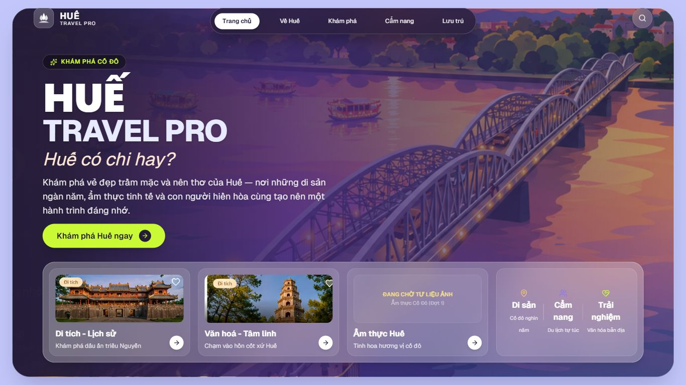
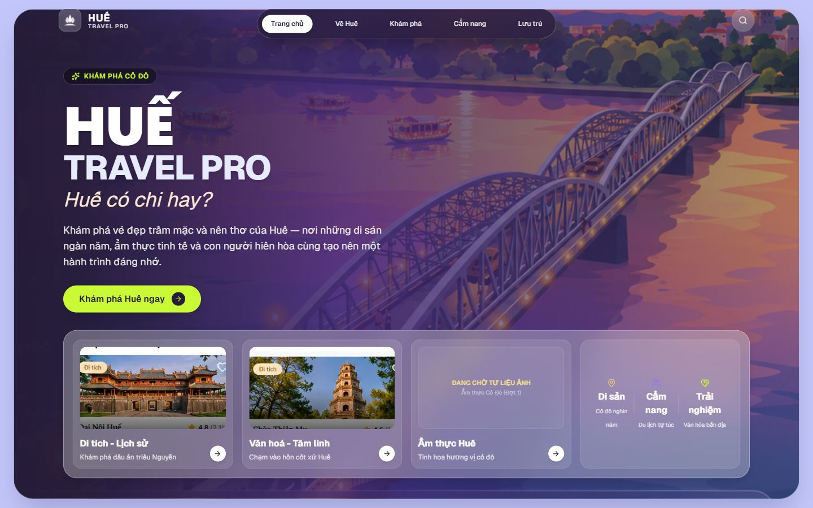
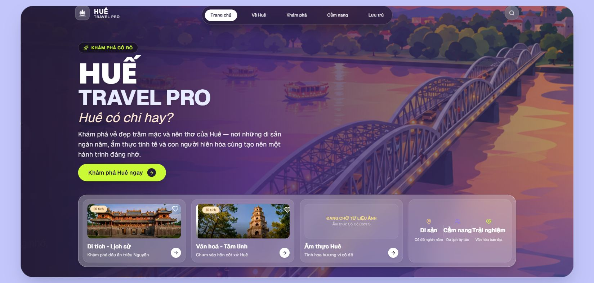

# GATE 07-01 — PHASE 1C — TARGETED HOMEPAGE LAYOUT FIX REPORT

## 1. Project / Gate / Task ID / Ngày thực hiện

- Project: HUẾ TRAVEL PRO V2.3 — “Huế có chi hay?”
- Root: `A:\trí tuệ nhân tạo\BAI_3\hue-travel-pro`.
- Gate / Task: GATE-07-01 / PHASE1C-TARGETED-FIX.
- Ngày thực hiện: 2026-10-24, Asia/Saigon.
- Mode: STUDENT PROJECT — DEMO FIRST.
- Cơ sở: [Báo cáo Phase 1B](GATE-07-01-PHASE1B-RUNTIME-VISUAL-DIAGNOSIS.md).

## 2. Executive Summary

Đã sửa đúng hai file được Owner cho phép: `src/app/page.tsx` và `src/components/layout/Shell.tsx`. Không thay đổi logic điều hướng, animation, logo, dữ liệu, asset ảnh hoặc source khác.

VERIFIED bằng browser, số đo DOM và ảnh thực tế: tại 1366×768 và 1440×900, scrollHeight bằng clientHeight; hero, CTA, ba card, caption và mũi tên nằm trọn trong viewport. Yêu cầu 1649×786 được browser làm tròn thành innerWidth=1650; tại 1650×786 cũng không còn cuộn và dock hiển thị đủ. Không tuyên bố đã kiểm đúng 1649 px.

Mobile 390×844 giữ nguyên chiều cao trang 1341 px và không tràn ngang. Các thao tác navigation, ba card, CTA mobile, drawer/bottom navigation và hai tổ hợp search đã được thử lại, đều PASS trong phạm vi đã thử. Typecheck và lint PASS.

Hai vấn đề còn mở: (1) chữ raster/UI cũ trong ảnh hero chỉ giảm bằng gradient, chưa được loại bỏ hoàn toàn — **NEEDS CLEAN HERO ASSET**; (2) console ghi nhận cảnh báo React extra attributes tại body — chưa xác định nguồn và chưa chứng minh có/không phải hồi quy. Vì vậy không đánh PASS toàn bộ Phase 1C hoặc tiêu chí “không có runtime error mới”. Chờ Owner visual acceptance.

## 3. Owner Authorization / Phạm vi được cấp phép

Owner cấp phép trong tệp đính kèm yêu cầu Phase 1C: OWNER APPROVED — SCOPED CODE EDIT. Quyền mới này thay thế giới hạn READ-ONLY Phase 1B chỉ đối với hai file được nêu; không sửa nội dung AGENTS.md trong lần này.

Được phép: height/min-height landing, padding/spacing, kích thước hero/dock theo breakpoint, chiều cao ảnh card và gradient overlay. Được tạo checkpoint, checksum, diff, báo cáo và evidence theo protocol.

Không được sửa source khác, ảnh, database/data, logo, navigation/animation; không thêm dependency, migration, seed, deploy hoặc triển khai Phase 2. Toàn bộ phần LOCKED khác giữ nguyên.

## 4. Changed Files / Công việc đã thực hiện

| File | Phạm vi diff |
|---|---|
| `src/components/layout/Shell.tsx:27` | Chỉ thay padding desktop của nhánh landing từ trên 10 / dưới 20 px thành trên 16 / dưới 16 px (`lg:py-4`). Nhánh sidebar và logic phase không thay đổi. |
| `src/app/page.tsx:21` | Bỏ fixed desktop height và max-height; dùng `lg:min-h-[calc(100svh-2rem)]` cùng `lg:flex-none`, khớp 32 px padding Shell. Giữ height tự nhiên nếu nội dung cần thêm chỗ. |
| `src/app/page.tsx:23` | Tăng độ đậm gradient ở mép trái: alpha 0.99 tại 0%, 0.96 tại 8%; giữ stop 42% và bên phải 100% như cũ. Không thay file ảnh. |
| `src/app/page.tsx:27–56,79–162` | Chỉ ở desktop ≥1024 px và height ≤820 px: giảm spacing/padding hero/dock, HUẾ xuống 80 px, ảnh card 96 px, gap card 8 px. Caption desktop bỏ line-clamp để giữ đầy đủ; mobile giữ class cũ. |

Trình tự: đọc Owner authorization và AGENTS.md; kiểm tra Git; lưu checkpoint và SHA-256; sửa hai file; chạy typecheck/lint; đo/chụp bốn viewport; thử navigation/search; đối chiếu hash và tạo báo cáo này.

Không sửa nội dung mô tả, tên card, href, onClick, state, timeout, font family, dữ liệu hay logic. Không clamp mô tả hero. Card Ẩm thực giữ NEEDS ASSET.

Các tài liệu mới gồm báo cáo này, checkpoint/diff/manifests trong `backup/GATE-07-01-PHASE1C-20261024-01/`, các ảnh và JSON Phase 1C trong `evidence/`. Không ghi đè báo cáo Phase 1B hoặc ảnh Phase 1B.

## 5. Root Cause & Applied Fixes

### RC-01 — VERIFIED: công thức height/min-height và padding mâu thuẫn

Trước sửa: desktop height = viewport −32 px, nhưng min-height kế thừa từ sm = viewport −28 px; Shell thêm 30 px dọc. Ở 900 px cao, landing tối thiểu 872 px + Shell 30 px = 902 px.

Sau sửa: Shell dùng tổng padding dọc 32 px, landing dùng một min-height desktop = 100svh −32 px. Không còn fixed height/max-height xung đột. Landing không bị flex-grow ép thành kích thước khác với ngân sách tính toán. Kết quả thực đo 1440×900: landing 868 px + Shell 32 px = 900 px.

### RC-02 — VERIFIED: hero + dock quá cao trên desktop thấp

Trước sửa, hero khoảng 466 px và dock 273–278 px, cộng padding/viền khiến landing vượt vùng có thể dùng. Sau sửa, chỉ dưới ngưỡng height 820 px, hero khoảng 402 px và dock khoảng 217 px; HUẾ vẫn lớn nhất (80 px, so với TRAVEL PRO 60 px), slogan 36 px và CTA cao 48 px.

Ở 1440×900, HUẾ giữ 96 px và ảnh card giữ aspect ratio cũ, không thu nhỏ toàn bộ hero trên mọi màn hình. Ảnh dùng object-cover như cũ, giảm chiều cao slot chứ không kéo méo ảnh. Caption desktop có overflow visible, không line-clamp; số đo clientHeight=scrollHeight=16 px tại ba viewport desktop. Nút mũi tên 28 px nằm trong card.

Giữ overflow-hidden sẵn có của panel để bo góc nền, không dùng nó để giấu overflow nội dung: panel có height auto, chỉ min-height; số đo panel scrollHeight=clientHeight và toàn bộ dock nằm trong panel ở trạng thái nghiệm thu. Ở 1366×600, panel nở thành 712.40 px và document có scrollHeight=745 px; dock bottom=707.60 < panel bottom=728.40. Đây là kiểm tra DOM bổ sung cho fallback cuộn tự nhiên, không phải thêm viewport nghiệm thu hoặc bài kiểm thử visual đầy đủ.

### RC-03 — VERIFIED: chữ nằm trong raster asset

Chỉ tăng gradient ở vùng trái, giữ cảnh cầu và vùng phải. Ảnh thực tế cho thấy chữ bên trái ít nổi hơn nhưng vẫn có dấu vết rất mờ và viền dock cũ ở đáy ảnh, rõ hơn tại 1440×900. Không tuyên bố đã làm sạch asset.

**NEEDS CLEAN HERO ASSET.** Không thể xóa chữ raster hoàn toàn bằng gradient mà bảo đảm không làm tối thêm cảnh; dừng ở thay đổi overlay được Owner cho phép. Không chỉnh sửa/tạo/thay ảnh.

## 6. Viewport Measurements Before / After

### 6.1. Trước sửa — dẫn từ Phase 1B, không phải chạy lại baseline

| Viewport thực đo | scrollHeight trước | Landing y / h / bottom | Dock y / h / bottom | Tình trạng trước |
|---|---:|---|---|---|
| 1366×768 | 878 (bounding box trang ≈878.69) | 10 / 848.69 / 858.69 | 556.40 / 273.49 / 829.89 | Dock ngoài viewport |
| 1440×900 | 902 | 10 / 872 / 882 | 574.88 / 278.33 / 853.20 | Dư 2 px |
| 1650×786 (yêu cầu 1649) | 883 | 10 / 853.53 / 863.53 | 556.40 / 278.33 / 834.73 | Dock ngoài viewport |
| 390×844 | 1341 | 68 / 1264.75 / 1332.75 | 514.90 / 801.05 / 1315.95 | Cuộn dọc tự nhiên, không tràn ngang |

clientHeight desktop 1366/1440 chưa được ghi riêng trong Phase 1B; innerHeight được ghi là 768/900. Không bổ sung số đo baseline chưa có.

### 6.2. Sau sửa — đo trong Phase 1C, scrollY=0

| innerWidth × innerHeight | clientWidth × clientHeight | scrollWidth × scrollHeight | Landing x,y,w,h,bottom | Dock x,y,w,h,bottom | Kết luận hình học |
|---|---|---|---|---|---|
| 1366×768 | 1366×768 | 1366×768 | 24,16,1318.40,736,752 | 52.80,514,1260.80,217.20,731.20 | PASS |
| 1440×900 | 1440×900 | 1440×900 | 24,16,1392,868,884 | 80,576.88,1280,278.33,855.20 | PASS |
| 1650×786 | 1650×786 | 1650×786 | 56.80,16,1536,754.40,770.40 | 184.80,532.40,1280,217.20,749.60 | PASS tại kích thước thực đo; chính xác 1649 px NOT TESTED |
| 390×844 | 375×844 | 375×1341 | 8,68,359.20,1264.75,1332.75 | 24.80,514.90,325.60,801.05,1315.95 | PASS mobile cuộn tự nhiên / không tràn ngang |

Browser làm tròn chiều rộng yêu cầu 1649 thành innerWidth=1650; không che giới hạn này. Mobile scrollbar chiếm phần chênh giữa innerWidth và clientWidth. Đơn vị tọa độ/kích thước là CSS px, số lẻ làm tròn để trình bày.

### 6.3. Card, caption và CTA desktop

| Viewport | Ba card: y → bottom | Ba caption/mũi tên: bottom | CTA: y → bottom | Caption đầy đủ |
|---|---|---|---|---|
| 1366×768 | 534.80 → 710.40 | 697.60 | 446.20 → 494.20 | PASS — caption height/scrollHeight=16/16 px |
| 1440×900 | 601.67 → 830.40 | 817.60 | 505.64 → 553.64 | PASS — 16/16 px |
| 1650×786 | 553.20 → 728.80 | 716 | 455.40 → 503.40 | PASS — 16/16 px |

CTA ở ba viewport desktop đều cao 48 px, rộng khoảng 243.85 px. Caption, title và mũi tên nhìn thấy trong ảnh thực tế, không chỉ dựa vào DOM. Tọa độ x/width từng card và computed styles đầy đủ ở [measurements JSON](evidence/GATE-07-01-PHASE1C-measurements.json).

## 7. Desktop / Mobile Screenshots và bằng chứng

Đã mở và kiểm tra các ảnh lưu cuối cùng. Một số lần chụp viewport ban đầu có vùng ghép/blur do đường chụp trình duyệt; ảnh desktop bàn giao dùng screenshot fullPage khi document vừa đúng chiều cao viewport, không có phần nội dung ngoài viewport bị ghép vào để giả One-Screen. Ảnh fullPage desktop cuối cùng hiển thị rõ đủ hero/dock. Mobile có cả ảnh viewport và ảnh toàn trang để thấy nội dung cuộn. Không chỉnh sửa pixel hoặc asset để tạo ảnh bằng chứng.

### 1366×768 — sau sửa



Trước sửa: [ảnh Phase 1B](evidence/GATE-07-01-PHASE1B-1366x768.jpg).

### 1440×900 — sau sửa



Trước sửa: [ảnh Phase 1B](evidence/GATE-07-01-PHASE1B-1440x900.jpg).

### Yêu cầu 1649×786 — thực đo 1650×786



Trước sửa: [ảnh Phase 1B tại 1650×786](evidence/GATE-07-01-PHASE1B-1650x786.jpg).

### 390×844 — sau sửa, đầu trang / drawer đóng


[Ảnh mobile toàn trang](evidence/GATE-07-01-PHASE1C-390x844-fullpage.jpg) · [Ảnh trước sửa](evidence/GATE-07-01-PHASE1B-390x844.jpg).

## 8. Navigation & Interaction Tests / Runtime Tests

Thực sự bấm trong browser, xác minh URL và nội dung trang đích; không suy luận từ HTTP 200. [Chi tiết 11 lượt kiểm thử](evidence/GATE-07-01-PHASE1C-interactions.json).

| Thao tác | Kết quả |
|---|---|
| Home → Về Huế → Home | PASS — trang Về Huế xuất hiện, data-morph-state sidebar rồi capsule |
| Home → Khám phá bằng navigation | PASS — `/kham-pha`, heading Khám phá Huế |
| Bấm card Di tích - Lịch sử | PASS — `/kham-pha` và heading trang đích |
| Bấm card Văn hoá - Tâm linh | PASS — `/kham-pha` và heading trang đích |
| Bấm card Ẩm thực Huế | PASS — `/kham-pha`; giữ placeholder NEEDS ASSET |
| Mobile mở drawer và chọn Về Huế | PASS — `/ve-hue`, bottom navigation xuất hiện |
| Mobile bottom navigation → Trang chủ | PASS — `/`, hero/banner xuất hiện |
| Mobile drawer mở/đóng | PASS — các link drawer xuất hiện rồi biến mất |
| Mobile CTA Khám phá Huế ngay | PASS — `/kham-pha` |
| Search `dai noi`, category all | PASS — URL `?q=dai+noi`, select all, 1 kết quả Đại Nội |
| Search `dai noi`, category camping | PASS — URL `?q=dai+noi&category=camping`, 0 kết quả và thông báo không tìm thấy |

Không sửa cơ chế morph, timeout, href hoặc search/filter. Không khẳng định đã kiểm mọi route, mọi bộ lọc, mọi link drawer hoặc animation từng frame.

### Console / lỗi runtime còn mở

**VERIFIED — console có 2 bản ghi level error của React warning**. Thông báo thực tế:

```text
Warning: Extra attributes from the server: %s%s __processed_2e30675f-9cbc-4211-b82a-ae0b75353cf1__
    at body
    at html
    at RootLayout (Server)
```

Bản ghi thứ hai cùng dạng với `__processed_eb299461-9adb-478e-bed5-0f1adfaf4830__`. Log nguyên văn và stack đầy đủ: [console JSON](evidence/GATE-07-01-PHASE1C-console.json).

VERIFIED: tìm `__processed_` trong `src` và `public` không có kết quả; diff chỉ thay class/gradient. LIKELY đây là thuộc tính được môi trường browser/tool/extension đưa vào, nhưng nguồn cụ thể **NOT VERIFIED**. Không kết luận cảnh báo vô hại hoặc chắc chắn không liên quan thay đổi. Không có exception ứng dụng làm gián đoạn các thao tác đã thử, nhưng điều đó không đủ để tuyên bố console sạch.

Badge Next.js `1 error` của các lượt trước chưa được đối chiếu trực tiếp với hai warning này. **NOT VERIFIED** chúng có cùng nguyên nhân. Không sửa RootLayout, không thêm suppressHydrationWarning và không đổi cấu hình/extension vì ngoài allowlist. Tiêu chí “không có runtime error mới”: **NOT VERIFIED / chưa đủ điều kiện PASS**, cần Owner review.

## 9. Typecheck / Lint / Build / Visual Test Results

| Kiểm tra | Trạng thái | Bằng chứng |
|---|---|---|
| Typecheck | PASS | `pnpm exec tsc --noEmit --incremental false`, exit 0, không có output lỗi; không ghi tsbuildinfo |
| Lint | PASS | `pnpm exec next lint --no-cache`, exit 0, “No ESLint warnings or errors” |
| Build | NOT TESTED | Không chạy production build trong lần sửa mục tiêu này |
| Runtime interaction tests | PASS trong 11 trường hợp đã thử | Browser clicks + URL/DOM, mục 8 |
| Runtime console sạch / không lỗi mới | NOT VERIFIED | Có 2 warning level error; không đánh PASS tiêu chí này |
| Visual desktop 1366×768 | PASS cho height/dock | Screenshot đã xem + scrollHeight=clientHeight=768 |
| Visual desktop 1440×900 | PASS cho height/dock | Screenshot đã xem + scrollHeight=clientHeight=900 |
| Visual desktop yêu cầu 1649×786 | NOT TESTED chính xác 1649; PASS tại 1650×786 | Screenshot thực tế + scrollHeight=clientHeight=786 |
| Visual mobile 390×844 | PASS cho bảo toàn bố cục và không tràn ngang | Screenshot/DOM; scrollWidth=clientWidth=375, scrollHeight=1341 như baseline |
| Chữ mờ raster hero | NEEDS CLEAN HERO ASSET | Gradient giảm phần chữ; vẫn có dấu vết nền cũ |
| Khớp mockup tổng thể / nghiệm thu Owner | NOT ACCEPTED YET | Không đánh giá phần trăm fidelity hoặc tự ký nghiệm thu |

## 10. SHA-256 & Diff Summary / Change Control

Git status tại gốc dự án báo `fatal: not a git repository (or any of the parent directories): .git`. Không có Git working-tree diff hợp lệ. Lệnh git diff ban đầu với hai đường dẫn bị Git diễn giải thành so sánh hai file khác nhau; output đó không được dùng làm diff trước/sau. Không git init/reset/commit.

Theo ngoại lệ Owner đã cấp, trước sửa tạo checkpoint không ghi đè:

- [page.tsx trước sửa](backup/GATE-07-01-PHASE1C-20261024-01/page.tsx.before).
- [Shell.tsx trước sửa](backup/GATE-07-01-PHASE1C-20261024-01/Shell.tsx.before).
- [Manifest SHA-256 trước](backup/GATE-07-01-PHASE1C-20261024-01/before-sha256.csv).
- [Manifest SHA-256 sau](backup/GATE-07-01-PHASE1C-20261024-01/after-sha256.csv).
- Diff đúng dùng `git diff --no-index` từng checkpoint với chính file sau sửa: [page.tsx.diff](backup/GATE-07-01-PHASE1C-20261024-01/page.tsx.diff), [Shell.tsx.diff](backup/GATE-07-01-PHASE1C-20261024-01/Shell.tsx.diff).

| File | SHA-256 trước | SHA-256 sau |
|---|---|---|
| `src/app/page.tsx` | `783A6789E32490BDAC987BBD09023D458D5C25C7F9D5B3962A4226911BA27DAF` | `365A7B8A8D146F79E554AFB2CE2F36BD8B9857C51CF4EF2BCCB874600B6FD844` |
| `src/components/layout/Shell.tsx` | `5AB2A89928DDC1C93539B5815B3B0E16551D57363CB7854F64D2D12F5236697F` | `F9AF7A8C036387D4A500512F9056AC91059FA68B72F9BABEA6E2C1E667190FAA` |

Baseline ghi hash 53 file: toàn bộ file trong `src/`, `public/` và AGENTS.md, package.json, pnpm-lock.yaml, tsconfig.json, tailwind.config.ts, next.config.mjs, .eslintrc.json. Đối chiếu sau sửa: chỉ đúng hai file allowlist đổi hash, 51 file baseline còn lại giữ nguyên; không có file mới trong src/public. Các file dữ liệu khóa, ảnh hero/logo, navigation, transition, subpages và cấu hình đều nằm trong phần được đối chiếu. Không tuyên bố đã audit database hay file ngoài baseline này.

Không sửa asset ảnh, dữ liệu, database, AGENTS.md hoặc cài dependency. Tài liệu/evidence/checkpoint mới nằm trong reports/codex. Không migration/seed/deploy.

## 11. Remaining Issues / Rủi ro và giới hạn

1. NEEDS CLEAN HERO ASSET: chữ/UI raster vẫn còn; overlay chỉ giảm khả năng nhìn thấy. Không được sửa ảnh trong Phase 1C.
2. Cảnh báo extra attributes tại body đã lưu nguyên văn; root cause và quan hệ với badge Next.js cũ chưa xác minh. Không đánh PASS toàn bộ runtime.
3. Chính xác 1649 px chưa kiểm do browser làm tròn thành 1650 px. Cần Owner kiểm thủ công nếu đây là điều kiện bắt buộc tuyệt đối.
4. Build production, zoom/accessibility, chiều rộng tablet, toàn bộ link/filter và animation từng frame NOT TESTED. Kiểm tra 1366×600 chỉ là DOM fallback bổ sung, không có screenshot riêng.
5. Gradient mới tác động vùng trái trên mobile nhưng không đổi geometry; cần Owner đánh giá độ đậm bằng mắt. Ảnh card hiện có vẫn chứa một số UI raster cũ; không làm sạch ảnh hoặc thêm ảnh ẩm thực vì ngoài phạm vi.
6. Bố cục giá trị cốt lõi trong ô dock thứ tư vẫn là bố cục hiện có; ở desktop rộng các nhãn khá sát nhau. Không mở rộng sửa ô này hoặc toàn bộ typography khi nhiệm vụ tập trung ba card/height.
7. CSS compact chỉ có hiệu lực desktop height ≤820 px. Ngoài các viewport đã thử, nội dung có thể tự nở để cuộn; chưa tuyên bố mọi kích thước đều One-Screen.

## 12. Phase 1C Acceptance Recommendation / Đề xuất bước tiếp theo

Đề xuất Owner xem ảnh trước/sau và nghiệm thu riêng phần sửa height/dock: đã đạt tại 1366×768, 1440×900 và viewport gần nhất 1650×786; mobile được bảo toàn. Đây là kết quả kiểm tra của agent, **không phải Owner acceptance**.

Trạng thái tổng: **IMPLEMENTED — PENDING OWNER VISUAL ACCEPTANCE / RUNTIME WARNING REVIEW**. Chưa đủ cơ sở đánh PASS toàn bộ Phase 1C do cảnh báo console và giới hạn viewport chính xác 1649 px. Chữ mờ vẫn NEEDS CLEAN HERO ASSET theo ngoại lệ Owner đã quy định.

Nếu Owner muốn xử lý tiếp: xác minh warning trong môi trường browser sạch/thuộc tính bên ngoài, kiểm chính xác 1649 px và cấp riêng asset hero sạch. Chỉ thực hiện khi được giao tiếp; không tự mở Phase 2, không sửa layout khác, logo/font/data hoặc triển khai.

## 13. HARD STOP — AWAIT OWNER REVIEW

**STOP — AWAIT OWNER VISUAL ACCEPTANCE.**

**PASS = LOCK — FIX ONLY WHAT FAILED — NO SCOPE CREEP.**
