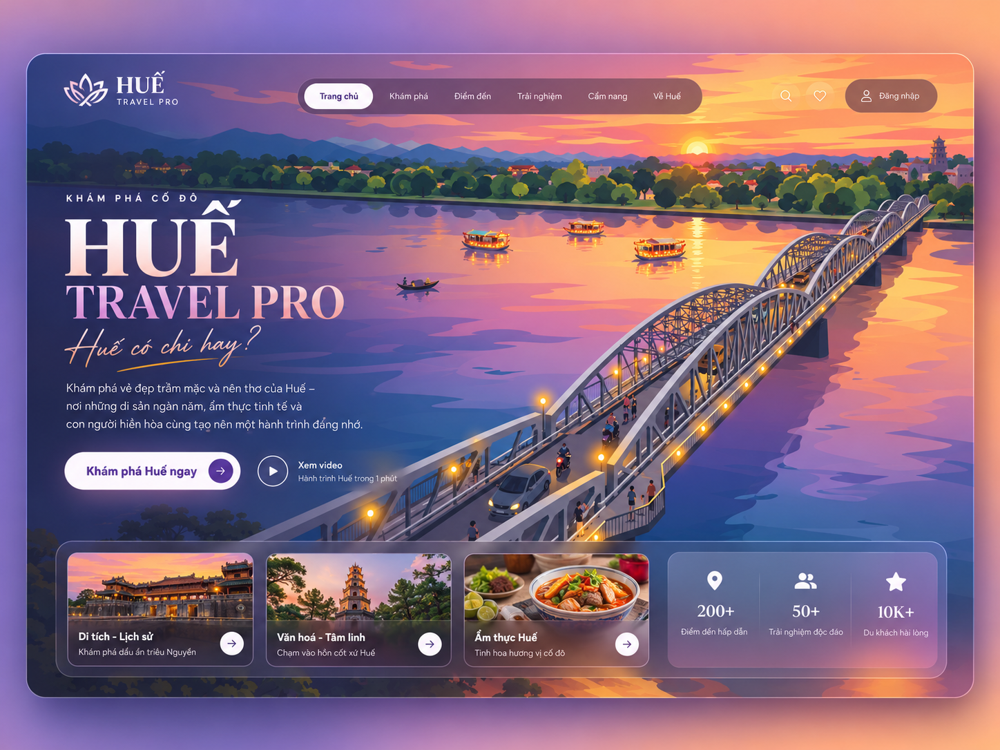
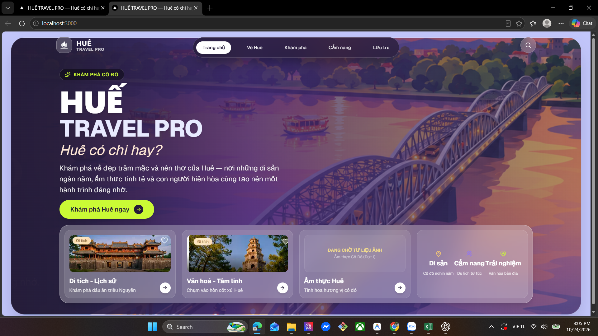

# GATE 07-01 — PHASE 1D — HOMEPAGE VISUAL FIDELITY COMPARISON

## 1. Project / Gate / Task ID

- Project: HUẾ TRAVEL PRO V2.3 — “Huế có chi hay?”
- Root: `A:\trí tuệ nhân tạo\BAI_3\hue-travel-pro`.
- Gate / Task: GATE-07-01 / PHASE1D-VISUAL-COMPARISON.
- Ngày thực hiện: 2026-10-24, Asia/Saigon.
- Chế độ: **READ ONLY — NO SOURCE MODIFICATION**.

## 2. Phạm vi Owner cấp phép

Đọc AGENTS.md và mã liên quan; đối chiếu ba ảnh Owner cung cấp; lập bảng sai lệch, ưu tiên P0/P1 và các quyết định cần Owner. Chỉ tạo báo cáo/evidence trong reports/codex. Không sửa source code, CSS, ảnh, logo, AGENTS.md hoặc database; không triển khai sửa chữa, không cài package.

Giữ concept navigation hiện tại, bốn mục đã duyệt và Home; không phục hồi menu cũ trong mockup, không thêm số liệu giả, video chưa có nội dung, chức năng yêu thích/đăng nhập giả. Giữ dữ liệu/logic hiện tại. Không ép toàn bộ nội dung vào một viewport nếu làm hỏng bố cục.

Yêu cầu mới là so sánh thị giác, không phải chạy lại Phase 1C hoặc tự mở khóa các file từng được phép sửa.

## 3. Executive Summary

**VERIFIED — website hiện tại chưa đạt mức tương đồng thị giác với mockup chính thức.** Các nhóm sai lệch lớn nhất là:

1. Logo cánh đặc trong ô vuông khác hình hoa sen nét mở Owner cung cấp; wordmark sans đậm cũng khác wordmark serif trong mockup.
2. Asset hero đã bị crop và còn mảnh chữ/UI raster. Gradient trái rất tối giúp giấu chữ nhưng mất độ sáng, chiều sâu và không gian trời/sông của mockup.
3. Typography hero chuyển từ serif thanh lịch + chữ viết tay sang sans rất đậm + sans nghiêng. HUẾ vẫn lớn nhất nhưng cảm giác thương hiệu và nhịp bố cục khác rõ.
4. Dock có nhiều lớp hộp và ảnh/caption tách rời; khối giá trị hiện tại bị dính chữ. Card ẩm thực thiếu ảnh đúng chủ đề.

Một số khác biệt là **quyết định sản phẩm hợp lệ cần giữ**, không phải lỗi phải sao chép lại: bốn mục navigation hiện tại, không có video giả, không có số đếm giả, card ẩm thực có placeholder trung thực. CTA lime khác mockup nhưng thuộc palette đã duyệt, cần Owner chọn mức ưu tiên giữa fidelity và accent hiện tại.

Đề xuất xử lý có giới hạn sau Owner duyệt: chuẩn hóa tài liệu logo và cảnh nền sạch trước; tiếp theo chỉ tinh chỉnh typography Trang chủ, crop/gradient, nhịp spacing, bề mặt dock và khối giá trị. Không có sửa chữa nào được thực hiện trong Phase 1D.

## 4. Công việc đã thực hiện và nguồn bằng chứng

Đã mở và nhìn trực tiếp cả ba ảnh Owner cung cấp, đọc các file Trang chủ/Shell/navigation/Button/Card/Container/font config liên quan, mở asset hero hiện tại để xác minh nguồn chữ sót, đọc metadata ảnh và sao chép evidence nguyên trạng.

| ID | Ảnh | Nguồn chính xác | Kích thước bitmap |
|---|---|---|---|
| E1 | Mockup chính thức | `A:\trí tuệ nhân tạo\BAI_3\HUE_TRAVEL_PRO_V2.3_5_MOCKUPS\01_TRANG_CHU.png` | 1448×1086 |
| E2 | Screenshot website Owner cung cấp | `C:\Users\CNG~1\AppData\Local\Temp\codex-clipboard-a767cfa0-5d93-462b-96f6-03d70162bc88.png` | 1920×1080, có browser chrome và taskbar |
| E3 | Logo hoa sen Owner chỉ định làm chuẩn | `A:\trí tuệ nhân tạo\BAI_3\hue-travel-pro\hoa sen.png` | 1254×1254, ARGB; alpha góc (0,0)=0 |

**Giới hạn so sánh:** E1 và E2 khác tỷ lệ khung, độ phân giải và phạm vi nội dung. Không so pixel tuyệt đối, không suy ra CSS viewport, zoom hoặc devicePixelRatio từ screenshot desktop 1920×1080. Thanh cuộn có trong E2 nhưng riêng ảnh không đủ xác định scrollHeight hay tái kết luận lỗi overflow. Các đánh giá vị trí/tỷ lệ bên dưới là quan sát tương đối trong landing panel, có đối chiếu mã; không phải phép đo runtime mới.

Ảnh E2 là screenshot do Owner cung cấp cho Phase 1D, không phải screenshot agent mới chụp. Không dùng ảnh Phase 1C thay cho trạng thái Owner đang yêu cầu so sánh. Không chấm phần trăm fidelity.

## 5. Bảng đối chiếu trực quan từng thành phần

Quy ước: **P0** = cản trở nhận diện/asset chính của bản phục hồi; **P1** = sai lệch bố cục/thẩm mỹ cần chỉnh có giới hạn. Mức ưu tiên này phục vụ kế hoạch, không tự mở khóa quyền sửa. VERIFIED chỉ có nghĩa đã nhìn thấy sai lệch hoặc đọc được quy tắc tương ứng; phương án sửa vẫn là đề xuất.

| Thành phần | Mockup gốc | Website hiện tại | Sai lệch | Cách khôi phục tối thiểu | File liên quan |
|---|---|---|---|---|---|
| Landing Panel và nền ngoài | Panel bo góc, viền sáng mảnh, nằm trong nền lavender–hồng–cam có khoảng thở rõ trên/dưới | Panel bo góc vẫn có; nền ngoài lavender phẳng, panel sát vùng header; khung hiển thị rộng và thấp hơn tương đối | **P1 / VERIFIED:** cấu trúc cơ bản được giữ nhưng thiếu không khí và khoảng thở của bản gốc. Khác tỷ lệ ảnh góp phần tạo cảm giác này | Giữ panel/bo góc; cân lại gutter và khoảng đệm theo viewport, cân nhắc nền ngoài chuyển sắc nhẹ sau Owner duyệt. Không bóp nội dung để cố vừa màn hình | `src/components/layout/Shell.tsx:24–27`; `src/app/page.tsx:21` |
| Vị trí và tỷ lệ khối Hero | Cụm chữ ở phần trái, bắt đầu thấp hơn header rõ rệt; còn nhiều mặt sông và trời; nội dung mang nhịp đọc nhẹ | Cụm chữ bắt đầu tương đối cao; mép trái chữ và dock lùi sâu vào panel; nội dung dày và CTA gần dock | **P1 / VERIFIED:** nhịp header → hero → dock bị nén, trục chữ lùi sâu hơn tham chiếu | Chỉnh padding/spacing riêng Trang chủ và chiều rộng khối mô tả; căn hero/dock theo một trục trái hợp lý. Cho phép panel nở/scroll tự nhiên nếu cần | `page.tsx:21,27–28,49,56,78`; `Container.tsx:24` (nguyên nhân padding lồng, không mặc nhiên phải sửa component chung) |
| Tiêu đề HUẾ | Serif tương phản nét rõ, màu trắng/ngà; là điểm nhấn lớn nhất | Chữ sans rất đậm, trắng; vẫn lớn nhất nhưng khối chữ nặng và khác bản sắc | **P1 / VERIFIED:** khác nhóm chữ và tỷ lệ thị giác. `font-serif` đang trỏ Segoe UI trước Georgia nên tên class không bảo đảm ra serif trên Windows | Chỉ chọn font serif hỗ trợ tiếng Việt cho heading Trang chủ sau khi Owner chốt; giữ HUẾ lớn nhất. Không đổi font toàn site hoặc mở comprehensive font audit | `page.tsx:37`; `tailwind.config.ts:27–29` |
| TRAVEL PRO | Serif, màu hồng/ngà chuyển sắc hoặc sắc độ mềm, khoảng chữ thoáng | Sans đậm, màu gần trắng tím, khối chữ chắc | **P1 / VERIFIED:** khác serif/sans, màu và nhịp nét; font chính xác của mockup **NOT VERIFIED** | Áp dụng cùng hướng serif của HUẾ cho riêng dòng này, tinh chỉnh weight/size/tracking/màu tại Trang chủ; không đoán tên font gốc | `page.tsx:40–42`; `src/app/layout.tsx:7–10,25` (nguồn sans, chưa đề xuất sửa toàn cục) |
| “Huế có chi hay?” | Chữ viết tay nét mảnh, sắc đào, có nét gạch vàng trang trí | Sans nghiêng thông thường, màu kem; thiếu cảm giác bút viết và nét gạch | **P1 / VERIFIED:** italic không thay thế được script/handwriting | Owner chọn hướng script hỗ trợ tiếng Việt và có/không phục hồi nét gạch; giới hạn vào một tagline. Chưa chọn font hoặc tạo asset mới | `page.tsx:43–45` |
| Badge và mô tả | “KHÁM PHÁ CỐ ĐÔ” là dòng chữ thưa nét, không có hộp pill; mô tả nhỏ, nhẹ | Badge lime có nền đen/viền và icon; mô tả lớn, trắng, chiếm bề ngang hơn | **P1 / VERIFIED:** badge và khối chữ cạnh tranh với cảnh; mô tả không bị cắt nhưng nặng hơn mẫu | Hạ độ nặng badge, cân lại tracking/weight và max-width mô tả; giữ nguyên nội dung và khả năng đọc, không line-clamp hero | `page.tsx:30–32,49–52` |
| Cầu Trường Tiền và crop | Cảnh đầy đủ hơn, có dải trời hoàng hôn, đồi, đường chân trời và cầu chạy chéo vào tiền cảnh | Cùng hướng cảnh cầu nhưng crop gần hơn, gần như mất phần trời; phần cầu lớn và bị dock che đáng kể | **P0 cho nguồn cảnh / P1 cho crop — VERIFIED:** asset hiện tại là mảnh crop có sẵn chữ/UI; bg-cover ở panel rộng tiếp tục đổi phần cảnh thấy được | **NEEDS CLEAN HERO ASSET:** cần cảnh gốc sạch UI, đủ vùng trời/sông để crop responsive. Sau đó mới chỉnh position/size; không dùng toàn mockup có chữ/menu làm background, không tái tạo ảnh trong nhiệm vụ này | `public/images/heroes/hero_trang_chu.png`; `page.tsx:21–23` |
| Gradient và chữ mờ | Sáng, nhiều cam/hồng ở phải, tím/xanh trái; cảnh và chữ cùng rõ; không có chữ thừa | Overlay tím/đen đậm, cảnh chìm hơn; vẫn thấy mảnh chữ rất mờ bên trái dưới dock và dấu vết khung cũ | **P0 / VERIFIED:** nguồn ảnh bẩn, gradient chỉ che bớt; không phải lỗi có thể giải quyết sạch chỉ bằng tăng opacity | Chốt asset sạch trước rồi giảm overlay đến mức đủ đọc chữ, giữ ánh hoàng hôn và cầu. Không tiếp tục làm tối toàn cảnh để giấu chữ | `page.tsx:23`; `public/images/heroes/hero_trang_chu.png` |
| Vị trí navigation và header | Capsule nằm trong panel với khoảng đệm phía trên, logo và nút phải cân cùng hàng | Concept capsule được giữ; tên mục đúng sản phẩm hiện tại. Capsule và logo gần như chạm mép trên panel, search đứng phía phải | **P1 / VERIFIED:** sai lệch là khoảng đệm/căn hàng; **khác nhãn menu không phải lỗi cần phục hồi** | Giữ Home + Về Huế / Khám phá / Cẩm nang / Lưu trú, route và morph. Chỉ đề xuất căn inset/header sau khi Owner cấp ngoại lệ riêng cho file navigation; không đổi animation hoặc phục hồi menu cũ | `AdaptiveNavigation.tsx:64–99,240–254,284–293`; `Shell.tsx:27` |
| CTA chính | Pill trắng/ngà, chữ tím, mũi tên trong vòng tím; có thêm video trong mockup | Pill Electric Lime, chữ tối, vòng mũi tên tối; không video | **P1 / VERIFIED + OWNER DECISION:** khác màu/style; lime thuộc palette đã duyệt. Không có video là quyết định đúng cần giữ | Owner chọn giữ lime hay phục hồi CTA sáng/tím riêng Trang chủ. Giữ tên/link/khả năng nhấn; không sửa Button dùng chung nếu có thể override cục bộ; không thêm video giả | `page.tsx:55–71`; `Button.tsx:22,30–31` |
| Dock tổng thể | Một dải glass mảnh; ba card tương đối rộng, khối cuối rộng hơn một card; viền/độ mờ nhẹ | Dock glass dày hơn; bốn cột bằng nhau; nhiều lớp dock → card → ảnh tạo cảm giác các hộp lồng | **P1 / VERIFIED:** tỷ lệ cột và bề mặt không giống mẫu, hơi nặng | Cân lại tỷ lệ ba card/khối cuối; giảm các lớp nền/viền và padding dư trên desktop; giữ responsive, text và href. Không kéo thấp dock đến mức che caption | `page.tsx:78–85,116,147,173`; `Card.tsx:17,22` (nguồn styles chung; ưu tiên chỉnh nơi gọi) |
| Card Di tích và Văn hoá | Ảnh có không khí chiều/hoàng hôn; caption trên nền tối sát/phủ phần đáy ảnh; không có nhãn danh mục/heart nằm trong ảnh | Ảnh ban ngày; caption là vùng tách dưới; ảnh có nhãn “Di tích” và hình heart nhìn thấy trong bitmap | **P1 / VERIFIED:** sai khác ánh sáng, crop, cấu trúc caption và UI raster trong ảnh. Không coi heart raster là chức năng thật | Dùng ảnh đúng chủ đề, sạch UI và cùng mood nếu Owner cung cấp; tinh chỉnh bố cục caption gần mẫu, giữ đầy đủ chữ và nút. Không thêm chức năng yêu thích | `page.tsx:85–109,116–140`; `public/images/cards/card_dai_noi.png`, `card_thien_mu.png` |
| Card Ẩm thực | Ảnh món ăn Huế tạo điểm màu ấm | Placeholder “ĐANG CHỜ TƯ LIỆU ẢNH / Ẩm thực Cố Đô (Đợt 1)” | **P0 về độ hoàn chỉnh asset / VERIFIED:** thiếu ảnh chuẩn; placeholder hiện tại trung thực, không phải lỗi logic | **NEEDS ASSET:** Owner cấp ảnh món ăn đúng chủ đề và quyền dùng. Giữ placeholder cho tới khi có ảnh; không gắn ảnh sai hoặc tự tạo tư liệu | `page.tsx:143–169` |
| Khối thống kê / giá trị | Ba icon trắng, số lớn và nhãn nhỏ; cột có khoảng cách/đường chia thoáng | Giữ nội dung phi định lượng Di sản / Cẩm nang / Trải nghiệm; icon nhiều màu nhỏ, tiêu đề nặng và dính nhau (“Cẩm nangTrải nghiệm”) | **P1 / VERIFIED:** lỗi thị giác là phân bố/spacing/weight. Việc bỏ số giả là đúng và LOCKED | Giữ nội dung phi định lượng; bố trí 3 ô bằng nhau, gap/padding đủ, chữ nhỏ hơn vừa phải, đường chia nhẹ; không nhập 200+/50+/10K+ hoặc số mới | `page.tsx:172–195` |
| Spacing và khoảng trống | Header có vùng trời đỡ phía sau; hero → CTA → dock có nhịp rõ; dock còn khoảng thở đến đáy panel | Phía trên hero sát hơn; CTA → dock hẹp; các lớp padding lồng khiến lề trong rộng, phần trên/ảnh lại bị nén | **P1 / VERIFIED:** tỷ lệ khoảng trống khác; không thể kết luận chỉ cần giảm/tăng một padding là khớp mọi viewport | Cân khoảng trống theo tỷ lệ cảnh và font đã chốt; kiểm lại desktop thấp và mobile sau sửa. Chấp nhận cuộn tự nhiên khi không đủ chỗ, không giảm chữ cực đoan để đạt One-Screen | `page.tsx:21,27–28,56,78–80`; `Shell.tsx:27`; `Container.tsx:24` |
| Logo: hình dạng | Logo mockup là hoa sen nét mở, có chuyển động ở phần đế; E3 cũng là hoa sen đường viền/cánh mở | Biểu tượng cánh đặc trên đế, đặt trong ô vuông glass; không dùng hình E3 | **P0 / VERIFIED:** sai silhouette và cách đặt biểu tượng | Dùng chính hình chuẩn Owner xác nhận; không thay bằng logo AI, không tự vẽ lại hoặc thiết kế logo mới. Cần ngoại lệ riêng trước khi sửa file navigation/asset | `AdaptiveNavigation.tsx:254–272`; `hoa sen.png` |
| Logo: kích thước và tỷ lệ | Icon tương đối lớn, đứng tự do cạnh wordmark; E3 có nhiều khoảng trống quanh nét sen | Box 40×40 CSS px, SVG 24×24 CSS px, gap 12 CSS px theo source; nhìn nhỏ và bị đóng khung so với mockup | **P1 / VERIFIED:** box/ink/wordmark mất tỷ lệ; pixel screenshot không đồng nhất CSS px | Căn theo vùng nét nhìn thấy của E3, không theo toàn canvas 1254×1254; chốt tỷ lệ icon/wordmark và bỏ/giữ ô nền theo Owner, không tự crop/cleanup file trong Phase 1D | `AdaptiveNavigation.tsx:252–256`; `hoa sen.png` |
| Logo: màu và chất lượng nguồn | Mockup dùng trắng/ngà; E3 do Owner cung cấp có nét hồng nhạt, khoảng trong suốt và một số viền/đốm sáng nhìn thấy | Icon trắng, hộp xám tím có viền | **P0 cần chốt chuẩn / VERIFIED về màu, NOT VERIFIED về nguồn gốc kỹ thuật:** hai tham chiếu khác màu; chưa phải quyền tự đổi màu | E3 là tham chiếu hình dạng theo chỉ định Owner mới nhất. Owner chốt giữ hồng hay dùng bản trắng/ngà chuẩn, và cung cấp bản sạch nếu cần; không suy ra logo AI chỉ từ màu hồng | `hoa sen.png`; `AdaptiveNavigation.tsx:254–256` |
| Wordmark và khoảng cách logo–chữ | HUẾ serif, TRAVEL PRO nhỏ, tracking thoáng; E3 là icon riêng, không có wordmark để đo | HUẾ sans bold 18 CSS px, Travel Pro 10 CSS px uppercase, icon–chữ gap 12 CSS px theo source | **P1 / VERIFIED:** khác serif/weight/tracking và tương quan icon/chữ; font gốc chính xác NOT VERIFIED | Chốt lockup từ hình sen gốc + wordmark theo mockup; cân baseline và khoảng cách riêng header. Không đổi tên thương hiệu, không dùng text raster từ mockup để giả logo | `AdaptiveNavigation.tsx:252,274–280` |

Tên file viết tắt trong bảng thuộc `src/app/`, `src/components/layout/`, `src/components/navigation/`, `src/components/common/` như tên component tương ứng. Mọi file được nêu là nơi liên quan để Owner xét quyền sửa sau này, **không phải allowlist triển khai hiện tại**.

## 6. Root Cause — phần xác minh được và phần còn nghi ngờ

**VERIFIED qua source và ảnh:**

- `font-serif` được khai báo bắt đầu bằng `'Segoe UI'`, không phải một serif thực thụ trên Windows. TRAVEL PRO và slogan dùng `font-sans`; body dùng Geist local. Giải thích trực tiếp vì sao hình chữ khác tham chiếu, nhưng không xác minh được tên font gốc từ bitmap.
- `bg-cover bg-right-top` trên một ảnh hero đã crop và có chữ/UI cũ tạo crop khác; gradient đậm không thể xóa cấu trúc raster mà chỉ giảm tương phản. Đã nhìn asset trực tiếp, không chỉ suy đoán từ screenshot.
- Landing/Shell và Container đều có padding; hero/dock còn max-width riêng, gây lề trong sâu hơn panel. Có thể giải thích trục trái quan sát được, chưa đo CSS viewport E2.
- Header/nav là fixed theo viewport, `top:16px` cho capsule; panel desktop bắt đầu sau padding Shell 16px. Vì vậy nav gần như ngang mép panel thay vì có inset như mockup. Không đề xuất đổi concept fixed/morph để sửa thẩm mỹ.
- Dock dùng grid 4 cột bằng nhau; khối cuối dùng flex justify-around nhưng không có gap/ô chữ có phân bổ chiều rộng rõ, làm nhãn dài sát nhau. CTA dùng variant accent có màu lime, khác nút sáng/tím trong mockup.
- Logo website là SVG path riêng trong hộp, không phải file hoa sen Owner cung cấp.

**LIKELY / NOT VERIFIED:** tỷ lệ khung và zoom/scaling của E2 góp phần làm các chữ/khối có kích thước khác cảm nhận; chưa có thông số runtime đồng thời với E2 để định lượng. Không khẳng định screenshot E2 là đúng viewport Phase 1C đã đo. Không kết luận mọi phần mất trời có thể phục hồi bằng background-position khi source crop không còn chứa phần trời đó.

## 7. Ưu tiên và các điểm cần Owner quyết định

### P0 — chuẩn nhận diện và asset trước khi tinh chỉnh

1. **Logo đúng:** xác nhận lockup dùng E3 làm hình chuẩn, bản màu hồng hay trắng/ngà, có/không ô nền, và bản sạch được phép dùng. E3 hiện có transparency ở góc; không được gọi nền đen hiển thị trong trình xem là nền đen đặc. Chưa kiểm toàn bộ alpha mask hoặc chứng nhận asset sạch.
2. **Hero sạch:** cần cảnh gốc không chữ, không dock/menu raster, đủ không gian crop. NEEDS CLEAN HERO ASSET; không chỉ làm tối thêm.
3. **Ảnh ẩm thực đúng chủ đề:** NEEDS ASSET. Có thể Owner chấp nhận DEFERRED cho demo; không thay bằng nội dung giả.

### P1 — phục hồi Trang chủ có giới hạn

Typography HUẾ/TRAVEL PRO/tagline, crop/gradient sau khi có ảnh sạch, khoảng thở header/hero, bố cục card/dock, khối giá trị và lockup logo. Không comprehensive font audit hoặc chỉnh bốn trang con.

### Quyết định Owner cần chốt trước triển khai

| ID | Cần quyết định | Đề xuất có giới hạn |
|---|---|---|
| OD-1D-01 | Màu/bản master logo và wordmark | Giữ hình sen E3 theo yêu cầu mới; chốt bản trắng/ngà gần mockup hay hồng gốc, chất lượng nguồn và tỷ lệ lockup. Việc chỉ định tham chiếu không tự cấp quyền sửa logo |
| OD-1D-02 | Nguồn hero sạch và ảnh món ăn | Cung cấp/duyệt asset sạch trước; giữ placeholder đúng sự thật khi còn thiếu |
| OD-1D-03 | Hướng typography Trang chủ | Chốt serif + script/handwriting hay phương án gần nhất hỗ trợ tiếng Việt; duyệt font trước, không mặc nhiên thay cấu hình font toàn site |
| OD-1D-04 | CTA lime hay trắng/tím | Nếu ưu tiên fidelity, cân nhắc variant cục bộ sáng/tím; nếu giữ accent lime, ghi rõ đây là sai khác được chấp nhận |
| OD-1D-05 | Mức sửa vị trí header và file được mở khóa | Chỉ căn khoảng đệm/logo/nav mà giữ concept, route và morph; phải nêu rõ ngoại lệ cho AdaptiveNavigation hoặc file liên quan |
| OD-1D-06 | Thứ tự ưu tiên hình thức so với One-Screen | Theo yêu cầu hiện tại: giữ thẩm mỹ và cỡ chữ dễ đọc, cho phép cuộn tự nhiên khi cần; không ép tất cả vào một viewport. Không tự gán thêm breakpoint hoặc sửa code |

Không yêu cầu Owner quyết định lại những điều đã rõ: giữ bốn mục hiện tại, không phục hồi menu cũ, không số giả/video giả, không thay dữ liệu/logic.

## 8. Kết quả kiểm tra

| Nhóm | Trạng thái Phase 1D | Giới hạn |
|---|---|---|
| Đọc AGENTS.md và source liên quan | PASS | Chỉ đọc, không sửa |
| Đối chiếu E1/E2/E3 | ĐÃ THỰC HIỆN — fidelity còn FAIL/PENDING OWNER REVIEW | Nhìn trực tiếp bitmap và đối chiếu source; không phải pixel-match cùng viewport |
| Evidence | PASS | Ba bản sao nguyên trạng, kiểm SHA-256 khớp nguồn; không tạo ảnh giả |
| Typecheck | NOT TESTED | Không chạy lại trong nhiệm vụ READ-ONLY này |
| Lint | NOT TESTED | Không chạy lại |
| Build | NOT TESTED | Không chạy build |
| Runtime Tests / console | NOT TESTED | Không mở/điều khiển browser hoặc chạy lại navigation/search trong Phase 1D |
| Visual Tests nhiều viewport | NOT TESTED mới | So sánh screenshot Owner cung cấp, không tái sử dụng PASS của Phase 1C làm kết quả mới |

Cảnh báo React của Phase 1C không được kiểm lại trong Phase 1D; không tuyên bố đã hết. Screenshot E2 có thanh cuộn nhưng chưa xác minh đây là cuộn thừa hay cuộn cần thiết. Không coi thiếu chức năng video/số đếm là lỗi cần thêm.

## 9. File thay đổi / Phạm vi diff

**READ-ONLY / NO SOURCE MODIFICATION.** Không sửa source, CSS, ảnh gốc, logo gốc, AGENTS.md, cấu hình, dữ liệu hoặc database.

Chỉ tạo:

- `reports/codex/GATE-07-01-PHASE1D-VISUAL-COMPARISON-REPORT.md` — báo cáo này.
- `reports/codex/evidence/GATE-07-01-PHASE1D-owner-mockup.png` — bản sao E1.
- `reports/codex/evidence/GATE-07-01-PHASE1D-owner-website.png` — bản sao E2.
- `reports/codex/evidence/GATE-07-01-PHASE1D-owner-lotus.png` — bản sao E3.
- `reports/codex/evidence/GATE-07-01-PHASE1D-evidence-manifest.csv` — nguồn/hash ba ảnh.
- `reports/codex/evidence/GATE-07-01-PHASE1D-readonly-baseline.csv` — hash 54 file được bảo toàn để đối chiếu cuối nhiệm vụ.

Baseline gồm toàn bộ src/public, AGENTS.md, hoa sen.png và các file cấu hình/package đã liệt kê trong manifest. Không có source diff do agent tạo; đây không phải tuyên bố Git working tree sạch. Không kiểm hoặc thay database.

## 10. Evidence đính kèm và provenance

### E1 — Mockup chính thức Owner cung cấp

SHA-256: `45364FC2F7830FF1E8C146883420B45E82F9BE746B18FC3D4B4794C8AA2EA68D`.

### E2 — Screenshot website Owner cung cấp

SHA-256: `A2398F0AC217E503641FF80C32A8E31245001AE942C916F161382E49B9A48C76`.

### E3 — Hình hoa sen Owner chỉ định

SHA-256: `6E53DD205EDE658EBCAEBAED45632A1E5613C8D01E141B22172F597EB6112B9D`.

E3 không kèm wordmark. Theo chỉ định mới nhất của Owner, E3 được dùng làm tham chiếu hình dạng; không tự suy luận E3 là logo AI chỉ vì màu hồng. Quy định không dùng logo AI thử vẫn giữ nguyên; không có quyền thay hoặc tái tạo logo trong nhiệm vụ này. Chưa xác minh lịch sử tạo file; màu/variant khi dùng trên website vẫn cần Owner chốt nếu muốn giống E1.

Asset hero đang dùng cũng đã được mở để kiểm tra trực tiếp tại `public/images/heroes/hero_trang_chu.png`; không sao chép/chỉnh sửa nó thành asset mới. Báo cáo không bao gồm screenshot browser do agent chụp mới: **NOT CAPTURED — không cần cho phạm vi so sánh ba ảnh Owner cung cấp**.

## 11. Những vấn đề chưa giải quyết / Đề xuất bước tiếp theo

Các sai lệch trong bảng chưa được sửa. Chưa có font master, logo variant được chốt cho website, hero sạch hoặc ảnh ẩm thực. Chưa có so sánh cùng viewport/zoom, runtime validation hoặc nghiệm thu cuối của Owner.

Owner duyệt P0/P1 và OD-1D-01…06, sau đó mới giao một đợt sửa nhỏ với file allowlist và loại thay đổi cụ thể. Ưu tiên asset/nhận diện trước rồi chỉnh một lượt Trang chủ; không mở rộng typography/nav toàn site. Khi có sửa cần kiểm lại desktop thấp, desktop rộng và mobile; đây là đề xuất tương lai, không phải kết quả đã thực hiện.

## 12. Trạng thái nghiệm thu đề xuất

**COMPARISON COMPLETE — AWAIT OWNER REVIEW.** Website còn sai lệch rõ về logo, typography, cảnh và dock; chưa đề xuất PASS visual fidelity. Các khác biệt sản phẩm đã duyệt phải được giữ, không dùng mockup để ghi đè quyết định Owner.

## 13. HARD STOP — AWAIT OWNER REVIEW

**PASS = LOCK — FIX ONLY WHAT FAILED — NO SCOPE CREEP.**

**STOP — AWAIT OWNER REVIEW.**
