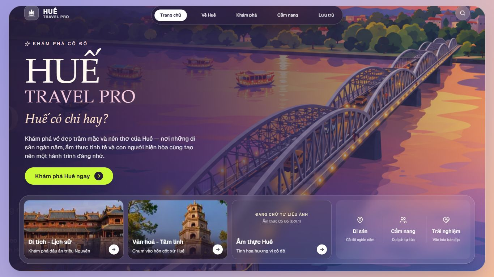
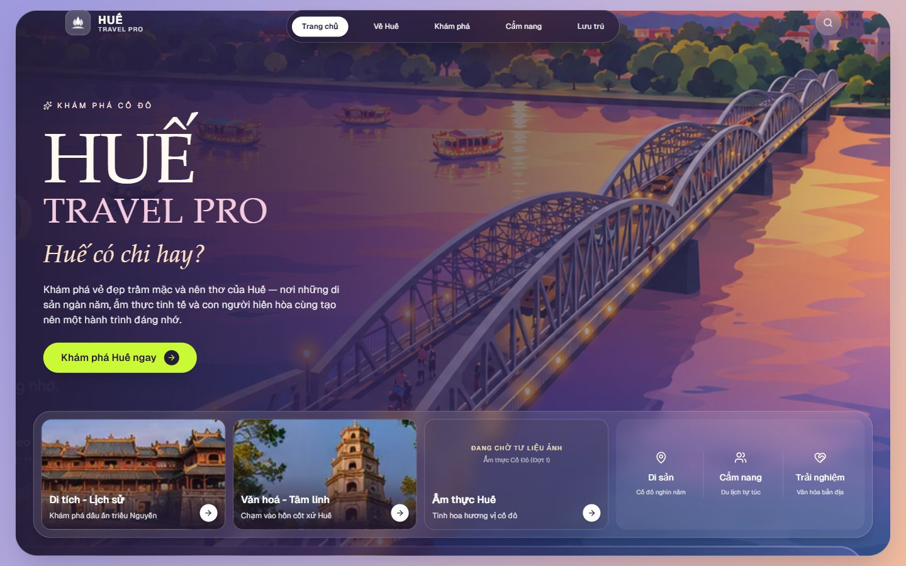
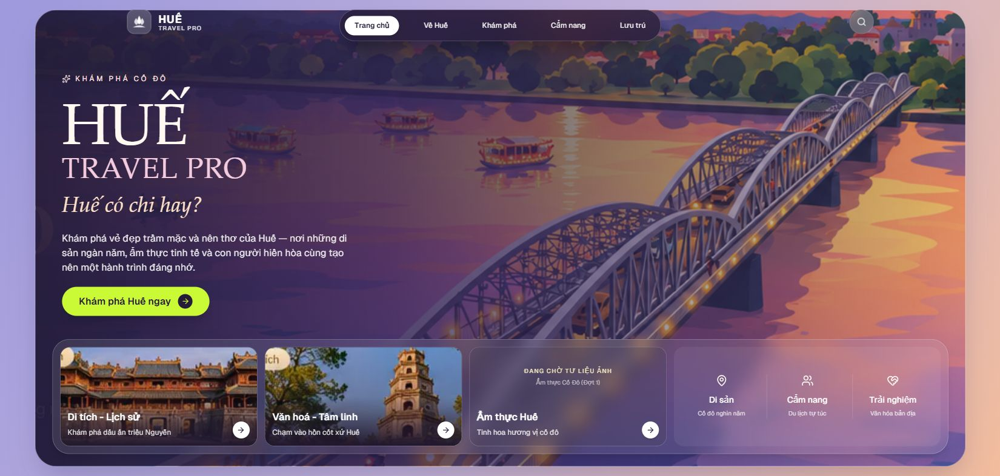
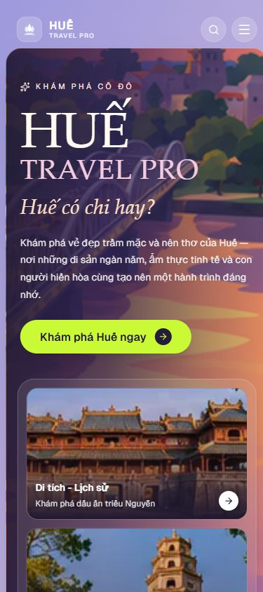

# GATE 07-01 — PHASE 1E — HOMEPAGE VISUAL RESTORATION REPORT

**Project:** HUẾ TRAVEL PRO V2.3 — “Huế có chi hay?”  
**Gate / Task ID:** GATE-07-01 / PHASE1E-HOMEPAGE-VISUAL-RESTORATION  
**Ngày:** 2026-10-24, Asia/Saigon  
**Project root:** `A:\trí tuệ nhân tạo\BAI_3\hue-travel-pro`  
**Mode:** STUDENT PROJECT — DEMO FIRST / OWNER APPROVED — SCOPED IMPLEMENTATION

## 1. Executive Summary

Đã triển khai phần phục hồi Trang chủ trong đúng hai file được cấp phép: `src/app/page.tsx` và `src/components/layout/Shell.tsx`.

- HUẾ / TRAVEL PRO dùng serif Palatino Linotype có sẵn, weight 400; tagline dùng serif italic có glyph Việt phù hợp, không dùng sans nghiêng nặng như trước.
- Hero bớt padding lồng, badge nhẹ hơn, mô tả giữ nguyên và không clamp; CTA giữ nguyên lime, kích thước nhấn và href.
- Dock còn một lớp glass chính; caption phủ đáy ảnh, khối giá trị rộng hơn và ba cột có khoảng cách rõ. Ảnh Di tích/Thiên Mụ chỉ đổi crop hiển thị, không sửa pixel. Ẩm thực vẫn NEEDS ASSET.
- Browser thực đo đúng 1366×768, 1440×900, 1650×786: không cuộn thừa, nội dung/card/CTA nằm trong viewport. Mobile 390×844 cuộn tự nhiên, không tràn ngang.
- 11 trường hợp tương tác PASS; typecheck/lint PASS. Console sau thử chỉ có cùng 1 warning đã ghi nhận trước sửa, không có bản ghi mới trong lượt kiểm tra.

**Chưa hoàn thành và không được khai báo đã hoàn thành:** hero sạch — NEEDS CLEAN HERO ASSET; font script giống mockup — NEEDS FONT APPROVAL; logo — chỉ chuẩn bị HTML preview, chưa tích hợp và chưa chụp xác minh do browser chặn file://, **NEEDS OWNER LOGO REVIEW**.

Trạng thái: **SCOPED IMPLEMENTATION COMPLETE — PENDING OWNER VISUAL ACCEPTANCE**. Không đánh PASS fidelity toàn bộ hoặc 100% mockup.

## 2. Owner Authorization / Phạm vi và công việc đã thực hiện

Đọc AGENTS.md, yêu cầu Phase 1E trong tệp đính kèm Owner, [báo cáo Phase 1C](GATE-07-01-PHASE1C-TARGETED-FIX-REPORT.md), [báo cáo Phase 1D](GATE-07-01-PHASE1D-VISUAL-COMPARISON-REPORT.md), mockup gốc và `hoa sen.png`.

Lệnh Phase 1E mới nhất cấp ngoại lệ chỉ cho page.tsx và nhánh landing của Shell.tsx. Các quy định READ-ONLY cũ không được dùng để phủ nhận ngoại lệ này; cũng không mở rộng quyền sang file khác. Logo/navigation và ảnh vẫn chưa được phép tích hợp/thay thế.

Đã thực hiện: kiểm tra Git, lưu checkpoint và baseline SHA-256 trước sửa; kiểm tra font cài sẵn và glyph; khảo sát ảnh dự án; sửa hai file; chuẩn bị logo preview độc lập; chạy typecheck/lint; đo và chụp browser; bấm kiểm thử navigation/search; đối chiếu trực tiếp mockup và screenshot cùng 1448×1086; xuất diff/checksum/báo cáo.

Không cài package/font, không dùng CDN, không tải asset, không sửa dữ liệu/database, logo hoặc navigation, không đổi route/logic, không deploy, không chuyển Phase 2. Không phát sinh chức năng video, số liệu giả hoặc menu cũ.

## 3. Changed Files

| File source | Phạm vi thay đổi |
|---|---|
| `src/app/page.tsx:19–86` | Font cục bộ cho ba dòng hero; spacing/padding, badge, mô tả; gradient; thay wrapper Container/Card bằng div với style riêng Home để bỏ padding/glass lồng. Giữ min-height tự nhiên và ngân sách desktop đã sửa. |
| `src/app/page.tsx:89–176` | Bố cục ba card với ảnh tuyệt đối ở nền và caption phía đáy; crop/object-position/scale CSS, overlay và khoảng cách; placeholder ẩm thực tinh tế hơn nhưng trung thực. |
| `src/app/page.tsx:179–201` | Khối giá trị thành grid ba cột có gap, chữ nhẹ và icon căn giữa; giữ nội dung phi định lượng. |
| `src/components/layout/Shell.tsx:27` | Chỉ thêm background gradient nhẹ ở nhánh landing, giữ gutter/padding, nhánh sidebar và logic transition như trước. |

Các component chung Card, Button, Container, Header, AdaptiveNavigation, font config, RootLayout và các trang con **không sửa**. Việc bỏ import/wrapper Card/Container trong page.tsx là thay đổi trình bày cục bộ, không sửa component chung.

Ngoài source: chỉ tạo báo cáo này, checkpoint/diff/manifests trong `reports/codex/backup/GATE-07-01-PHASE1E-20261024-01/` và evidence/preview/QA trong `reports/codex/evidence/`. Không ghi đè báo cáo các phase trước.

## 4. Typography Changes

### Root cause và font đã áp dụng

Font-serif cũ ưu tiên Segoe UI trong tailwind.config.ts; TRAVEL PRO và tagline dùng sans. Không sửa cấu hình chung. Thay riêng ba dòng hero bằng inline stack:

```css
font-family: "Palatino Linotype", "Times New Roman", serif;
font-weight: 400;
```

Palatino và Times New Roman regular/italic có sẵn trên máy. Đã đọc bảng cmap của TTF để kiểm tra các chuỗi đang dùng; không chỉ dựa vào tên font. [Kết quả font/glyph](evidence/GATE-07-01-PHASE1E-font-verification.json):

- Georgia regular/italic, Segoe Script và Segoe Print cài sẵn thiếu “Ế/ế” trong chuỗi kiểm tra, nên không dùng làm font chính.
- Palatino regular/italic và Times New Roman regular/italic không thiếu glyph trong `HUẾ TRAVEL PRO Huế có chi hay? Khám phá cố đô`.
- Kết quả chỉ xác nhận các chuỗi và font phiên bản trên máy này, không phải chứng nhận mọi Unicode hoặc mọi hệ điều hành.

### Kích thước và phân cấp

| Trạng thái | HUẾ | TRAVEL PRO | Tagline |
|---|---:|---:|---:|
| Desktop cao >820 px | 112 px | 56 px | 40 px italic |
| Desktop ≤820 px | 96 px | 48 px | 36 px italic |
| Mobile 390×844 | 72 px | 40 px | 30 px italic |

HUẾ trắng/ngà là lớn nhất; TRAVEL PRO hồng nhạt, tracking nhẹ; tagline sắc đào. Không kéo méo chữ. Mô tả giữ đủ nội dung, weight 400, max-width 496 px desktop, không line-clamp. Font UI/CTA không đổi toàn site.

**NEEDS FONT APPROVAL:** chưa tìm được script cài sẵn vừa phù hợp hình thức vừa có glyph đang dùng; Palatino italic là phương án gần nhất đã triển khai trong Home, chưa phải handwriting chính xác của mockup. Không tải font mới.

## 5. Hero & Dock Changes / Root Cause & Applied Fixes

### Hero

Trước: padding lồng Shell → panel → Container, chữ sans nặng và badge pill; cảnh bị overlay đậm. Sau: bỏ padding wrapper chung dư, hero có max-width riêng, badge chữ thưa nhẹ, serif lớn và khoảng thở rõ hơn trước mô tả/CTA.

Giữ cùng URL `hero_trang_chu.png`. Overlay giảm độ đậm phía phải (alpha 0.12 ở 100%, trước 0.35), trái alpha 0.94 cho khả năng đọc; không làm tối thêm toàn cảnh để giấu chữ. Chữ/UI raster vì thế **vẫn nhìn thấy ở một số vùng**, không tuyên bố đã xóa. Cần asset sạch để phục hồi trời/đường chân trời và crop chính xác.

Shell chỉ thêm nền ngoài lavender–hồng–cam nhẹ, gợi mockup; không đổi navigation/header đang LOCKED. CTA vẫn #CAFA35 — browser xác nhận `rgb(202,250,53)` — cùng variant accent, nội dung và href `/kham-pha`.

### Dock và card

Trước: dock glass + card glass + ảnh trong hộp riêng, bốn cột bằng nhau, nhãn giá trị dính. Sau:

- Một glass dock chính, padding 12 px, ba card tỷ lệ 1:1:1 và khối cuối 1.35.
- Caption và mũi tên nằm trên vùng đáy tối của ảnh; ảnh object-cover không kéo méo, không sửa file.
- Crop cuối dùng object-right-bottom, scale 1.5, hover 1.55. Chủ đề/URL/alt ảnh giữ nguyên. Cách này giảm mép trắng/UI nhưng không bảo đảm xóa mọi mảnh UI ở mọi chiều rộng; có đánh đổi crop gần hơn/độ nét do ảnh nguồn nhỏ.
- Placeholder ẩm thực vẫn ghi rõ ảnh chưa sẵn sàng, giữ cấu trúc card và href.
- Giá trị giữ nguyên “Di sản / Cẩm nang / Trải nghiệm” và các mô tả; dùng grid 3 cột, gap 8 px, font 14 px medium, icon ngà 20 px, đường chia nhẹ. Không thêm số đếm.

Panel vẫn height auto + min-height; không cố định chiều cao để cắt nội dung. Overflow-hidden chỉ giữ bo góc nền/ảnh. Caption/heading/description nằm trong panel và hiển thị đủ; scrollHeight lớn hơn clientHeight của riêng card ảnh có thể đến từ ảnh scale được crop có chủ ý, không phải caption bị giấu. Ở 1366×600 panel tự nở và trang cuộn đến 765 px thay vì cắt dock.

## 6. Mockup Before / After Comparison

### Bằng chứng và phương pháp

- Mockup chuẩn: `A:\trí tuệ nhân tạo\BAI_3\HUE_TRAVEL_PRO_V2.3_5_MOCKUPS\01_TRANG_CHU.png`, 1448×1086.
- [Ảnh source được giữ nguyên tại evidence Phase 1D](evidence/GATE-07-01-PHASE1D-owner-mockup.png).
- [Baseline mới chụp trước Phase 1E](evidence/GATE-07-01-PHASE1E-before-runtime.jpg): bitmap 1264×744, CSS viewport đồng thời chưa ghi; chỉ dùng so sánh định tính.
- [Ảnh sau sửa bổ sung](evidence/GATE-07-01-PHASE1E-after-runtime-reference.jpg): phép thử viewport 1264×744 phát sinh cuộn tự nhiên, bitmap khoảng 1248×764; không dùng cặp này để tuyên bố pixel-match hoặc One-Screen.
- [So sánh sau sửa cùng kích thước mockup](evidence/GATE-07-01-PHASE1E-1448x1086-comparison.jpg): thực đo CSS viewport và bitmap đều 1448×1086, DPR khoảng 1, scrollY=0. Đã mở source và ảnh render cùng lượt xem để đánh giá; không tạo screenshot giả hoặc ảnh nền lấy nguyên mockup.

| Thành phần | Trước Phase 1E | Sau Phase 1E | So với mockup / trạng thái |
|---|---|---|---|
| HUẾ / TRAVEL PRO | Sans nặng | Serif thanh, 400, ngà/hồng | Gần ngôn ngữ gốc hơn; chưa xác định font gốc chính xác |
| Tagline | Sans nghiêng | Serif italic, mềm hơn, đủ dấu | NEEDS FONT APPROVAL cho hướng handwriting |
| Badge / mô tả | Pill đen/lime, nội dung nặng | Chữ thưa nhẹ, mô tả giữ đủ và bớt nặng | Nhịp gần mẫu hơn |
| Hero / cảnh | Tối và crop lớn, còn UI raster | Cảnh phải sáng hơn, khối chữ nhẹ và trục trái bớt lùi | Chưa khôi phục phần trời do asset thiếu; NEEDS CLEAN HERO ASSET |
| CTA | Lime | Giữ lime, thêm nhịp spacing | Khác CTA trắng/tím của mockup theo quyết định Owner, không phải lỗi cần đổi |
| Dock / card | Nhiều lớp hộp, caption tách | Một dock, caption trên ảnh | Gần cấu trúc mẫu hơn; ảnh nguồn vẫn khác ánh sáng và có UI raster |
| Khối giá trị | Nhãn dính, nhiều màu | Ba cột rõ, icon ngà, chữ nhẹ | Giữ dữ liệu thật/phi định lượng, không sao số giả |
| Logo / navigation | Biểu tượng hiện tại và concept capsule | Giữ nguyên website; preview riêng | Chưa tích hợp logo theo giới hạn Owner; không phục hồi menu cũ |

QA nội bộ: [GATE-07-01-PHASE1E-design-qa.md](evidence/GATE-07-01-PHASE1E-design-qa.md), **final result: blocked** cho fidelity toàn bộ do hero/logo/font còn chờ Owner. Phần implementation được cấp phép đã thực hiện; không mở rộng allowlist chỉ để đổi trạng thái QA.

## 7. Screenshots và số đo ở các viewport

Đã kiểm viewport trước khi chấp nhận ảnh cuối; không dùng ảnh mang nhãn sai kích thước trong các lượt resize ban đầu. Các ảnh desktop fullPage chỉ cao đúng viewport vì document không cuộn. Mobile có ảnh vùng đầu viewport và toàn trang để thấy nội dung cuộn. [Số đo chi tiết](evidence/GATE-07-01-PHASE1E-measurements.json).

| Viewport thực đo | clientWidth / clientHeight | scrollWidth / scrollHeight | Landing y / h / bottom | Dock y / h / bottom | CTA y / bottom |
|---|---|---|---|---|---|
| 1366×768 | 1366 / 768 | 1366 / 768 | 16 / 736 / 752 | 541.60 / 189.60 / 731.20 | 464 / 512 |
| 1440×900 | 1440 / 900 | 1440 / 900 | 16 / 868 / 884 | 653.60 / 201.60 / 855.20 | 544.90 / 592.90 |
| 1650×786 | 1650 / 786 | 1650 / 786 | 16 / 754.40 / 770.40 | 560 / 189.60 / 749.60 | 473.20 / 521.20 |
| 390×844 | 375 / 844 | 375 / 1331 | 68 / 1255.30 / 1323.30 | 540.15 / 766.35 / 1306.50 | 456.15 / 504.15 |

Đơn vị CSS px; số lẻ làm tròn. ScrollY=0 ở bộ số đo nghiệm thu. Mobile scrollbar làm clientWidth nhỏ hơn innerWidth 15 px. Panel/card không bị mất nội dung dù mobile không One-Screen.

Caption desktop cuối có clientHeight=scrollHeight=20 px; title, caption và mũi tên nằm trong card. Đáy ba card lần lượt cùng hàng: 718.40 / 842.40 / 736.80 px tại ba viewport desktop. Khối giá trị có ô riêng và gap, không tràn sang ô kế tiếp. CTA giữ cao 48 px.

Phép thử bổ sung 1366×600: scrollHeight=765 px, panel bottom=748.80, dock bottom=728 px, caption bottom=702.40 px; nội dung nằm trong panel, cuộn tự nhiên. Đây là DOM fallback check, không phải một viewport visual nghiệm thu mới.

### 1366×768



### 1440×900



### 1650×786



### 390×844



[Ảnh toàn trang mobile](evidence/GATE-07-01-PHASE1E-390x844-fullpage.jpg). Không post-process ảnh. Ảnh vùng mobile chụp trực tiếp bằng screenshot clip trong browser tại scrollY=0; không dùng crop để giấu nội dung ngoài màn hình. Kích thước bitmap nội dung mobile nhỏ hơn innerWidth do scrollbar; xem inventory để phân biệt CSS viewport và bitmap.

## 8. Navigation & Runtime Tests

Đã thực sự bấm và xác minh URL + nội dung trang; không lấy HTTP 200 làm bằng chứng hoạt động. [11 kết quả chi tiết](evidence/GATE-07-01-PHASE1E-interactions.json).

| Thử nghiệm | Kết quả |
|---|---|
| Mobile drawer → Về Huế | PASS |
| Mobile bottom navigation → Home | PASS sau morph ổn định |
| Mobile drawer mở/đóng | PASS |
| CTA lime → `/kham-pha` | PASS |
| Search `dai noi`, all | PASS — 1 kết quả Đại Nội |
| Search `dai noi`, camping | PASS — 0 kết quả đúng phép kết hợp |
| Desktop Home → Về Huế → Home | PASS — sidebar rồi capsule |
| Dock Di tích → `/kham-pha` | PASS |
| Dock Văn hoá → `/kham-pha` | PASS |
| Dock Ẩm thực → `/kham-pha` | PASS |
| Desktop Home → Khám phá bằng navigation | PASS |

Một lần bấm Home ngay sau khi route Về Huế vừa xuất hiện bị guard đang morph bỏ qua; thử lại sau khi trang ổn định hoạt động. Đây phù hợp cơ chế chặn điều hướng chồng đang có trong TransitionContext, không sửa guard hoặc thời gian animation để làm test pass. Không đánh giá spam-click hoặc animation từng frame là đã nghiệm thu.

### Console trước / sau

[Trước sửa](evidence/GATE-07-01-PHASE1E-before-console.json) và [sau thử](evidence/GATE-07-01-PHASE1E-after-console.json) đều chỉ có đúng một bản ghi:

```text
Warning: Extra attributes from the server: %s%s __processed_8a019164-2796-4d45-ac6c-81e2ae4e53ae__
    at body
    at html
    at RootLayout (Server)
timestamp: 2026-10-24T08:22:38.949Z
```

Cùng nội dung/thuộc tính/timestamp, đã tồn tại trước thay đổi source Phase 1E. **VERIFIED: không có bản ghi lỗi/warning mới trong lượt kiểm thử đã thu.** Không tuyên bố console hoàn toàn sạch hoặc biết chắc nguồn gốc thuộc tính. Không suppress warning, không sửa RootLayout, không thay cấu hình browser. Liên hệ với badge Next.js `1 error` lịch sử vẫn NOT VERIFIED.

## 9. Typecheck / Lint / Build / Visual Tests

| Check | Trạng thái | Bằng chứng và giới hạn |
|---|---|---|
| Typecheck | PASS | `pnpm exec tsc --noEmit --incremental false`, exit 0; [log](evidence/GATE-07-01-PHASE1E-typecheck.txt) |
| Lint | PASS | `pnpm exec next lint --no-cache`, exit 0, no warnings/errors; [log](evidence/GATE-07-01-PHASE1E-lint.txt) |
| Production Build | NOT TESTED | Không chạy build trong Phase 1E |
| Runtime interactions | PASS trong 11 trường hợp | URL/DOM và thao tác browser thực tế |
| Không phát sinh console signature mới | PASS so với baseline đã thu | Một warning cũ còn nguyên; không phải kết luận warning đã sửa |
| Visual 1366 / 1440 / 1650 desktop | PASS cho hiển thị đủ, phân cấp, CTA và cột giá trị | Có screenshot đã xem, scrollHeight=clientHeight; nghiệm thu thẩm mỹ cuối thuộc Owner |
| Visual mobile 390×844 | PASS cho không mất nội dung / không tràn ngang | Trang cuộn 1331 px; screenshot vùng đầu và toàn trang |
| Fidelity tổng thể / asset / logo | PENDING / BLOCKED | Không tuyên bố 100%, xem QA và các mục 11–14 |

Không thêm unit test bắt chước CSS, không cài dependency, không sửa config lint/typecheck để đạt kết quả. Viewport khác, zoom, screen reader, hiệu năng, toàn bộ filter và production runtime NOT TESTED.

## 10. SHA-256 & Diff / Change Control

Git status tại gốc dự án vẫn báo không phải Git repository. Đã dùng checkpoint trước sửa theo ngoại lệ Owner; không git init/reset/commit.

- [page.tsx trước sửa](backup/GATE-07-01-PHASE1E-20261024-01/page.tsx.before).
- [Shell.tsx trước sửa](backup/GATE-07-01-PHASE1E-20261024-01/Shell.tsx.before).
- [Baseline SHA-256](backup/GATE-07-01-PHASE1E-20261024-01/before-sha256.csv) và [sau sửa](backup/GATE-07-01-PHASE1E-20261024-01/after-sha256.csv).
- Diff trước/sau bằng `git diff --no-index`: [page.tsx.diff](backup/GATE-07-01-PHASE1E-20261024-01/page.tsx.diff), [Shell.tsx.diff](backup/GATE-07-01-PHASE1E-20261024-01/Shell.tsx.diff).

| File | SHA-256 trước | SHA-256 sau |
|---|---|---|
| `src/app/page.tsx` | `365A7B8A8D146F79E554AFB2CE2F36BD8B9857C51CF4EF2BCCB874600B6FD844` | `3EAA1C0AB4792D09981429AA7F4E5B43D877F22529A086122E2F958716393A7B` |
| `src/components/layout/Shell.tsx` | `F9AF7A8C036387D4A500512F9056AC91059FA68B72F9BABEA6E2C1E667190FAA` | `A3998B01D0574E2219FD42DE227CD7DFE43884B1C95AB2DFD32A4C9BE4771BA6` |

Đối chiếu baseline 54 file: chỉ hai file allowlist đổi hash, **52 file còn lại giữ nguyên**. Bao gồm toàn bộ src/public, AGENTS.md, hoa sen.png, package/lockfile và config đã ghi trong manifest; không có source/asset mới trong src/public. Đây không phải khẳng định Git working tree sạch hoặc database đã được audit.

Đã so chuỗi token trước/sau trong page.tsx: href, src, alt, onClick và thân handleGo không thay đổi. Navigation/TransitionContext/search/data nằm trong phần hash không đổi. Dữ liệu 6 Places / 6 Rentals / 8 Accommodations được giữ nguyên file; không chạy migration/seed hoặc truy cập sửa database.

## 11. Logo Preview / Verification Status

Đã đọc ảnh gốc `hoa sen.png`, đối chiếu hình sen nét mở trong mockup. Tạo [logo lockup preview HTML](evidence/GATE-07-01-PHASE1E-logo-preview.html) độc lập, không trong app:

- Bên trái dùng nguyên PNG hồng làm tham chiếu; bên phải dùng đúng alpha của PNG làm mask màu ngà #FFF9F2 trên nền tím #382750.
- Wordmark HUẾ dùng Palatino Linotype 38 px, TRAVEL PRO sans 10 px, tracking 0.25em; icon canvas 84×84 px, gap 12 px. Đây là phương án trình duyệt, không phải lockup đã duyệt.
- Không tự vẽ lại hoa sen, không dùng AI, không sửa pixel file nguồn hoặc tự làm sạch alpha. PNG bản sao trong evidence có SHA-256 khớp gốc: `6E53DD205EDE658EBCAEBAED45632A1E5613C8D01E141B22172F597EB6112B9D`.
- File nguồn có khoảng trong suốt và viền/đốm cần QC; preview không tự coi chúng đã được làm sạch.

**NEEDS OWNER LOGO REVIEW — NOT INTEGRATED.** Browser từ chối mở file:// do chính sách URL chỉ cho http/https. Không dùng browser khác, server trung gian hoặc cách vòng qua để đạt thao tác bị chặn. Không có screenshot logo preview đã xác minh: **NOT CAPTURED**. HTML được bàn giao để Owner xem; chưa khẳng định bản render đã được kiểm bằng mắt trong browser. Dừng phần logo theo fallback Owner cho phép.

AdaptiveNavigation.tsx, Header.tsx và logo hiện trên website giữ nguyên. Không dùng biểu tượng ô vuông làm chuẩn mới, không tích hợp khi chưa được Owner xác nhận preview và cấp ngoại lệ file rõ ràng.

## 12. Clean Hero Asset Status

Đã tìm các PNG/JPG/JPEG/WebP/SVG/font trong thư mục dự án, loại các bản build/dependency và ảnh báo cáo khỏi danh sách nguồn có thể dùng. [Inventory ảnh hiện có](evidence/GATE-07-01-PHASE1E-asset-inventory.csv) có kích thước/hash.

| Nguồn đang có | Kích thước | Đánh giá |
|---|---|---|
| `public/images/heroes/hero_trang_chu.png` | 920×580 | Đúng cảnh cầu nhưng có chữ/UI raster và crop thiếu trời; không sạch |
| `public/images/cards/card_truong_tien.png` | 290×150 | Cảnh cầu có badge Check-in, heart, tên/điểm đánh giá raster, quá nhỏ làm hero; không hợp lệ |
| `public/images/01_TRANG_CHU.png` / mockup Owner | 1448×1086 | Có chữ/menu/dock đầy đủ; chỉ là reference, không dùng nguyên ảnh làm background |
| Các hero Về Huế / Cẩm nang / Lưu trú | Xem inventory | Đã mở: cảnh Đại Nội, người đi xe, lưu trú có một phần cảnh cầu; có UI hoặc sai chủ thể/crop, không phải hero cầu sạch phù hợp |

Nguồn của các file này là asset đang có trong dự án; nguồn tác giả/quyền dùng bên ngoài chưa xác minh. Không tìm được candidate hero sạch hợp lệ trong tập asset đã khảo sát, nên không có preview thay hero mới và không tự tải/tạo ảnh.

**NEEDS CLEAN HERO ASSET.** Giữ nguyên file nền và đường dẫn chính; gradient chỉ thay tại CSS trong page.tsx. Không khai báo đã làm sạch chữ raster.

## 13. Remaining Issues

1. Hero thiếu asset sạch, vẫn có chữ/UI raster; gradient sáng hơn có thể làm dấu vết dễ thấy hơn ở một số khung. Không thể phục hồi toàn bộ trời/hoàng hôn bằng CSS khi ảnh nguồn đã crop.
2. Tagline là Palatino italic gần nhất, chưa phải handwriting gốc. NEEDS FONT APPROVAL.
3. Logo website chưa đổi. Preview HTML chuẩn bị xong nhưng chưa có screenshot xác minh do file URL bị chặn; NEEDS OWNER LOGO REVIEW.
4. Ẩm thực vẫn NEEDS ASSET; hai ảnh card hiện tại có giới hạn độ phân giải/UI. Crop CSS không sửa pixel nhưng không phải thay thế ảnh sạch, ở khung rộng có thể còn mẩu badge.
5. Warning extra attributes cũ còn tồn tại, không phát sinh mới trong log đã thu; nguồn cụ thể vẫn chưa xác minh. Không tự sửa ngoài allowlist.
6. 1264×744 hoặc màn hình rất thấp có thể cuộn tự nhiên để giữ font/khoảng thở. Bốn viewport yêu cầu đạt hiển thị đủ; không tuyên bố mọi màn hình đều One-Screen.
7. Chưa có Owner visual acceptance. Font rendering có thể khác trên hệ điều hành khác; chưa kiểm production build hoặc toàn bộ accessibility.

## 14. Owner Decisions Required / Đề xuất bước tiếp theo

- Duyệt phần typography serif, spacing và dock hiện tại qua ảnh; quyết định Palatino italic có đủ cho demo hay cần cấp riêng font script có glyph Việt.
- Xem logo HTML hoặc cung cấp bản master sạch; chốt màu ngà, tỷ lệ, wordmark. Chỉ giao tích hợp sau khi có chấp thuận preview và file allowlist mới.
- Cấp/duyệt hero cầu sạch đủ vùng trời và ảnh món ăn đúng chủ đề; không tự thay asset sau báo cáo này.
- Xem warning runtime cũ trong đợt riêng nếu cần; không mở rộng Phase 1E sang RootLayout/config/navigation.

Không cần duyệt lại những điểm đã chốt: CTA lime, bốn mục navigation hiện tại, không video/số liệu giả, dữ liệu và logic giữ nguyên.

## 15. Trạng thái nghiệm thu đề xuất

**IMPLEMENTED WITH DOCUMENTED DEFERRED ITEMS — AWAIT OWNER VISUAL ACCEPTANCE.**

Có thể Owner nghiệm thu riêng phần sửa typography/hero layout/dock được cấp phép dựa trên ảnh và kiểm thử. Logo/hero sạch/script chính xác không được đánh dấu hoàn thành. QA fidelity toàn bộ vẫn blocked/pending; agent không tự tuyên bố Owner đã nghiệm thu hoặc tự mở gate tiếp theo.

## 16. HARD STOP — AWAIT OWNER REVIEW

**STOP — AWAIT OWNER VISUAL ACCEPTANCE.**

**PASS = LOCK — FIX ONLY WHAT FAILED — NO SCOPE CREEP.**
