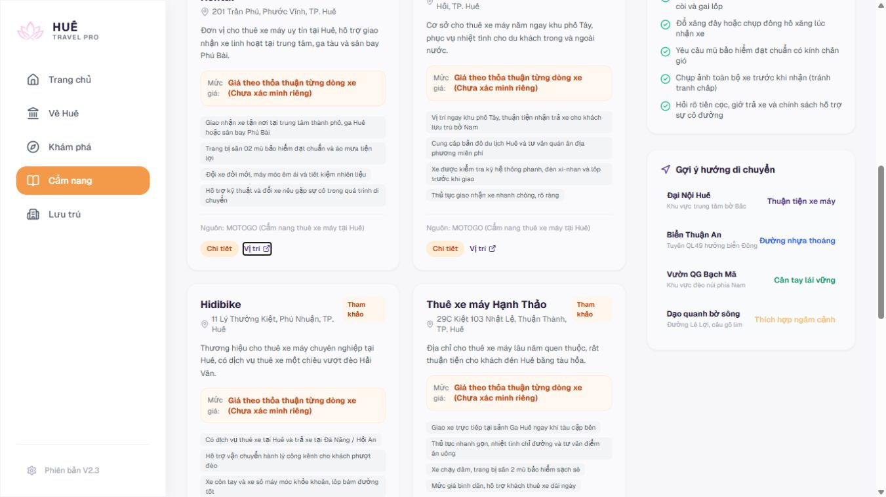

# HUẾ TRAVEL PRO V2.3 — T05 + T07 TARGETED FIX

- **Project / Gate / Task:** HUẾ TRAVEL PRO V2.3 / GATE07-01 / T05-T07 — CONTROLLED IMPLEMENTATION.
- **Ngày:** 24/10/2026, Asia/Saigon.
- **Root:** `A:\trí tuệ nhân tạo\BAI_3\hue-travel-pro`.
- **Trạng thái đề xuất:** PASS cho tiêu chí T05/T07 đã kiểm tra — **AWAIT OWNER REVIEW**. Chưa tự công nhận Owner nghiệm thu.

## 1. Executive Summary

Đã sửa đúng hai vùng được duyệt:

- **T05:** sáu footer card thuê xe cho nguồn và nhóm actions xuống hàng khi thiếu chỗ, giữ “Chi tiết”/“Vị trí” trên một dòng. Không giảm font, cắt nguồn hoặc đổi link.
- **T07:** bộ lọc lưu trú dùng một cột dưới1024px, hai cột từ1024 đến1535px; từ1536px dùng bốn cột với cột giá rộng hơn. Nội dung option đầy đủ, không thay native select/state/query/logic.

Đã đo và lưu ảnh trước/sau năm viewport yêu cầu. Sáu nhóm nút × năm viewport: không thấy xuống dòng, va nhau hoặc tràn footer; nguồn không có overflow. Nhãn giá mặc định và lựa chọn dài đọc đủ trên ảnh kiểm tra. Đã click đủ sáu link Chi tiết/sáu link Vị trí; thử chọn giá, kết hợp tìm kiếm có dấu/không dấu và reset. Typecheck/lint PASS.

So sánh57 file baseline chỉ hai file allowlist đổi hash. Logo/wordmark LOCK, Home, navigation, AGENTS.md, hồ sơ LOCK, assets và dữ liệu giữ nguyên. T06 không sửa.

## 2. Owner Authorization

Owner gửi đề bài “GATE07-01 — TARGETED TYPOGRAPHY & CARD LAYOUT FIX / T05 + T07 — CONTROLLED IMPLEMENTATION”, cấp ngoại lệ chính xác:

1. `src/app/cam-nang/page.tsx`: footer nguồn/actions của card thuê xe.
2. `src/app/luu-tru/page.tsx`: responsive grid khu vực bộ lọc.

Đã đọc AGENTS.md và Typography Audit trước sửa. Đề bài mới ưu tiên quyền sửa cục bộ này so với phần Phase1B READ-ONLY lịch sử, không mở các LOCK khác. Không sửa AGENTS.md để tự mở rộng quyền.

## 3. Changed Files

| File | Phạm vi diff |
|---|---|
| `src/app/cam-nang/page.tsx:381–400` | Chỉ class trình bày footer, nguồn và nhóm/link actions;5 dòng class thay đổi |
| `src/app/luu-tru/page.tsx:190` | Một dòng class grid filter |

Không có Git repository khi chạy git status. Theo quyền Owner, đã lưu checkpoint hai file và SHA-256 baseline trước sửa tại `reports/codex/evidence/GATE-07-01-T05-T07-20261024/`. Diff được tạo bằng git diff --no-index, không commit/push/reset.

Tạo báo cáo này, checkpoint, diff, CSV/JSON số đo và screenshot trong reports/codex/evidence. Không thêm package, unit test mô phỏng implementation, migration, seed hoặc triển khai.

## 4. T05 Root Cause & Fix

**VERIFIED trước sửa:** footer flex một hàng để nguồn dài cạnh nhóm actions được phép co. Nhãn Chi tiết/Vị trí của cả sáu card xuống hai dòng. Ví dụ1366: Chi tiết height41px, Vị trí33px, font11px.

**Sửa:** footer `flex-wrap gap-3`; nguồn `min-w-0 flex-1 basis-48 break-words`; nhóm actions `shrink-0 whitespace-nowrap`; từng link cũng `shrink-0 whitespace-nowrap`. Nguồn vẫn là nguyên text ban đầu và được wrap tự nhiên. Khi đủ chỗ, nguồn/actions có thể cùng hàng; khi hẹp, nhóm actions chuyển xuống hàng riêng.

**VERIFIED sau sửa:** font vẫn11px; Chi tiết24,5px (gồm padding), Vị trí16,5px; Range text mỗi nhãn chỉ có một vị trí dòng. Không có label đổi tên hoặc href thay đổi. Không thêm overflow-hidden/truncate/line-clamp. Bố cục cho card cao thêm khi cần, không ép chữ nhỏ lại.

## 5. T07 Root Cause & Fix

**VERIFIED trước sửa:** bốn cột bằng nhau từ lg; ô khoảng giá238,25px tại1366 và256,75px tại1440, native select cắt phần cuối nhãn dài.

**Sửa duy nhất grid wrapper:** `grid-cols-1 lg:grid-cols-2 2xl:grid-cols-[minmax(0,1fr)_minmax(0,1fr)_minmax(20rem,1.5fr)_minmax(0,1fr)]`. Giữ nguyên gap, nội dung, thứ tự control, option, handlers và class của từng select.

Hai cột trên laptop chừa đủ chiều rộng; bốn cột chỉ xuất hiện khi container đủ rộng, cột giá có mức tối thiểu20rem. Một cột trên mobile/tablet hẹp tránh co native select. Không thay thư viện/component select.

## 6. Before / After Screenshots

Ảnh trong bảng là screenshot thật, không chỉnh ảnh để che lỗi. Các thử capture crop bị sai vùng hoặc khung hình còn transition đã bị loại và chụp lại; không dùng chúng làm bằng chứng. Ảnh toàn trang có fixed navigation tại vị trí viewport đầu; không coi đó là phần nằm giữa document flow.

| Viewport | T05 trước / sau | T07 trước / sau |
|---|---|---|
|1366×768|[Trước](evidence/GATE-07-01-T05-T07-20261024/before-cam-nang-1366.png) / [Sau](evidence/GATE-07-01-T05-T07-20261024/after-cam-nang-1366.png)|[Trước](evidence/GATE-07-01-T05-T07-20261024/before-luu-tru-1366.png) / [Sau](evidence/GATE-07-01-T05-T07-20261024/after-luu-tru-1366.png)|
|1440×900|[Trước](evidence/GATE-07-01-T05-T07-20261024/before-cam-nang-1440.png) / [Sau](evidence/GATE-07-01-T05-T07-20261024/after-cam-nang-1440.png)|[Trước](evidence/GATE-07-01-T05-T07-20261024/before-luu-tru-1440.png) / [Sau](evidence/GATE-07-01-T05-T07-20261024/after-luu-tru-1440.png)|
|1650×786|[Trước](evidence/GATE-07-01-T05-T07-20261024/before-cam-nang-1650.png) / [Sau](evidence/GATE-07-01-T05-T07-20261024/after-cam-nang-1650.png)|[Trước](evidence/GATE-07-01-T05-T07-20261024/before-luu-tru-1650.png) / [Sau](evidence/GATE-07-01-T05-T07-20261024/after-luu-tru-1650.png)|
|1920×1080|[Trước](evidence/GATE-07-01-T05-T07-20261024/before-cam-nang-1920.png) / [Sau](evidence/GATE-07-01-T05-T07-20261024/after-cam-nang-1920.png)|[Trước](evidence/GATE-07-01-T05-T07-20261024/before-luu-tru-1920.png) / [Sau](evidence/GATE-07-01-T05-T07-20261024/after-luu-tru-1920.png)|
|390×844|[Trước](evidence/GATE-07-01-T05-T07-20261024/before-cam-nang-390.png) / [Sau](evidence/GATE-07-01-T05-T07-20261024/after-cam-nang-390.png)|[Trước](evidence/GATE-07-01-T05-T07-20261024/before-luu-tru-390.png) / [Sau](evidence/GATE-07-01-T05-T07-20261024/after-luu-tru-390.png)|

Nhãn dài ở cả bốn control: [1366](evidence/GATE-07-01-T05-T07-20261024/long-options-1366.png), [1440](evidence/GATE-07-01-T05-T07-20261024/long-options-1440.png), [1650](evidence/GATE-07-01-T05-T07-20261024/long-options-1650.png), [1920](evidence/GATE-07-01-T05-T07-20261024/long-options-1920.png), [390](evidence/GATE-07-01-T05-T07-20261024/long-options-390.png). Đã chọn “Khu nghỉ dưỡng (Resort)”, “Gần Đại Nội / Thành Nội”, “Phân khúc cao cấp & resort (Cần kiểm chứng)”, “Bữa sáng / Quán cà phê” để kiểm tra chữ đầy đủ. Không lấy kết quả0 của tổ hợp này làm lỗi lọc.

## 7. Responsive Measurements

| CSS viewport | Số card T05 kiểm | Chi tiết height trước→sau | Vị trí height trước→sau | Price select width trước→sau | Tràn ngang hai trang |
|---|---:|---:|---:|---:|---|
|1366×768|6|41→24,5px|33→16,5px|238,25→488,5px|Không đo thấy|
|1440×900|6|41→24,5px|33→16,5px|256,75→525,5px|Không đo thấy|
|1650×786|6|41→24,5px|33→16,5px|284,5→379,34px|Không đo thấy|
|1920×1080|6|41→24,5px|33→16,5px|284,5→379,34px|Không đo thấy|
|390×844|6|41→24,5px|33→16,5px|313→313px|Không đo thấy|

Height là hộp link; line-count được kiểm thêm bằng các tọa độ Range của text, không suy ra chỉ từ height. Số đo trên minh họa card đầu; JSON chứa đủ sáu card ở mỗi viewport. Tất cả30 nhóm: text một dòng, nguồn không overflow, nhóm trong bounds footer, hai link tách nhau. Mọi href/mapHref/source và tập option trước/sau khớp.

Kiểm tra thêm hai breakpoint768×900 và1024×900: không có document overflow ở hai route; price select407px và317,5px, lựa chọn cao cấp đọc đủ trong ảnh1024. [Tablet JSON](evidence/GATE-07-01-T05-T07-20261024/tablet-checks.json), [1024 giá dài](evidence/GATE-07-01-T05-T07-20261024/tablet-luu-tru-1024.png).

[CSV tổng hợp](evidence/GATE-07-01-T05-T07-20261024/responsive-summary.csv). Các JSON `before-<route>-<width>.json` và `after-<route>-<width>.json` trong cùng thư mục ghi URL, viewport thực, font loaded, bounds, Range, scroll/client và option. [Ví dụ sáu footer1366](evidence/GATE-07-01-T05-T07-20261024/after-cam-nang-1366.json), [filter1366](evidence/GATE-07-01-T05-T07-20261024/after-luu-tru-1366.json), [long options](evidence/GATE-07-01-T05-T07-20261024/long-options.json).

Browser: Codex in-app browser, JavaScript DOM và screenshot. Đây là CSS viewport override, không phải thử nghiệm trên điện thoại vật lý hoặc xác nhận Windows scaling/zoom. Không tuyên bố hỗ trợ mọi viewport/zoom chỉ từ năm mẫu này.

## 8. Interaction Tests

| Thao tác thực tế | Kết quả |
|---|---|
| Click Chi tiết của Đồng Xanh, Kevin, Hidibike, Hạnh Thảo, Nam Thanh, Chị Chi | PASS6/6: URL chi tiết đúng, h1 đúng tên tương ứng; [JSON](evidence/GATE-07-01-T05-T07-20261024/interaction-details.json), ảnh detail-rental-0…5.png |
| Click Vị trí cả6 card | PASS cho việc mở tab Google Maps theo query/link có sẵn. [Tabs/URL](evidence/GATE-07-01-T05-T07-20261024/interaction-maps.json). Đã xem DOM trang Maps đầu với heading Đồng xanh motorbikes rental, Huế và [lưu ảnh](evidence/GATE-07-01-T05-T07-20261024/map-result-first.png). Không chứng nhận vị trí địa lý/độ chính xác kết quả của bên thứ ba; đóng các tab kiểm thử tạo thêm |
| Chọn đủ4 option giá | PASS: URL/value cập nhật; standard/luxury vẫn đưa8 cơ sở vào nhóm chưa kiểm chứng giá; contact/all trả danh sách8. [JSON](evidence/GATE-07-01-T05-T07-20261024/interaction-budget.json) |
| Thay loại hình, khu vực, tiện nghi kết hợp khoảng giá | PASS: control/query đồng bộ; tổ hợp resort + Đại Nội + coffee cho0 theo điều kiện kết hợp hiện có; nội dung nhãn không cắt |
| Reset bằng Xóa bộ lọc | PASS: về /luu-tru, bốn giá trị all,8 cơ sở. [JSON](evidence/GATE-07-01-T05-T07-20261024/interaction-reset.json) |
| Search “Mường Thanh” và “muong thanh” | PASS: đều tìm Mường Thanh Holiday Huế; thêm standard giữ1 cơ sở trong nhóm chưa rõ giá; reset xóa q và trả8. [JSON](evidence/GATE-07-01-T05-T07-20261024/interaction-search-reset.json) |

Các thao tác được xác nhận sau chờ hydration/network idle và URL cập nhật; không coi value native thay đổi trước hydration là test logic PASS. Khi thử navigation ngay trong transition có lần click chưa chuyển route; thử lại sau transition ổn định thành công, không sửa navigation hoặc kéo rộng phạm vi.

## 9. Typecheck / Lint / Build

- `pnpm exec tsc --noEmit --incremental false`: **PASS**, exit0.
- `pnpm lint`: **PASS**, exit0, “No ESLint warnings or errors”.
- Production Build: **NOT TESTED**; đề bài yêu cầu typecheck/lint/browser, không triển khai. Không lấy PASS trước đây làm PASS build mới.
- Runtime/visual T05 và T07: **PASS trong các trạng thái/viewport đã kiểm**, dựa trên DOM + ảnh + tương tác, không dựa riêng HTTP200.

## 10. SHA-256 & Diff / Change Control

| File | SHA-256 trước | SHA-256 sau |
|---|---|---|
| cam-nang/page.tsx | `50BE14BA8069DC66E440EE6644EEA64890EEF70035C337D654F533E9F697301A` | `C6FF4D38F91A78B8AF05AC704B5D8AF651AB1D1267C31DC8EBA6535279440135` |
| luu-tru/page.tsx | `81FE99B5B76E6CA8283693D052D89AA0927E16D86E41A1E0F76FE24DF5BAA12F` | `829379152F6250A3E57C551F7A668BB2B3822F3EA87B269FCD6330758B594279` |

[Checkpoint Cẩm nang](evidence/GATE-07-01-T05-T07-20261024/cam-nang.before.tsx), [Lưu trú](evidence/GATE-07-01-T05-T07-20261024/luu-tru.before.tsx), [baseline57 file](evidence/GATE-07-01-T05-T07-20261024/baseline.csv), [hash sau](evidence/GATE-07-01-T05-T07-20261024/integrity-final.csv), [diff T05](evidence/GATE-07-01-T05-T07-20261024/cam-nang.diff), [diff T07](evidence/GATE-07-01-T05-T07-20261024/luu-tru.diff).

**VERIFIED:**2 file allowlist đổi;55 file còn lại baseline không đổi. Không sửa AGENTS.md, LOCK register, logo/component navigation, Home/Shell, global font/CSS, lib/data/types hoặc Prisma. Không thao tác database/Supabase; không cài dependency, migration/seed/deploy. Dev cache .next và report/evidence là artifact phát sinh từ kiểm thử/tài liệu, không phải source diff ngoài allowlist.

## 11. Non-regression Results

- **Home / logo:** source, asset và renderer cùng hash baseline; [Home sau sửa, đã xem đúng route ổn định](evidence/GATE-07-01-T05-T07-20261024/home-after.png). Không sửa typography Phase1E hoặc logo đã LOCK.
- **Navigation:** Sidebar→Home và Home→Cẩm nang sau transition ổn định hoạt động; vẫn5 link gồm Home +4 mục được duyệt. [DOM/navigation](evidence/GATE-07-01-T05-T07-20261024/navigation.json). Không chứng nhận mọi trường hợp click nhanh trong transition.
- **Detail routes:**6 trang chi tiết thuê xe được click và xác nhận h1; mã/href không đổi.
- **T06:** diff Lưu trú chỉ đổi dòng190; span truncate nguồn ở dòng477 giữ nguyên. Screenshot sau vẫn có ellipsis theo quyết định không sửa T06.
- **Dữ liệu:** source6 Places/6 Rentals/8 Accommodations không đổi hash; không tạo số liệu giá, rating hay địa điểm mới.

### Console warning có giải thích và giới hạn

Không tuyên bố console hoàn toàn sạch. [Console cuối](evidence/GATE-07-01-T05-T07-20261024/console-final.json) có46 warning ghi ở level error, cùng một loại: `Warning: Extra attributes from the server ... __processed_<id>__`, stack body/html/RootLayout.

**VERIFIED cảnh báo đã xuất hiện trước patch:** log đầu16:03:22.048Z, trong khi cam-nang/page.tsx được sửa lúc16:05:16.153Z. Source không có chuỗi `__processed_`; HTML trả trực tiếp từ server không chứa nó, trong khi DOM browser có thuộc tính này trên body. Vì thế đây là khác biệt thuộc tính phía browser so với server đã tồn tại trước sửa; tác nhân cụ thể (instrumentation/extension) **LIKELY, chưa xác định chắc chắn**. Không có loại lỗi khác trong tập46 log đã thu. Không đổi body/layout/suppressHydrationWarning hoặc bảo mật để che cảnh báo. Không coi cảnh báo này đã được sửa.

## 12. Remaining Issues

- Cảnh báo hydration `__processed_*` nêu trên còn tồn tại; không do T05/T07 mới sinh theo thứ tự thời gian ghi nhận, chưa quy kết chính xác tác nhân browser.
- T06, background có UI/text baked-in, typography Hero/actual glyph fonts và các vấn đề P2 trước đây vẫn ngoài phạm vi, không tự sửa hoặc công nhận hết lỗi.
- Chưa kiểm điện thoại vật lý, browser khác hoặc mọi tổ hợp filter/viewport/zoom. Đã có5 viewport bắt buộc và2 kiểm tra breakpoint bổ sung.

## 13. Acceptance Recommendation

Đề xuất **PASS T05 và T07 trong phạm vi đã đo và xem**, chờ Owner kiểm tra/duyệt thay đổi. Rủi ro/bù trừ đã thấy: footer và grid filter có thể cao hơn để giữ đủ chữ; không ảnh hưởng nội dung/link/logic. Không tuyên bố toàn website PASS hoặc Owner đã nghiệm thu. Không cập nhật LOCK/AGENTS.md khi chưa có lệnh riêng.

Owner có thể kiểm tra local tại `/cam-nang` và `/luu-tru`, gồm laptop1366/1440 và điện thoại cùng Wi-Fi. Không tự mở Phase2 hoặc nhiệm vụ tiếp theo.

**FIX ONLY T05 AND T07 — PRESERVE EVERYTHING ELSE.**

**PASS = LOCK — FIX ONLY WHAT FAILED — NO SCOPE CREEP.**

**STOP — AWAIT OWNER REVIEW.**
