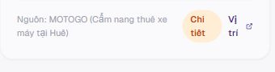
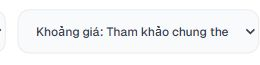
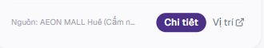
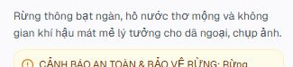

# HUẾ TRAVEL PRO V2.3 — TYPOGRAPHY AUDIT

- **Project:** HUẾ TRAVEL PRO V2.3.
- **Gate / Task ID:** GATE 07-01 / TYPOGRAPHY AUDIT — DESKTOP FONT RENDERING & TEXT COLLISION DIAGNOSIS.
- **Ngày:** 24/10/2026, Asia/Saigon.
- **Root:** `A:\trí tuệ nhân tạo\BAI_3\hue-travel-pro`.
- **Phạm vi Owner:** đọc mã nguồn, font, cấu hình, năm mockup, báo cáo Phase 1D/1E; kiểm tra typography năm route và năm viewport; tạo báo cáo/evidence. Không được sửa source, CSS, font, logo, assets, dữ liệu hoặc cài package.
- **Trạng thái đề xuất:** DIAGNOSIS DELIVERED — PENDING OWNER REVIEW. Không tuyên bố Owner đã nghiệm thu hoặc toàn website PASS.

## 1. Executive Summary

Đã chụp và xem 25 ảnh toàn trang: năm route × năm viewport. Đã lưu số đo DOM tương ứng và inventory 2.284 dòng text/control. Có hai vấn đề P1 thấy trực tiếp: nhóm nút ở card thuê xe xuống dòng quá chật; nhãn khoảng giá Lưu trú bị cắt ở laptop 1366/1440. Nguồn tham khảo của tám card Lưu trú bị rút gọn bằng dấu ba chấm ở cả năm viewport; đây là clipping có chủ ý trong CSS, không phải chữ đè lên nút.

Font Geist local thiếu nhiều ký tự/dấu tiếng Việt. CSS có fallback Arial điều chỉnh kích thước 107,19%; đây là cơ sở kỹ thuật rõ ràng cho việc phải fallback khi glyph không được font chính hỗ trợ. Tuy nhiên API hiện có không cung cấp tên font thực sự được dùng cho từng glyph: chưa kết luận chính xác ký tự nào đang do Arial/Segoe UI vẽ, cũng chưa xác minh fallback là nguyên nhân duy nhất khiến label “Về Huế” trông chật.

**Chưa xác minh được P0 chữ đè nhau hoặc mất dấu làm không đọc được.** Home serif Phase 1E vẫn tách rõ các dòng và dấu tiếng Việt trên ảnh. Giữ LOCK typography Home; không đề xuất thay font toàn website hoặc sửa global config trong đợt này.

## 2. Công việc đã thực hiện

1. Đọc `AGENTS.md`, đề bài hiện tại, cấu hình font/CSS và các component đang dùng. Quyền audit typography mới nhất của Owner mở phạm vi **đọc/kiểm tra**, không mở quyền sửa các trang con.
2. Đọc báo cáo Phase 1D/1E, xem năm mockup chính thức và hai screenshot Owner cung cấp. Mockup là hình tham chiếu, không xác định được chính xác font từ pixel; không phục hồi menu cũ, số liệu giả hoặc video.
3. Kiểm tra font local và font Windows qua bảng `cmap`, gồm mẫu tiếng Việt NFC và NFD.
4. Khởi động demo có sẵn bằng `pnpm dev --hostname 127.0.0.1 --port 3000` khi localhost không còn kết nối. Không cài package. Có cache `.next` phát sinh từ việc chạy dev.
5. Kiểm tra route trên cùng demo tại `http://127.0.0.1:3000`, đặt lần lượt năm viewport, đọc DOM và chụp ảnh toàn trang. Đọc font-size/weight/line-height/spacing, range text, bounds, overflow, clipping ancestor và transform ancestor.
6. Xem lại ảnh toàn trang và chụp cận cảnh để phân biệt chữ nhìn thấy với phần range bị ẩn/khung font giao nhau. Trả viewport override về mặc định sau kiểm tra.
7. So sánh hash trước/sau của 54 file source/asset/config/tài liệu được lấy baseline: **54/54 không đổi**.

## 3. Môi trường và giới hạn kiểm thử

| Thuộc tính | Kết quả |
|---|---|
| Browser dùng để đo | Codex in-app browser, hỗ trợ JavaScript DOM, viewport override và screenshot |
| Browser/engine version | **NOT VERIFIED** — API không trả user agent/version trong phạm vi đọc hiện có; không gọi đây là Edge theo screenshot Owner |
| App | Next.js dev server 14.2.35, dự án đang có dependencies; không cài mới |
| URL kiểm thử cuối | `http://127.0.0.1:3000/` và bốn route con; localhost ban đầu báo ERR_CONNECTION_REFUSED |
| Zoom | Đã gửi Ctrl+0. **Không đọc được phần trăm zoom UI độc lập**; không chứng nhận tuyệt đối zoom desktop 100% |
| DPR / visual viewport scale | DPR xấp xỉ 1,000000015, visualScale=1 trong các snapshot có override. Đây không phải số đo Windows scaling |
| CSS viewport | `innerWidth/innerHeight` khớp năm kích thước yêu cầu; xem ma trận và CSV |
| Fonts | Snapshot có `fontStatus`; probe riêng sau `document.fonts.ready` trả loaded, check Geist/fallback/Palatino=true. `check()` không chứng minh coverage hoặc actual glyph face |
| Giới hạn ảnh | Ảnh toàn trang dài hơn viewport; fixed bottom nav xuất hiện ở vị trí viewport đầu trong ảnh dài, không phải một khối nằm giữa luồng nội dung |
| Giới hạn bộ đo | Chỉ so sánh text node trực tiếp/control hiển thị theo style, không đo đường viền từng nét glyph. Range có thể bao gồm phần bị clip, font ascender/descender hoặc geometry thay đổi giữa hai lần lấy mẫu. Native input/select không có text Range. Không dùng số raw overlap làm số lỗi |
| Phạm vi trạng thái | Trang ban đầu, dữ liệu mặc định. Không kiểm hết mọi filter, drawer, hover/focus, zoom khác, browser khác hoặc hệ điều hành khác |

Trang lỗi kết nối ban đầu khiến công cụ chặn thao tác với URL `data:` của trang báo lỗi. Đã chuyển sang tab HTTP hợp lệ cùng browser và hoàn tất ma trận; không thay cấu hình bảo mật. Những bản chụp route sai lúc thử điều hướng đã được thay bằng bằng chứng có URL đúng, không dùng để kết luận.

## 4. Typography Inventory

`G` dưới đây là computed stack: `__geistSans_1e4310, __geistSans_Fallback_1e4310, "Segoe UI", Roboto, Arial, sans-serif`. Đây là **computed family**, không phải chứng nhận actual platform font từng ký tự. Số liệu dòng tiêu biểu từ TP-01; các snapshot khác và bounds/scroll đầy đủ ở inventory CSV và JSON.

| Nhóm | Computed stack / size / weight / line-height / spacing | Nguồn |
|---|---|---|
| Home desktop nav | G; 12px; 500 (Home active 600); 16px; normal | AdaptiveNavigation.tsx:129 |
| Wordmark Home | G; HUẾ 18/700/22,5px/0,9px; Travel Pro 10/600/10px/1px | AdaptiveNavigation.tsx:275,278 |
| Home eyebrow | G; 12/500/16px; tracking 3,36px | page.tsx:28 |
| Home HUẾ | Palatino Linotype, Times New Roman, serif; 96/400/96px; −2,4px | page.tsx:36–37 |
| Home TRAVEL PRO | Cùng serif; 48/400/50,4px; +0,72px | page.tsx:42–43 |
| Home tagline | Cùng serif italic; 36/400/48,6px; normal | page.tsx:48–49 |
| Home mô tả / CTA | G; 16/400/24px và 16/600/24px; normal | page.tsx:56, Button.tsx |
| Ba card Home | G; title 16/600/24px; mô tả 12/400/19,5px | page.tsx:105–168 |
| Di sản/Cẩm nang/Trải nghiệm | G; 14/500/19,25px; sublabel 10/400/16,25px | page.tsx:184–199 |
| Sidebar | G; 14px, 500 hoặc active 600; normal spacing | AdaptiveNavigation.tsx:212 |
| Subpage hero | `"Segoe UI", Georgia, serif`; desktop 48px/800, tracking −1,2px. Ví dụ Về Huế measured line-height 48px | ve-hue/page.tsx:58; kham-pha:154; cam-nang:140; luu-tru:151 |
| Subpage section | Segoe UI-first khi có font-serif; 20/700/28px hoặc 24/700/32px | Các h2 tại từng page |
| Search/control | G; input 12px mobile /14px desktop; select 12px/500, native line-height normal | SubpageTopBar.tsx:81; filters tại page |
| Place/rental/stay card | G; title thường 16/700; metadata 10–12px; body 12px. Xem từng selector trong CSV | kham-pha/page.tsx:436–500; cam-nang:330–400; luu-tru:430–500 |
| Rental footer actions | G; 11/600/16,5px, normal spacing, white-space normal | cam-nang/page.tsx:381–400 |
| Stay nguồn | G; 10/400/15px; nowrap, overflow hidden; max-width 120px hoặc 160px | luu-tru/page.tsx:477 |
| Bottom nav | G; 10px, line-height tight, có truncate; chưa thấy chữ bị mất trong trạng thái đã chụp | AdaptiveNavigation.tsx:408,423 |

Giá trị computed có thể khác cách suy ra từ tên class Tailwind; báo cáo ưu tiên số đo runtime. Không suy ngược line-height chỉ từ `leading-*` trong source.

Home tại TP-02/TP-04 tăng HUẾ/TRAVEL PRO/tagline lên 112/56/40px; TP-03 giữ 96/48/36px vì chiều cao ≤820px; mobile 72/40/30px. Đây là breakpoint có sẵn, không phải font tải ngẫu nhiên.

## 5. Font Loading & Fallback Results / Vietnamese Glyph Audit

- `src/app/layout.tsx:7–10` khai báo local GeistVF.woff, weight 100–900; body:25 dùng biến và font-sans.
- `tailwind.config.ts:27–29`: sans ưu tiên biến Geist; **font-serif thực tế ưu tiên Segoe UI**. Vì Segoe UI có sẵn nên bốn subpage h1 nhìn sans, dù class mang tên serif. Đây là cấu hình có thật, không phải lỗi font chưa tải.
- `.next/static/css/app/layout.css:4–11` (artifact dev, không chỉnh) có fallback `src:local("Arial")`, `size-adjust:107.19%`, ascent 85,83%, descent 20,52%, line-gap 9,33%. Đây là fallback Next tạo, không đồng nhất với Arial bình thường ở cuối stack.
- `cmap` Geist thiếu các ký tự trong mẫu: **ơ, ư, Ơ, Ư, Ế, ế, ề, ẩ, ị, ử, ả, ệ**. NFD còn thiếu combining horn U+031B, hook U+0309, dot below U+0323. Không thể mặc định browser luôn dựng được mọi chữ thiếu bằng decomposition.
- Các file Arial regular/bold, Segoe UI regular/semibold/bold, Times New Roman đã đọc có coverage đầy đủ mẫu và tập dấu thử. Palatino regular/italic đủ mẫu NFC; thiếu một số combining marks NFD nên không chứng nhận mọi dạng Unicode.
- Các string đo được có cờ `textNFC` trong inventory. Không sửa/chuẩn hóa dữ liệu để che vấn đề.
- **FONT FALLBACK / VERIFIED coverage limitation:** font chính không đủ glyph và có fallback hợp lệ trong stack. **NOT VERIFIED actual face từng glyph**; cần Rendered Fonts trong DevTools/khả năng tương đương để xác định chính xác khi Owner muốn kết luận trộn font trong một label.
- **GLYPH ISSUE / NOT REPRODUCED** ở mức mất dấu/tofu/chữ không đọc được trong ảnh hiện tại. Không đồng nhất font thiếu codepoint với một lỗi glyph nhìn thấy: fallback vẫn có thể vẽ đúng.
- Label “Về Huế” của Owner trông đậm/compact; ảnh cận cảnh runtime vẫn có khoảng trống giữa hai từ, không cắt dấu hoặc va icon. Fallback, cỡ 12px và weight 500 là các yếu tố cần kiểm tra riêng trước sửa.

Bằng chứng chi tiết: [font cmap](evidence/GATE-07-01-TP-font-cmap-results.json), [script đọc cmap](evidence/GATE-07-01-TP-font-cmap-audit.cjs), [nav runtime](evidence/GATE-07-01-TP-nav-detail.jpg), [nav Owner](evidence/GATE-07-01-TP-owner-nav.png).

## 6. Text Collision Matrix / Root Cause

| ID / route / nhóm | Phát hiện và phân loại | Root cause, file/dòng | Ưu tiên / đề xuất tối thiểu |
|---|---|---|---|
| T01 — `/`, nav/wordmark/CTA/cards/values | **NOT REPRODUCED** va chữ/icon, cắt chữ DOM trong ảnh năm viewport. Title/tagline serif rõ; không có P0 được xác minh | page.tsx:28–56,105–199; AdaptiveNavigation.tsx:129,275–278 | LOCK. Không đổi typography Home chỉ vì khác mockup |
| T02 — `/`, hero Range overlap | Raw Range HUẾ/TRAVEL PRO giao nhau 24px ở TP-01/03, 28px TP-02/04; TP-02/04 thêm eyebrow/HUẾ khoảng 2,4px. **NOT REPRODUCED** ink collision trên ảnh | page.tsx:36–49; font line boxes chứa phần trắng/ascender/descender | Không sửa leading hoặc margin dựa riêng vào cảnh báo này |
| T03 — `/ve-hue`, hero/cards/timeline/sidebar | Không thấy collision/clipping nhìn thấy trong năm ảnh. Chữ nguồn timeline 9px rất nhỏ nhưng vẫn là lựa chọn thẩm mỹ/khả năng đọc | ve-hue/page.tsx:58,127,150–153; AdaptiveNavigation.tsx:212 | P2 cho chữ nguồn nhỏ; chưa có cơ sở mở sửa toàn trang |
| T04 — `/kham-pha`, place summary | TP-01 probe báo Đồi Thiên An 39px clientHeight /59px scrollHeight, 3 range dòng với line-clamp-2. **NOT VERIFIED clipping ở lần probe; NOT REPRODUCED trong ảnh cận cảnh mới**: câu kết “chụp ảnh.” vẫn đọc đủ trong hai dòng | kham-pha/page.tsx:469. Geometry có thể đổi sau font/layout settling; không gọi đây là P0 | Chỉ đo lại sau trạng thái ổn định nếu cần; không bỏ/cài thêm clamp khi chưa xác minh |
| T05 — `/cam-nang`, rental footer | **VISUAL INCONSISTENCY — VERIFIED**: “Chi tiết” và “Vị trí” xuống hai dòng ở card, kể cả desktop. Không thấy chữ chồng/va icon | cam-nang/page.tsx:381–400; footer flex chung hàng nguồn dài và actions, chưa bảo đảm chỗ cho nhóm actions. TP-01 Chi tiết width≈48,09px (gồm padding20px), height41px; Vị trí text width≈17,51px, height33px, hai fragments cách16,5px | **P1**: cho footer wrap/stack nguồn và actions khi thiếu chỗ; actions giữ nhóm, không co và nhãn nowrap. Không chỉ thêm nowrap mà không bố trí chỗ vì có thể tạo overflow |
| T06 — `/luu-tru`, tám source labels | **VERIFIED CLIPPING** với dấu “…”, không phải collision. Tất cả năm viewport | luu-tru/page.tsx:475–480; truncate + max-w120/160; TP-01 nguồn đầu client160px/scroll294px, height15px. Raw range tràn sang nút nhưng phần đó bị ẩn | P2/Owner decision nếu chấp nhận nguồn tóm tắt; **P1 nếu bắt buộc đọc đủ nguồn**. Tách nguồn thành hàng tự wrap, bỏ giới hạn/truncate tại đúng span sau duyệt; giữ nguyên nội dung và URLs |
| T07 — `/luu-tru`, khoảng giá select | **VERIFIED CLIPPING** ở TP-01/02: hiện “Khoảng giá: Tham khảo chung the…”; ảnh cận cảnh TP-01 chứng minh cắt cuối. TP-03/04/05 đọc đủ trong ảnh | luu-tru/page.tsx:190,232; lg:grid-cols-4 chia đều, select native một dòng; TP-01 box≈238,4px kể cả border/padding/arrow | **P1**: điều chỉnh cột/breakpoint riêng filter dài, cho đủ chiều rộng; giữ label/option đầy đủ, không rút ngắn text, không đổi logic |
| T08 — nhiều route, chữ nằm trong ảnh | **VISUAL INCONSISTENCY — VERIFIED**: background Home còn chữ mờ; ảnh hero Cẩm nang có UI cũ phía dưới, Lưu trú có “Khu nghỉ dưỡng/Bộ lọc nâng cao”; place thumbnails có label/title baked-in | page.tsx:22; kham-pha:143,441; cam-nang:129; luu-tru:140 và các PNG nguồn | P2/NEEDS ASSET; đây không phải browser font/collision DOM. Muốn sửa cần Owner duyệt asset sạch riêng; không sửa CSS typography để che |
| T09 — shared typography | **FONT FALLBACK** về coverage; sai lệch hình dáng/metric là nguy cơ. Không xác minh được thiếu glyph làm mất chữ hoặc collision trên ảnh | layout.tsx:7–10,25; tailwind.config.ts:27–29; fonts/GeistVF.woff; AdaptiveNavigation.tsx:129,212,423 | Điều tra actual rendered face cho label có vấn đề trước. Có thể thử font hệ thống hỗ trợ Việt ở đúng component **sau** duyệt; không đổi global font/config trong audit |

### Đánh giá theo nhóm bắt buộc

Header, wordmark, navigation, hero, CTA, ba Home card, values, sidebar và bottom nav đều đã được xem trong các trạng thái chụp; chưa thấy mất dấu hoặc chữ đè nhau. Search placeholder dài trên mobile bị giới hạn trong input một dòng (ví dụ trang Lưu trú), cần phân biệt với giá trị người dùng nhập và nhãn xác định chức năng. Đây là hạn chế hiển thị gợi ý, không chứng minh search hỏng; không đề xuất sửa logic. Rental footer T05 và stay filter T07 là hai điểm ưu tiên bố cục. Card địa điểm có chữ trong raster và cảnh báo clamp T04 cần phân biệt riêng.

Không thấy transform scale trên các ancestor của text đã đo sau ổn định; hiệu ứng hover/transition vẫn chưa được audit toàn bộ. Tracking âm −0,025em ở H1 không đồng nghĩa ký tự đè nhau. Weight 800 ở subpage tạo cảm giác đậm hơn mockup là **P2**, không phải bằng chứng lỗi glyph.

## 7. Viewport Comparison

Đã xem ảnh cho toàn bộ 25 ô. `NR` = chưa tái hiện collision nhìn thấy trong trạng thái chụp; không phải PASS toàn trang. T05 = actions chật, T06 = nguồn truncate, T07 = select cắt.

| Route | TP-01 1366×768 | TP-02 1440×900 | TP-03 1650×786 | TP-04 1920×1080 | TP-05 390×844 |
|---|---|---|---|---|---|
| `/` | NR | NR | NR | NR | NR; nội dung cuộn dọc bình thường |
| `/ve-hue` | NR | NR | NR | NR | NR |
| `/kham-pha` | NR; probe T04 cần phân biệt | NR | NR | NR | NR |
| `/cam-nang` | T05 | T05 | T05 | T05 | T05 |
| `/luu-tru` | T06, T07 | T06, T07 | T06 | T06 | T06 |

| ID | innerWidth×innerHeight | clientWidth Home / trang con | scrollHeight Home | DPR≈ / visualScale |
|---|---|---|---|---|
| TP-01 | 1366×768 | 1366 /1351 | 768 | 1 /1 |
| TP-02 | 1440×900 | 1440 /1425 | 900 | 1 /1 |
| TP-03 | 1650×786 | 1650 /1635 | 786 | 1 /1 |
| TP-04 | 1920×1080 | 1920 /1905 | 1080 | 1 /1 |
| TP-05 | 390×844 | 375 /375 | 1331 | 1 /1 |

`scrollWidth=clientWidth` ở cả 25 snapshot: không đo được document horizontal overflow, nhưng vẫn có clipping T06/T07 và wrapping T05. Không dùng điều này để kết luận giao diện đúng. Ảnh chụp có thể rộng ít hơn innerWidth vì scrollbar và làm tròn; không gọi ảnh Owner 1920×1080 là CSS viewport 1920×1080.

## 8. Screenshots / Evidence

Ảnh cận cảnh đã mở kiểm tra, không sửa nội dung ảnh:

- [Mobile viewport thực tế](evidence/GATE-07-01-TP-mobile-viewport.jpg).
- [Screenshot Home Owner cung cấp](evidence/GATE-07-01-TP-owner-home.png), [crop nav Owner](evidence/GATE-07-01-TP-owner-nav.png): ảnh tham chiếu, không dùng suy ra zoom/DPR.
- [Ma trận kích thước/overflow](evidence/GATE-07-01-TP-matrix.csv).
- [Inventory 2.284 text/control, bounds và typography](evidence/GATE-07-01-TP-typography-inventory.csv).
- [Mã thuật toán DOM inspector](evidence/GATE-07-01-TP-runtime-inspector.txt). Dùng Range để tìm **ứng viên**; trường `collisions` không phải danh sách lỗi đã xác minh. Một số tham chiếu object lặp được transport biểu diễn `[Circular]`; rect/fragments ở row vẫn có giá trị gốc.
- [Baseline hash](evidence/GATE-07-01-TP-readonly-baseline.csv), [hash cuối](evidence/GATE-07-01-TP-readonly-final.csv).

Năm mockup đã xem tại `A:\trí tuệ nhân tạo\BAI_3\HUE_TRAVEL_PRO_V2.3_5_MOCKUPS\01_TRANG_CHU.png` đến `05_LUU_TRU.png`. Các mockup cho thấy typography trang trí khác website ở một số vị trí; không dùng các khác biệt P2 đó mở lại Home hoặc nội dung LOCKED. Font chính xác của mockup **NOT VERIFIED**.

## 9. Minimal Fix Recommendations / Exact Affected Files

Chưa thực hiện bất kỳ đề xuất nào.

1. **P1 T05 — `src/app/cam-nang/page.tsx:381`**: bố trí footer nguồn/actions có thể xuống hàng; chừa chỗ cố định cho nhóm nút, giữ nhãn trên một dòng. Kiểm tra lại cả 5 viewport và các tên đơn vị dài. Rủi ro thấp nhưng card có thể cao hơn; không thu nhỏ chữ để ép.
2. **P1 T07 — `src/app/luu-tru/page.tsx:190,232`**: tăng phần cột cho select khoảng giá hoặc dời breakpoint bốn cột. Không thay option/content hoặc behavior. Kiểm lại ba select còn lại, mobile và chiều rộng nội dung thực sau sidebar.
3. **T06 — `src/app/luu-tru/page.tsx:477`**: chỉ khi Owner yêu cầu nguồn đầy đủ, đưa nguồn thành dòng wrap riêng, giữ actions nguyên nhóm. Không đổi dữ liệu. Nếu Owner chấp nhận ellipsis hiện tại, LOCK điểm này.
4. **T09 — `src/components/navigation/AdaptiveNavigation.tsx:129`**: lấy actual Rendered Fonts trước, so sánh đúng label “Về Huế” với một system font Việt ở component trong đợt sửa được duyệt. Không tăng letter-spacing toàn site hoặc thay font global chỉ dựa trên ảnh crop.
5. **Giữ nguyên** Home `src/app/page.tsx:36–49`, Shell, logo, database, route, navigation concept. `tailwind.config.ts:27–29`, `src/app/layout.tsx:7–10` và `src/app/fonts/GeistVF.woff` là **file liên quan nguyên nhân**, chưa được phép thay.

Các file tham chiếu thêm: `src/components/navigation/SubpageTopBar.tsx:81`, `src/app/ve-hue/page.tsx:58,153`, `src/app/kham-pha/page.tsx:469`, `src/app/globals.css`, `src/components/common/Button.tsx`. Không đề xuất chỉnh Header.tsx không được Shell dùng trong những trạng thái audit này.

## 10. Read-only Declaration / File Changes

**READ-ONLY / NO SOURCE MODIFICATION.** Không sửa source/CSS/font/asset/logo/database/AGENTS.md; không cài package, triển khai, commit hoặc mở Phase mới. Hash 54 file baseline giống cuối phiên. Đây là bằng chứng cho tập file đã kiểm, không phải tuyên bố toàn ổ đĩa không phát sinh file: dev server tạo cache `.next` và báo cáo/evidence được phép tạo.

Tạo mới báo cáo này và các artifact mang prefix `reports/codex/evidence/GATE-07-01-TP-` cùng ảnh/số đo `GATE-07-01-TP-01…05-*`. Không ghi đè báo cáo cũ. Danh sách chính xác kèm hash nằm trong manifest được dẫn ở cuối báo cáo.

## 11. Test Results / Vấn đề chưa giải quyết

| Hạng mục | Kết quả |
|---|---|
| Typecheck | **NOT TESTED** trong audit này; không mượn PASS đợt trước |
| Lint | **NOT TESTED** |
| Build production | **NOT TESTED** |
| Runtime typography capture | **PASS cho việc thu thập** 25 URL/viewport và ảnh; không phải PASS UI toàn website |
| Visual typography | **FAIL ở các tiêu chí P1 T05/T07**; T06 verified clipping cần Owner quyết định; chưa có VERIFIED COLLISION P0 |
| HTTP | Server có phản hồi sau khởi động; không coi HTTP 200 là bằng chứng visual |
| Browser version / actual face từng glyph / zoom UI 100% độc lập | **NOT VERIFIED** |
| Search/filter logic, card detail routes, hover/focus/drawer toàn bộ | **NOT TESTED** trong audit typography |
| No source modification | **PASS trong tập 54 file baseline** |

Python alias của hệ thống không chạy được script preflight Product Design; kiểm tra file context trực tiếp cho thấy chưa có context đã lưu. Không cài Python, không ảnh hưởng font/DOM/screenshot dùng trong báo cáo. Skill audit được dùng để giữ findings bám ảnh; báo cáo theo định dạng Markdown Owner yêu cầu.

Những giới hạn còn lại: cần công cụ Rendered Fonts/phiên bản browser và kiểm thử zoom UI có thể xác nhận để quy kết actual fallback theo glyph; cần Owner phân định nguồn rút gọn là chủ ý được chấp nhận hay phải hiển thị đầy đủ. Chưa có căn cứ đổi toàn bộ typography hoặc tuyên bố hết mọi lỗi.

## 12. Owner Decisions Required / Trạng thái nghiệm thu đề xuất

- Xem xét cho phép sửa đúng T05/T07 trong hai page tương ứng, hoặc giữ nguyên chờ bước khác; chưa có quyền implementation.
- Quyết định T06 giữ ellipsis hay hiển thị nguồn đầy đủ.
- Nếu cần xử lý label “Về Huế”, duyệt kiểm tra actual rendered font và một thử nghiệm cục bộ trước; không tự mở quyền global font/config.
- Giữ Home typography Phase 1E LOCK theo bằng chứng hiện tại; asset có UI baked-in là phạm vi riêng.

**DIAGNOSIS DELIVERED — AWAIT OWNER REVIEW. Không tự tuyên bố Owner nghiệm thu.**

**PASS = LOCK — FIX ONLY WHAT FAILED — NO SCOPE CREEP.**

**HARD STOP — AWAIT OWNER REVIEW.**

## Phụ lục A — 25 ảnh và số đo theo route

| Viewport | Home | Về Huế | Khám phá | Cẩm nang | Lưu trú |
|---|---|---|---|---|---|
| TP-01 | [Ảnh](evidence/GATE-07-01-TP-01-HOME.jpg) / [DOM](evidence/GATE-07-01-TP-01-HOME-metrics.json) | [Ảnh](evidence/GATE-07-01-TP-01-VE-HUE.jpg) / [DOM](evidence/GATE-07-01-TP-01-VE-HUE-metrics.json) | [Ảnh](evidence/GATE-07-01-TP-01-KHAM-PHA.jpg) / [DOM](evidence/GATE-07-01-TP-01-KHAM-PHA-metrics.json) | [Ảnh](evidence/GATE-07-01-TP-01-CAM-NANG.jpg) / [DOM](evidence/GATE-07-01-TP-01-CAM-NANG-metrics.json) | [Ảnh](evidence/GATE-07-01-TP-01-LUU-TRU.jpg) / [DOM](evidence/GATE-07-01-TP-01-LUU-TRU-metrics.json) |
| TP-02 | [Ảnh](evidence/GATE-07-01-TP-02-HOME.jpg) / [DOM](evidence/GATE-07-01-TP-02-HOME-metrics.json) | [Ảnh](evidence/GATE-07-01-TP-02-VE-HUE.jpg) / [DOM](evidence/GATE-07-01-TP-02-VE-HUE-metrics.json) | [Ảnh](evidence/GATE-07-01-TP-02-KHAM-PHA.jpg) / [DOM](evidence/GATE-07-01-TP-02-KHAM-PHA-metrics.json) | [Ảnh](evidence/GATE-07-01-TP-02-CAM-NANG.jpg) / [DOM](evidence/GATE-07-01-TP-02-CAM-NANG-metrics.json) | [Ảnh](evidence/GATE-07-01-TP-02-LUU-TRU.jpg) / [DOM](evidence/GATE-07-01-TP-02-LUU-TRU-metrics.json) |
| TP-03 | [Ảnh](evidence/GATE-07-01-TP-03-HOME.jpg) / [DOM](evidence/GATE-07-01-TP-03-HOME-metrics.json) | [Ảnh](evidence/GATE-07-01-TP-03-VE-HUE.jpg) / [DOM](evidence/GATE-07-01-TP-03-VE-HUE-metrics.json) | [Ảnh](evidence/GATE-07-01-TP-03-KHAM-PHA.jpg) / [DOM](evidence/GATE-07-01-TP-03-KHAM-PHA-metrics.json) | [Ảnh](evidence/GATE-07-01-TP-03-CAM-NANG.jpg) / [DOM](evidence/GATE-07-01-TP-03-CAM-NANG-metrics.json) | [Ảnh](evidence/GATE-07-01-TP-03-LUU-TRU.jpg) / [DOM](evidence/GATE-07-01-TP-03-LUU-TRU-metrics.json) |
| TP-04 | [Ảnh](evidence/GATE-07-01-TP-04-HOME.jpg) / [DOM](evidence/GATE-07-01-TP-04-HOME-metrics.json) | [Ảnh](evidence/GATE-07-01-TP-04-VE-HUE.jpg) / [DOM](evidence/GATE-07-01-TP-04-VE-HUE-metrics.json) | [Ảnh](evidence/GATE-07-01-TP-04-KHAM-PHA.jpg) / [DOM](evidence/GATE-07-01-TP-04-KHAM-PHA-metrics.json) | [Ảnh](evidence/GATE-07-01-TP-04-CAM-NANG.jpg) / [DOM](evidence/GATE-07-01-TP-04-CAM-NANG-metrics.json) | [Ảnh](evidence/GATE-07-01-TP-04-LUU-TRU.jpg) / [DOM](evidence/GATE-07-01-TP-04-LUU-TRU-metrics.json) |
| TP-05 | [Ảnh](evidence/GATE-07-01-TP-05-HOME.jpg) / [DOM](evidence/GATE-07-01-TP-05-HOME-metrics.json) | [Ảnh](evidence/GATE-07-01-TP-05-VE-HUE.jpg) / [DOM](evidence/GATE-07-01-TP-05-VE-HUE-metrics.json) | [Ảnh](evidence/GATE-07-01-TP-05-KHAM-PHA.jpg) / [DOM](evidence/GATE-07-01-TP-05-KHAM-PHA-metrics.json) | [Ảnh](evidence/GATE-07-01-TP-05-CAM-NANG.jpg) / [DOM](evidence/GATE-07-01-TP-05-CAM-NANG-metrics.json) | [Ảnh](evidence/GATE-07-01-TP-05-LUU-TRU.jpg) / [DOM](evidence/GATE-07-01-TP-05-LUU-TRU-metrics.json) |

## Phụ lục B — File tạo mới

[Manifest evidence, kích thước và SHA-256](evidence/GATE-07-01-TP-created-files-manifest.csv). Manifest liệt kê artifact audit; chính manifest không tự hash nó. Báo cáo: `reports/codex/GATE-07-01-TYPOGRAPHY-AUDIT-REPORT.md`.

**HARD STOP — AWAIT OWNER REVIEW.**
