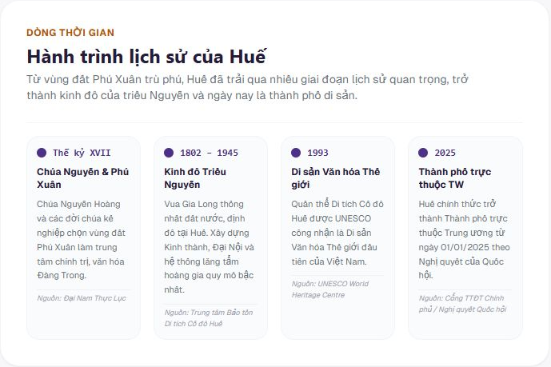
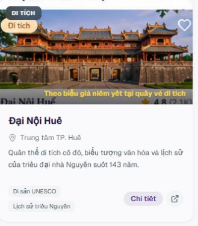
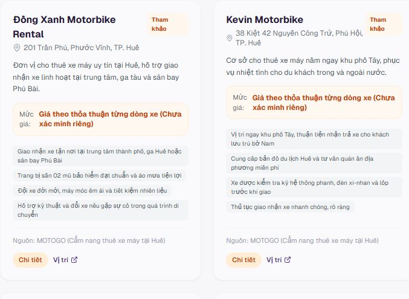
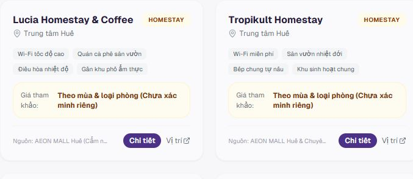

# HUẾ TRAVEL PRO V2.3 — GATE 07-02C-00
## SUBPAGE UI FIDELITY AUDIT — READ ONLY

- Project / Gate / Task ID: HUẾ TRAVEL PRO V2.3 / GATE 07-02C-00 / SUBPAGE UI FIDELITY AUDIT.
- Ngày: 25/10/2026 — Asia/Saigon.
- Root: `A:\trí tuệ nhân tạo\BAI_3\hue-travel-pro`.
- Phạm vi Owner: READ-ONLY AUDIT ONLY; chỉ tạo báo cáo và evidence trong reports/codex.
- **READ-ONLY / NO SOURCE MODIFICATION. HARD STOP — AWAIT OWNER REVIEW.**

## 1. Executive Summary

Đã truy cập ứng dụng local, đọc source, đối chiếu đúng bốn mockup và chụp/mở xem đủ **20 screenshot viewport** (4 route × 5 viewport), cùng ảnh cuộn/toàn trang và sáu crop P1. Không sửa source, CSS, asset website, logo, font, navigation, data, database, AGENTS hoặc LOCK.

**Chưa xác minh lỗi P0** về tràn ngang, clipping hoặc chữ đè làm mất thao tác chính trong 20 trạng thái mặc định. Không đồng nghĩa mọi trạng thái/zoom đều PASS. Các P1 chính: thumbnail Khám phá chứa UI/rating trong raster; ô map dùng ảnh toàn mockup và chú thích không khớp link; card lọc bỏ qua bàn phím; mật độ card/timeline khác đáng kể mockup, card thuê xe/lưu trú thiếu ảnh đúng cơ sở.

Audit: **COMPLETE — AWAIT OWNER REVIEW**. Fidelity toàn bộ bốn trang: **chưa đủ điều kiện PASS**. Khác biệt thuộc LOCK hoặc mockup-only không được coi là lỗi phải khôi phục. Không có điểm số pixel similarity tự ước lượng, không mở implementation.

## 2. Scope & Lock Boundaries

Đã đọc AGENTS.md, hồ sơ duy nhất hiện có trong docs/locks (Logo Design Lock 2026-10-24), báo cáo T05/T07, 07-02A và 07-02B. Ưu tiên Owner mới nhất → LOCK → nghiệp vụ → mockup. Prompt 07-02C-00 hiện tại xác nhận **07-02B PASS/LOCKED**, supersede trạng thái chờ review trong báo cáo cũ; chỉ ghi nhận ở audit, không cập nhật AGENTS/LOCK.

Giữ: Trang chủ/Lịch sử/Khám phá/Di chuyển/Lưu trú; routes cũ; Hero-to-Sidebar; logo/wordmark/size/lockup; bốn Hero cùng crop/gradient/position; H1 dài Lưu trú; T05 footer, T07 filter; T06 DEFERRED; 6 Places/6 Rentals/8 Accommodations. Không phục hồi menu/hero cũ, rating, giá, video hoặc chức năng minh họa. Không lấy ảnh Internet, sinh ảnh, cài package hoặc deploy.

## 3. Reference Mockups

Đã xác minh đúng tên tại `A:\trí tuệ nhân tạo\BAI_3\HUE_TRAVEL_PRO_V2.3_5_MOCKUPS\`. Bản copy nguyên byte và checksum: [references.csv](evidence/GATE-07-02C-00/references.csv).

| Route | Mockup | Kích thước gốc | So sánh cạnh nhau |
|---|---|---|---|
| /ve-hue | [02_VE_HUE.png](evidence/GATE-07-02C-00/02_VE_HUE.png) |1536×1024|[Comparison](evidence/GATE-07-02C-00/compare-ve-hue.png)|
| /kham-pha | [03_KHAM_PHA.png](evidence/GATE-07-02C-00/03_KHAM_PHA.png) |1536×1024|[Comparison](evidence/GATE-07-02C-00/compare-kham-pha.png)|
| /cam-nang | [04_CAM_NANG.png](evidence/GATE-07-02C-00/04_CAM_NANG.png) |1672×941|[Comparison](evidence/GATE-07-02C-00/compare-cam-nang.png)|
| /luu-tru | [05_LUU_TRU.png](evidence/GATE-07-02C-00/05_LUU_TRU.png) |1536×1024|[Comparison](evidence/GATE-07-02C-00/compare-luu-tru.png)|

Comparison chỉ chuẩn hóa chiều rộng để đặt cạnh nhau, giữ tỷ lệ; PNG mockup tĩnh khác kích thước viewport 1366×768. Không coi đó là đối chiếu pixel cùng viewport. Không có mockup mobile: đánh giá mobile bằng usability/reflow thực tế, không tuyên bố đạt một mockup mobile chưa được cung cấp.

## 4. Current Screenshots

In-app browser, server đang chạy tại `http://192.168.1.12:3000`. Tab Owner đang ở trang chi tiết thuê xe nên tạo tab audit riêng cho bốn trang chính. Trước chụp chờ network idle, xác minh URL/h1/viewport, thu DOM/computed CSS. Đã mở xem và chấp nhận từng ảnh viewport dưới đây.

| Viewport | Lịch sử | Khám phá | Di chuyển | Lưu trú |
|---|---|---|---|---|
|1366×768|[01](evidence/GATE-07-02C-00/01-ve-hue-1366.png)|[02](evidence/GATE-07-02C-00/02-kham-pha-1366.png)|[03](evidence/GATE-07-02C-00/03-cam-nang-1366.png)|[04](evidence/GATE-07-02C-00/04-luu-tru-1366.png)|
|1440×900|[05](evidence/GATE-07-02C-00/05-ve-hue-1440.png)|[06](evidence/GATE-07-02C-00/06-kham-pha-1440.png)|[07](evidence/GATE-07-02C-00/07-cam-nang-1440.png)|[08](evidence/GATE-07-02C-00/08-luu-tru-1440.png)|
|1650×786|[09](evidence/GATE-07-02C-00/09-ve-hue-1650.png)|[10](evidence/GATE-07-02C-00/10-kham-pha-1650.png)|[11](evidence/GATE-07-02C-00/11-cam-nang-1650.png)|[12](evidence/GATE-07-02C-00/12-luu-tru-1650.png)|
|1920×1080|[13](evidence/GATE-07-02C-00/13-ve-hue-1920.png)|[14](evidence/GATE-07-02C-00/14-kham-pha-1920.png)|[15](evidence/GATE-07-02C-00/15-cam-nang-1920.png)|[16](evidence/GATE-07-02C-00/16-luu-tru-1920.png)|
|390×844|[17](evidence/GATE-07-02C-00/17-ve-hue-390.png)|[18](evidence/GATE-07-02C-00/18-kham-pha-390.png)|[19](evidence/GATE-07-02C-00/19-cam-nang-390.png)|[20](evidence/GATE-07-02C-00/20-luu-tru-390.png)|

JSON cùng tên mỗi screenshot chứa URL/viewport/grid/bounds/overflow. [measurements.json](evidence/GATE-07-02C-00/measurements.json) tổng hợp 20 ca. Ảnh toàn trang bổ sung ba desktop/bốn mobile chỉ dùng xem thứ tự nội dung; fixed nav có thể được vẽ ở vị trí viewport đầu, không phải nằm giữa document flow.

Hai lần full-page Lịch sử bị lỗi capture (bẹp nội dung hoặc blank phía dưới) được đánh dấu `REJECTED-*`, không dùng làm bằng chứng lỗi website. Thay bằng [ảnh cuộn timeline1366](evidence/GATE-07-02C-00/ve-hue-timeline-1366.png) và DOM; 20 screenshot viewport vẫn hợp lệ. Không suy P0 từ lỗi công cụ capture.

## 5. Lịch sử — Findings

**Giữ tốt:** đủ bốn chủ đề/bốn mốc có nguồn, CTA thật, showcase có link Khám phá thay video; mobile reflow một cột. Hero/logo/sidebar theo LOCK.

- **LS01 — P1 / VERIFIED:** topic grid cao285.5px tại1366; bốn card mobile chiếm975.5px, timeline bắt đầu y1429.5. Nội dung bị đẩy xa, không mất/cắt. Root cause: p-6, icon48px, mb-4, flex-col, khoảng arrow và grid stretch. Mockup dùng card ngang gọn có minh họa. Tối thiểu thu spacing/card dưới Hero, giữ đủ nội dung; không đổ cho Hero LOCK.
- **LS02 — P1 / VERIFIED:** timeline là bốn hộp text, thiếu ảnh/trục nối; mỗi cột140.7px tại1366, title12px/body11px/source9px. Đề xuất reflow hai cột khi hẹp, trục nối ở wide; giữ mốc/nguồn. Bốn thumbnail lịch sử cần Owner cung cấp/duyệt, không tạo dữ liệu mới.
- **LS03 — P2 / VERIFIED source:** arrow topic chỉ là div, không link/handler; chưa click thử. Giảm affordance không hoạt động, không tự thêm tính năng. Showcase hiện có ảnh192px và link thật; video mockup **MOCKUP-ONLY / NOT IMPLEMENTATION READY**.

## 6. Khám phá — Findings

**Giữ tốt:** sáu địa điểm, bốn native filter, title/location/summary/tags/CTA, safetyNote, links ngoài; mobile một cột. Không thấy rating động trong JSX card đã đọc.

- **KP01 — P1 / VERIFIED:** card_dai_noi.png tự chứa tag “Di tích”, tim, mép title/rating4.8(2.1K). Background cover176px làm pixel UI lộ/cắt; DOM thêm tag/giá/title lần nữa. Đây là số liệu trong raster, không phải rating đã xác minh. Cần sáu ảnh sạch đúng địa điểm, giữ data/href; không chỉ đổi crop để che tạm.
- **KP02 — P1 / VERIFIED:** widget map dùng toàn `/images/03_KHAM_PHA.png` làm nền, hiện giao diện thu nhỏ. Cả hai href là Google Maps search khu vực, không tọa độ; chú thích “theo toạ độ địa danh chính xác” không được href chứng minh. Tối thiểu bỏ nền mockup hoặc thay preview Owner duyệt, giữ link ngoài và mô tả đúng link tìm kiếm. Không tạo marker/API/map tương tác giả.
- **KP03 — P1 / VERIFIED:** grid chỉ hai cột mọi desktop, sáu card thành ba hàng thay3×2 mockup; card đầu328.3×374px tại1366, danh sách bắt đầu y747. SafetyNote dài là nội dung hợp lệ, không được bỏ. Cân nhắc ba cột trên wide đủ min-width, giữ hai cột laptop; giảm gap dưới Hero, không ép one-screen.
- **KP04 — P2 / VERIFIED:** bốn gợi ý icon thành bốn hàng thay2×2. Có thể chỉnh grid cục bộ sau P1, giữ handlers/ý nghĩa.

## 7. Di chuyển — Findings

**Giữ tốt:** tên/Hero mới, sáu rentals, giá chưa xác minh, checklist sáu ý; hướng đi không gán km/phút giả; CTA thật; footer T05 giữ nhóm actions.

- **DC01 — P1 / VERIFIED:** hai cột card text, không render ảnh; card đầu478.5px tại1366. Features/summary/price làm mật độ text cao so3×2 card có ảnh mockup. Tên nhà xe hiện khác mockup là dữ liệu phải giữ. Optional image trong data là ảnh cầu/di tích, không được tự bật làm ảnh nhà xe. Cần sáu ảnh đúng cơ sở; trước đó chỉ compact spacing, không giảm font vốn10–12px/ẩn nội dung/phá T05.
- **DC02 — P2 / VERIFIED source/DOM:** ba card nội thành/lưu ý/mẹo có cursor-pointer nhưng không href/handler; runtime click chưa thử. Tối thiểu bỏ affordance giả, không tạo tính năng mới.
- **DC03 — P2 / VERIFIED:** checklist có, bốn hướng đi là text đơn thay tile ảnh; guides nằm dưới danh sách; không map vùng nhận xe. Ảnh/map/km/phút mockup thiếu nguồn: **MOCKUP-ONLY / NOT IMPLEMENTATION READY**. Không thêm chính sách, cam kết hoặc số liệu từ hình.

## 8. Lưu trú — Findings

**Giữ tốt:** H1 dài đúng Owner, filter T07 reflow1/2/4 cột, tám cơ sở; bốn nút tiện nghi/kinh nghiệm; giá chưa xác minh rõ. Không khôi phục “Nghỉ ngơi ở Huế”.

- **LT01 — P1 / VERIFIED:** tám card text, hai cột desktop thay4×2 có ảnh. Card đầu264px, không render item.image. Các optional image là thumbnail địa điểm, không phải ảnh cơ sở được xác thực. Cần tám ảnh đúng cơ sở rồi xét grid wide; giữ giá/href/nguồn, không thêm rating.
- **LT02 — P2 / VERIFIED:** năm tile icon-only, mobile2/2/1 là reflow hợp lệ, không clipping. Thiếu ảnh là phụ thuộc asset. Giữ mục Resort hiện tại, không đổi thành Cặp đôi theo mockup.
- **LT03 — P2 / VERIFIED:** cột phụ bốn tiện nghi/kinh nghiệm, không map khu vực/sort/số khách/advanced filter. Không tự xây chức năng chưa có model; không quay T07 về bốn cột bằng nhau.
- **LT04 — P2 / VERIFIED / DEFERRED:** tám source ellipsis120px mobile/160px desktop, scrollWidth230–308px. Đây là T06 đang deferred, không đưa vào scope sửa tự động.

## 9. Severity Matrix

P0: chặn tác vụ/mất nội dung chính. P1: trở ngại đáng kể khi đọc/chọn hoặc thông tin gây hiểu nhầm. P2: thẩm mỹ, phần chưa sẵn sàng, DEFERRED hoặc điểm phải bảo toàn. Không chấm chỉ từ màu sắc. Có 8 nhóm P1 và 9 quan sát P2 (gồm cả LOCK/DEFERRED, không phải 9 yêu cầu sửa ngay).

Bản đầy đủ có thể lọc: [severity-matrix.csv](evidence/GATE-07-02C-00/severity-matrix.csv) / [findings.json](evidence/GATE-07-02C-00/findings.json). Tên page rút gọn trong bảng đều nằm dưới src/app; tên evidence thuộc evidence/GATE-07-02C-00/.

|ID|Route|Section|Mockup|Current|Gap|Evidence|Severity|Root cause|Proposed fix|Files|Dependencies|Lock impact|Owner decision|
|---|---|---|---|---|---|---|---|---|---|---|---|---|---|
|LS01|/ve-hue|Topic cards|4 card ngang gọn|285.5px tại1366 và975.5px mobile|Timeline bị đẩy xa|P1-LS01-topic-crop.png|P1|p-6/icon48/mb-4/flex-col|Thu spacing giữ nội dung|ve-hue/page.tsx:92|Minh họa Owner tùy chọn|Không Hero/nav/logo|Duyệt card cục bộ|
|LS02|/ve-hue|Timeline|Ảnh và trục nối|4 hộp text cột140.7px|Nguồn9px khó đọc/thiếu trục|P1-LS02-timeline-crop.png|P1|Grid4cols và không render ảnh|Reflow khi hẹp giữ mốc/nguồn|ve-hue/page.tsx:138|4 ảnh lịch sử nếu muốn|Không sửa heritage data|Duyệt layout và asset riêng|
|LS03|/ve-hue|Arrow/showcase|Arrow và video|Arrow div/showcase link thật|Affordance chưa có hành động|ve-hue-timeline-1366.png|P2|Arrow không handler|Bỏ affordance giả/giữ link|ve-hue/page.tsx:110|Video thật chưa có|Không video giả|Duyệt sau P1|
|KP01|/kham-pha|Thumbnail|Ảnh sạch và HTML|Raster có tag/tim/title/rating|UI lặp và số liệu ảnh cũ|P1-KP01-thumbnail-crop.png|P1|place.image là crop UI/bg-cover176|Owner clean assets giữ data|6 asset cards và kham-pha/page.tsx:439|NEEDS ASSET6 ảnh sạch|Assets dùng chung cần duyệt|Duyệt replacement/mapping|
|KP02|/kham-pha|Map preview|Bản đồ khu vực|Full mockup trong widget|Không đọc như map/copy quá chắc|P1-KP02-map-crop.png|P1|page609 full PNG và630 copy tọa độ|Link ngoài rõ/preview sạch/copy đúng|kham-pha/page.tsx:587|Preview Owner nếu cần|Giữ maps external|Duyệt phương án không API giả|
|KP03|/kham-pha|Grid|3×2|2×3 mọi desktop|Danh sách dài và ít card nhìn cùng lúc|measurements.json|P1|grid sm2col/main8-4/gap32|2cols laptop/3cols wide đủ chỗ|kham-pha/page.tsx:378|KP01 trước|Giữ safetyNote/filter/Hero|Duyệt min-width không ép1screen|
|KP04|/kham-pha|Gợi ý|2×2 tile|4 hàng icon|Khác nhịp chia cột|kham-pha-1366-full.png|P2|space-y-2 thay grid|Grid khi đủ chỗ giữ handler|kham-pha/page.tsx:635|Ảnh tùy chọn|Giữ query logic|Duyệt sau P1|
|DC01|/cam-nang|6 card|3×2 có ảnh|2×3 text cao478.5px|Thiếu ảnh/text dày|P1-DC01-cards-crop.png|P1|Không render item.image và features dài|Compact spacing/ảnh đúng rồi grid wide|cam-nang/page.tsx:332|NEEDS ASSET6 nhà xe|T05 footer nguyên dạng|Duyệt asset/card không đổi T05|
|DC02|/cam-nang|Category|Card gợi click|3 pointer div tĩnh|Affordance không handler|source178-205|P2|Không onClick/href|Bỏ pointer không thêm chức năng|cam-nang/page.tsx:178|Không|Không rental logic|Duyệt presentation|
|DC03|/cam-nang|Cột phụ/guides|Tile ảnh/map|Checklist và dòng text|Ít ảnh/guides xa|cam-nang-1366-full.png|P2|Guides sau danh sách/không map|Thu grid guides giữ nội dung|cam-nang/page.tsx:465|Map/ảnh/km NOT READY|Không fake policy/route numbers|Duyệt phần có dữ liệu|
|LT01|/luu-tru|8 card|4×2 ảnh|2×4 text264px|Không thành gallery|P1-LT01-cards-crop.png|P1|Không render optional image|Ảnh đúng cơ sở rồi xét grid|luu-tru/page.tsx:425|NEEDS ASSET8 ảnh|Giữ Hero/T07/T06/price|Duyệt asset/mật độ|
|LT02|/luu-tru|Gợi ý|5 tile ảnh|5 tile icon mobile2/2/1|Thiếu ảnh không clipping|20-luu-tru-390.png|P2|Grid2-3-5/icon|Giữ5 ý nghĩa chỉnh spacing|luu-tru/page.tsx:283|Ảnh sạch tùy chọn|Không đổi Resort theo mockup|Duyệt sau P1|
|LT03|/luu-tru|Cột phụ/control|Map8amenity/sort|4amenity/4filter|Thiếu chức năng model không có|luu-tru-1366-full.png|P2|DOM chỉ4 controls/4 buttons|Giữ chức năng đang có|luu-tru/page.tsx:553|MOCKUP-ONLY NOT READY|T07 không đổi|Phạm vi riêng nếu thêm chức năng|
|LT04|/luu-tru|Nguồn T06|Không source|8source ellipsis|Chưa đọc hết source|measurements.json|P2|truncate max-w120/160|DEFERRED không sửa|luu-tru/page.tsx:472|Ngoại lệ Owner riêng|T06 DEFERRED|Không đề nghị tự mở|
|A01|3 route lọc|Keyboard|Mockup không chứng minh keyboard|Div click tabindex-1|Tab bỏ5 gợi ý Lưu trú|keyboard-luu-tru.json và semantics.json|P1|Div không focusable/không key handler|Button wrapper giữ handler/style|3 page vùng gợi ý/category|Không package/asset|Không nav/Hero/T05/T07|Duyệt từng trang|
|SH01|4 route|Shell/sidebar|Sidebar~130px/Hero liền nền|Sidebar256/main max1280|Khác hình học nhưng cần bảo toàn|20 screenshots và Shell.tsx|P2|md:pl-64/max-w-7xl/padding|PRESERVE LOCK chỉ gap page|Shell.tsx CHỈ ĐỌC|Không|Thay Shell/nav cần ngoại lệ|Không đề xuất mở ở gate này|
|SH02|4 route|Typography/icon|Serif và icon minh họa|H2 computed Segoe UI/outline|Phong cách/phân cấp khác|semantics.json|P2|serif stack bắt đầu Segoe UI|Chỉ cục bộ dưới Hero nếu duyệt|4 page/global config CHỈ ĐỌC|Actual glyph font NOT VERIFIED|Global font/wordmark/Hero LOCK|Không mở font toàn site|

### A01 — keyboard / P1

[semantics.json](evidence/GATE-07-02C-00/semantics.json): các gợi ý có click là DIV, role=null, tabIndex=-1, không child focusable. Lưu trú390: click input rồi Tab11 lần →4 chip →4 select →tên Lucia →Chi tiết →Vị trí, bỏ qua cả5 card gợi ý. [keyboard-luu-tru.json](evidence/GATE-07-02C-00/keyboard-luu-tru.json).

Runtime keyboard **VERIFIED cho Lưu trú**. Khám phá/Di chuyển cùng pattern source/DOM VERIFIED nhưng chưa chạy chuỗi Tab riêng, không tuyên bố runtime thay cho chúng. Tối thiểu đổi wrapper tác vụ hiện có sang button type=button, giữ style/handlers/URL, không thêm chức năng. Chờ Owner cấp phép từng trang.

## 10. Source & Root Cause

| File / vùng đọc | Nguyên nhân xác minh |
|---|---|
| src/app/ve-hue/page.tsx:92–117 | Grid1/2/4, p-6/icon48/mb-4/flex-col và arrow div làm card dọc cao |
| src/app/ve-hue/page.tsx:119–193 | Timeline4 hộp text, không thumbnail/trục; font9–12px; showcase link thật |
| src/app/kham-pha/page.tsx:190–375 | Category +4 native filters; state/query/search hiện có |
| src/app/kham-pha/page.tsx:378–576 | Main8/4, card2cols, place.image176/160px bg-cover; safetyNote/tags/CTA |
| src/app/kham-pha/page.tsx:587–632 | Full mockup trong map; hai href search khu vực; chú thích nói tọa độ |
| src/app/kham-pha/page.tsx:635–721 | Gợi ý4 div click không keyboard semantics |
| src/app/cam-nang/page.tsx:161–278 |4 category/3 native filters;3 card tĩnh có pointer |
| src/app/cam-nang/page.tsx:280–400 | Main8/4, rental2cols, no image; T05 footer381–400 |
| src/app/cam-nang/page.tsx:465–580 | Guides/checklist/hướng đi text, không map |
| src/app/luu-tru/page.tsx:184–281 | T07 grid1/2/4, cột giá min20rem khi wide |
| src/app/luu-tru/page.tsx:283–495 |5 gợi ý div;2col card no image; T06 source472 truncate |
| src/app/luu-tru/page.tsx:553–650 |4 amenity buttons thật và kinh nghiệm; không map |
| src/components/common/Card.tsx:23 | Wrapper div rounded/overflow-hidden; không suy mọi clipping là do Card |
| src/components/layout/Shell.tsx:38–45 | md:pl-64/max-w-7xl/padding giải thích sidebar256px và content1208px trên wide; chỉ đọc |
| tailwind.config.ts:28 | serif stack bắt đầu Segoe UI; computed font-family khớp; chưa đo actual glyph font/fallback |
| src/data/heritage.ts / places.ts / rentals.ts / accommodations.ts / src/types/content.ts | Giữ dữ liệu hiện có; heritage không image field; rental/accommodation optional image hiện trỏ ảnh địa điểm |

Dòng code là mốc tại audit, không cấp quyền sửa cả file. LIKELY: text nhỏ/nhạt có thể khó đọc hơn trên laptop Owner; chưa đo contrast/anti-aliasing. NOT VERIFIED: font per-glyph, fallback tiếng Việt và độ chính xác dữ liệu/map bên thứ ba. Không suy kết luận các mục này từ screenshot.

## 11. Responsive Results

| Viewport | Doc height Lịch sử / Khám phá / Di chuyển / Lưu trú | Overflow ngang |
|---|---|---|
|1366×768|1344 /2175 /2376 /2059px|Không đo thấy|
|1440×900|1291 /2110 /2298 /2059px|Không đo thấy|
|1650×786|1289 /2077 /2131 /1978px|Không đo thấy|
|1920×1080|1289 /2077 /2131 /1978px|Không đo thấy|
|390×844|2842 /4341 /4889 /4135px|Không đo thấy|

- 20 ca có document scrollWidth=clientWidth. Sidebar đủ5 nhãn, không chồng nội dung trong ảnh mặc định; mobile dùng bottom nav. Chưa thử mọi scroll/zoom hoặc điện thoại vật lý.
- Grid địa điểm/thuê xe/lưu trú2 cột desktop/1 mobile. Cuộn dọc mobile là hợp lệ, không ép one-screen. Section gap chủ yếu32px; category4 thẻ chuyển2×2; topic Lịch sử4→1 cột.
- [card-filter-probes.json](evidence/GATE-07-02C-00/card-filter-probes.json): đủ6 rentals/8 accommodations ở5 viewport;30 footer thuê xe có text “Chi tiết” một dòng qua Range. “Vị trí” không thấy ngắt trên ảnh. Không khai báo đã thử lại tất cả href/option dài trong lần audit này.
- T07 ô giá width488.5 /525.5 /379.34 /379.34 /313px tương ứng5 viewport; số cột2/2/4/4/1. Không đề xuất bốn cột bằng nhau.
- Overflow cục bộ8 span source Lưu trú là T06 truncate, không phải document overflow. Không thấy card clipping/text đè nhau ở trạng thái mặc định. Screenshot full-page fixed nav không dùng kết luận overlap trong flow.
- Rủi ro đọc ở font9–12px/xám nhạt được ghi nhận; không có chứng nhận WCAG/screen reader. Runtime Tab Lưu trú xác minh riêng A01.

| Kiểm tra lần audit này | Trạng thái | Giới hạn |
|---|---|---|
| Typecheck | NOT TESTED | Không chạy lại vì không sửa source; PASS cũ không coi là PASS mới |
| Lint | NOT TESTED | Không chạy lại trong audit |
| Production Build | NOT TESTED | Không build/deploy |
| Runtime access/DOM | PASS trong phạm vi quan sát |4 route ×5 viewport mở/chụp được; không dựa riêng HTTP200 |
| Keyboard gợi ý Lưu trú | FAIL |Tab bỏ qua5 card có tác vụ click |
| Visual fidelity toàn4 trang | FAIL / NEEDS OWNER REVIEW |P1 còn tồn tại; không phải mọi khác biệt mockup đều cần sửa |
| READ-ONLY integrity | PASS |59/59 file baseline không thay đổi |

[console-audit.json](evidence/GATE-07-02C-00/console-audit.json): có React extra attributes __processed_… trên body, cùng loại các báo cáo trước ghi nhận; tác nhân cụ thể NOT VERIFIED. Không sửa/che cảnh báo hoặc tuyên bố console sạch. [runtime-summary.json](evidence/GATE-07-02C-00/runtime-summary.json).

## 12. Missing Assets / Dependencies

- NEEDS ASSET:6 thumbnail địa điểm sạch không UI/rating,6 ảnh đúng nhà xe,8 ảnh đúng cơ sở lưu trú. Không bật ảnh cầu/đại nội đang nằm ở optional image để minh họa nhà xe/khách sạn; giữ data và cần Owner mapping rõ.
- Timeline4 ảnh lịch sử,5 tile Lưu trú/4 tile Khám phá: tùy chọn, cần ảnh Owner duyệt nếu muốn; phase đầu có thể chỉ CSS/icon có sẵn.
- Map preview cần ảnh sạch/quyền dùng được duyệt nếu giữ ảnh. Link ngoài thật có thể trình bày rõ mà không thêm API/map/marker giả.
- MOCKUP-ONLY / NOT IMPLEMENTATION READY: video/play, rating/review counts, giá riêng chưa xác minh, km/phút, sort/số khách/thời điểm/advanced filters chưa có model, tiện nghi ngoài4 đang hỗ trợ. Không nhập số liệu/nhà cung cấp minh họa từ mockup.
- Spacing/grid/semantics không cần thư viện mới. Global font/logo/Hero vẫn LOCK.

## 13. Restoration Phases — chỉ đề xuất

| Phase | Mục tiêu / file dự kiến | Điều kiện bắt đầu | Phạm vi cấm | Acceptance criteria / tests | Owner cần duyệt |
|---|---|---|---|---|---|
|07-02C-01 — P0|Chỉ lỗi chặn tác vụ tái hiện được; hiện chưa có file proposed|Có reproducer/ảnh/DOM P0 và lệnh scoped|Không lấy phaseP0 để làm thẩm mỹ hoặc mở LOCK|Trước tái hiện/sau hết lỗi;5viewport/nav/filter/typecheck/lint|Không mở khi chưa có P0 đủ chứng cứ|
|07-02C-02 — P1|Chia nhỏ: KP01/KP02; A01 từng trang; LS01/LS02; DC01/LT01 khi có ảnh;4 page theo §14|Owner duyệt allowlist tiểu phần, asset trước overwrite|Không Hero/nav/logo/globalfont/T05/T07/T06/data; không bỏ safety/nguồn/disclaimer|Before/after5viewport; no overflow/overlap;6/6/8; href/query giữ;Tab/Enter/Space;typecheck/lint;checksum LOCK/T05/T07|Map/asset mapping/min-width card; không ép1screen|
|07-02C-03 — P2|Local typography/icon/spacing và chi tiết có đủ dữ liệu theo từng page|P1 đã Owner nghiệm thu và có lệnh mới|Không globalfont/wordmark/Hero/T06 hoặc chức năng thiếu model|So mockup kèm ngoại lệ;5viewport/glyph/contrast/keyboard cục bộ/regression|Chọn P2 muốn làm, asset tùy chọn; không tự phục hồi toàn mockup|

Không có P0 nên chưa cần mở07-02C-01. Đề nghị Owner duyệt **07-02C-02 tiểu phần Khám phá KP01/KP02 trước**, KP01 chờ ảnh sạch, KP02 theo phương án preview/link được duyệt. Có thể tách A01 Lưu trú thành một tiểu phần nhỏ không phụ thuộc asset. Không gom bốn trang vào một lần chỉnh lớn. Đây chưa phải implementation authorization.

## 14. Exact Proposed File Allowlist

**Không file nào được phép sửa trong audit này.** Đề xuất để Owner cấp quyền tiếp:

1. `src/app/kham-pha/page.tsx`: card436–576/map587–632/gợi ý635–721 và spacing/grid dưới Hero. Không Hero141–187 hoặc state/query/search/filter handlers.
2. `src/app/ve-hue/page.tsx`: topic92–117/timeline-showcase119–193; không Hero43–90/topbar/logo.
3. `src/app/cam-nang/page.tsx`: category161–207/card body332–379/guides465–580; T05 footer381–400 nguyên dạng; không Hero/filter/state/data/rental logic.
4. `src/app/luu-tru/page.tsx`: gợi ý283–370/card body423–469/cột phụ553–650; không Hero138–181/filter T07 toàn184–281/footer-source T06 471–494; không query/data/handlers.

Conditional asset allowlist cho KP01, chỉ khi Owner cấp quyền thay và duyệt ảnh sạch/checksum:

- `public/images/cards/card_dai_noi.png`
- `public/images/cards/card_truong_tien.png`
- `public/images/cards/card_thien_an.png`
- `public/images/cards/card_lang_co.png`
- `public/images/cards/card_thien_mu.png`
- `public/images/cards/card_thuy_xuan.png`

Đây là asset dùng chung ở Home/trang chi tiết/các chỗ khác. Thay ảnh có tác động ngoài card Khám phá dù không sửa code nơi đó: cần Owner duyệt phạm vi shared assets và regression nơi sử dụng trước overwrite. Nếu muốn bộ riêng Khám phá, đăng ký đường dẫn cụ thể ở task tiếp theo; không tự đặt asset mới trong audit.

Chưa có file ảnh nhà xe/khách sạn/timeline Owner duyệt nên chưa có allowlist ghi ảnh tương ứng: NEEDS ASSET / REQUIRES OWNER EXCEPTION trước khi thêm/sửa. Không cấp quyền chung cả thư mục. Không đưa data/types/lib/Shell/navigation/Card chung/globals/tailwind/package/Prisma/AGENTS/LOCK vào allowlist.

## 15. Owner Decisions Required

1. Duyệt KP01/KP02; map dùng link ngoài rõ ràng hay preview sạch Owner duyệt; không map/marker giả.
2. Duyệt6 thumbnail sạch và lựa chọn shared assets hay bộ riêng, kèm phạm vi regression.
3. Duyệt A01 chỉ đổi wrapper tác vụ hiện có, giữ logic; bắt đầu một trang.
4. Duyệt compact topic/timeline Lịch sử; ảnh lịch sử riêng hay trục/text trước.
5. Duyệt6 ảnh nhà xe/8 ảnh lưu trú và min-width trước grid có ảnh; không dùng placeholder như ảnh xác thực.
6. Giữ Hero07-02B/logo/navigation/T05/T07 LOCK và T06 DEFERRED. Không cần mở ngoại lệ các vùng đó để sửa P1 đã đề xuất.

## 16. Read-only Integrity Verification

Không có Git repository, không commit/reset/checkout. [baseline.csv](evidence/GATE-07-02C-00/baseline.csv) và [integrity-final.csv](evidence/GATE-07-02C-00/integrity-final.csv): **59/59 unchanged,0 changed**. Tập kiểm gồm toàn bộ src/public/docs/locks/Prisma hiện có và6 file quy tắc/config/package. Không phải snapshot mọi file trên ổ đĩa.

Chỉ tạo báo cáo/ảnh/CSV/JSON/text và script xử lý evidence bên trong reports/codex. Crop/comparison là bản phái sinh từ screenshot/reference đã mở xem, giữ nguyên ảnh website và ảnh gốc. Evidence giao diện đều chụp trong lần audit này; báo cáo gate cũ chỉ cung cấp lịch sử/LOCK. Dev cache .next có thể phát sinh khi duyệt trang, khác source modifications. Không đọc/in .env, không thao tác database; local dataset giữ nguyên không có nghĩa đã kiểm hàng trong database.

Logo owner-lotus.png giữ SHA-256 `6E53DD205EDE658EBCAEBAED45632A1E5613C8D01E141B22172F597EB6112B9D`.

Bốn Hero giữ checksum07-02B:

- hero_lich_su.png: `D7143BA2693B61E9C3E35A2E0B4BB1320EA43CC7252430BB492E62AAEEA7CC9F`
- hero_kham_pha.png: `6A832B20857101A2F6EF71778F152F173F9B88B63C8AA206B702E7AC1CB61E23`
- hero_di_chuyen.png: `C6DB8491B411D15D1481DF1161B0265C3953AD3A284E7C9A2BBF5FA655FCEE37`
- hero_luu_tru.png: `A2296E45F95E8FD2184921990DD73AAE3C53790B1220EA5F2985F65D54801558`

Page source không đổi hash nên crop/gradient/position Hero, H1, T05/T07 nguyên dạng. AGENTS và hồ sơ LOCK không sửa; không tự cập nhật trạng thái nghiệm thu. Metadata/checksum mockup đã lưu references.csv.

## 17. Recommendation & Next Gate

Audit hoàn chỉnh; đề nghị Owner duyệt nhóm P1/asset/phạm vi cụ thể trước07-02C-02. Chưa có P0 đủ căn cứ mở07-02C-01; không cần thiết kế lại từ đầu, có thể chỉnh từng vùng page hiện có. T06 và mockup-only tiếp tục DEFERRED/NOT READY.

**READ-ONLY / NO SOURCE MODIFICATION.**

**HARD STOP — AWAIT OWNER REVIEW.** Không sửa layout, không mở07-02C-01/02, không cập nhật LOCK, không deploy.

**PASS = LOCK — FIX ONLY WHAT FAILED — NO SCOPE CREEP.**
