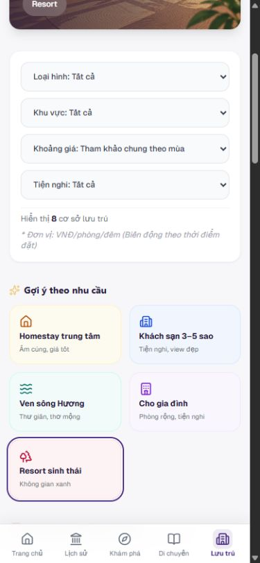

# HUẾ TRAVEL PRO V2.3 — GATE 07-02C-02A
## ACCESSIBILITY FIX — A01 / ACCOMMODATION SUGGESTION CARDS

- Project / Gate / Task ID: HUẾ TRAVEL PRO V2.3 / GATE 07-02C-02A / A01 — /luu-tru.
- Ngày: 25/10/2026, Asia/Saigon.
- Project root: `A:\trí tuệ nhân tạo\BAI_3\hue-travel-pro`.
- Phạm vi: OWNER APPROVED — SCOPED IMPLEMENTATION, chỉ năm suggestion cards trong src/app/luu-tru/page.tsx.
- Trạng thái đề xuất: **PASS A01 trong phạm vi đã kiểm — AWAIT OWNER REVIEW**. Không tự xác nhận Owner nghiệm thu hoặc cập nhật LOCK.

## 1. Executive Summary

Đã đổi đúng năm wrapper DIV có hành động lọc thành BUTTON native, type=button, giữ nguyên năm handler/state/query, tên/thứ tự/card count. Thêm focus-visible ring cục bộ và scroll margin để card focus không nằm sau bottom navigation mobile. Không thay thiết kế bình thường: cả25 card ở5 viewport vẫn cao89px; grid, bounds, màu, padding, font, icon và vị trí nội dung khớp baseline.

Đã thực sự thử Tab/Shift+Tab ở cả5 viewport; Enter/Space/Mouse cho từng card ở5 viewport =75 ca kích hoạt, mỗi ca kèm reset. URL, bốn giá trị filter và số kết quả đều khớp click baseline trước sửa; reset đều trở về8 cơ sở. Typecheck/lint PASS. Chỉ một file source đổi; toàn bộ source ngoài section gợi ý nguyên byte,58 file baseline khác không đổi.

## 2. Owner Authorization

Owner gửi file yêu cầu GATE 07-02C-02A — ACCESSIBILITY FIX, cấp quyền đúng src/app/luu-tru/page.tsx, section khoảng283–370 lúc audit. Đã đọc AGENTS.md, Logo Design LOCK và báo cáo07-02C-00/A01; lệnh scoped mới nhất chỉ mở vùng này, không thay quy tắc của các vùng khác.

Không sửa Hero/ảnh Hero, logo/navigation, T07, accommodation cards/T06, state/query/filter logic, global font/theme/icon/màu, data/DB, package, map hoặc thumbnail. Không mở rộng A01 sang Khám phá/Di chuyển. Không migration/seed/install/deploy.

## 3. Root Cause A01

VERIFIED trước sửa: năm wrapper là DIV, tabIndex=-1, không role/keyboard semantics và chỉ có onClick. Audit07-02C-00 đã thử Tab và xác nhận bỏ qua cả năm. Baseline DOM lần này cũng ghi DIV/tabIndex=-1, không interactive descendants: [before-measurements.json](evidence/GATE-07-02C-02A/before-measurements.json).

Hành động là thay bộ lọc trong cùng trang, nên dùng button thay vì link điều hướng. Native button cung cấp Tab/Enter/Space mà không cần tabIndex hay xử lý phím thủ công. Không có nested interactive controls cần ngoại lệ Owner.

## 4. Exact Changed Files / Công việc thực hiện

**File source duy nhất:** `src/app/luu-tru/page.tsx`, năm suggestion cards bắt đầu dòng290, section kết thúc khoảng375 sau thêm5 dòng type.

- Năm wrapper div → button, thêm type=button.
- Heading h4 và paragraph trong từng button → span display:block, giữ text/font-size/weight/color/line-height/vị trí. Việc này giữ nội dung dạng phrasing hợp lệ bên trong button, không tạo heading/paragraph lồng trong button.
- Thêm w-full/text-left để giữ kích thước và căn trái như div trước đây.
- Chỉ báo focus: focus-visible ring2px deep-violet + offset2px trắng; outline được thay bằng ring nhìn thấy, không bỏ chỉ báo focus.
- scroll-mt-4 / scroll-mb-24: khoảng cuộn16/96px, không tạo margin trong normal flow. Mobile card cuối sau focus có đáy748px, bottom nav bắt đầu784.5px; ring ngoài4px vẫn có khoảng hở.

Năm handler và mọi state/selected-color expression giữ nguyên. Không thêm ARIA/role/tabIndex/onKeyDown/onKeyUp; accessible name lấy từ nội dung thật. Không cần aria-pressed mới để hoàn thành tác vụ này; không thêm trạng thái giả.

## 5. Semantic Before / After

| Card / accessible name sau sửa | Trước | Sau | Nested interactive |
|---|---|---|---|
| Homestay trung tâm Ấm cúng, giá tốt | DIV/tabIndex-1 | BUTTON/type=button/tabIndex0 |0|
| Khách sạn 3–5 sao Tiện nghi, view đẹp | DIV/tabIndex-1 | BUTTON/type=button/tabIndex0 |0|
| Ven sông Hương Thư giãn, thơ mộng | DIV/tabIndex-1 | BUTTON/type=button/tabIndex0 |0|
| Cho gia đình Phòng rộng, tiện nghi | DIV/tabIndex-1 | BUTTON/type=button/tabIndex0 |0|
| Resort sinh thái Không gian xanh | DIV/tabIndex-1 | BUTTON/type=button/tabIndex0 |0|

Tên/description hiển thị không đổi. Button không submit form do explicit type=button. SVG/icon, các biểu thức màu selected và grid wrapper giữ nguyên. [after-measurements.json](evidence/GATE-07-02C-02A/after-measurements.json), [protected-check.json](evidence/GATE-07-02C-02A/protected-check.json).

## 6. Keyboard Test Results

Môi trường: in-app browser tại http://192.168.1.12:3000/luu-tru, viewport CSS mô phỏng. Chờ hydration/network idle và vị trí cuộn ổn định; không suy PASS chỉ từ JSX hoặc HTTP200.

| Viewport | Tab từ đầu trang, thứ tự5 card | Shift+Tab từ card cuối | Focus-visible | Enter / Space |
|---|---|---|---|---|
|1366×768|0→1→2→3→4|3→2→1→0|5/5|5/5 mỗi phím|
|1440×900|0→1→2→3→4|3→2→1→0|5/5|5/5 mỗi phím|
|1650×786|0→1→2→3→4|3→2→1→0|5/5|5/5 mỗi phím|
|1920×1080|0→1→2→3→4|3→2→1→0|5/5|5/5 mỗi phím|
|390×844|0→1→2→3→4|3→2→1→0|5/5|5/5 mỗi phím|

0…4 tương ứng thứ tự bảng trên, đúng thứ tự hiển thị. Bằng chứng có toàn chuỗi focus đi từ đầu trang: [keyboard-order.json](evidence/GATE-07-02C-02A/keyboard-order.json). Enter/Space dùng thao tác bàn phím thật trên button; không dispatch event bằng JavaScript.

Không quan sát double activation trong các thao tác phím đơn: URL/state đúng một kết quả mong đợi, không submit hoặc điều hướng ngoài ý muốn. Source chỉ giữ một onClick mỗi card và không thêm keyboard handler để kích hoạt trùng. Không instrument bộ đếm onClick; kết luận dựa trên native semantics, thao tác đơn và kết quả thực tế, không tuyên bố đã đếm mọi callback nội bộ.

Trong kiểm thử đã phát hiện card focus cuối có thể bị bottom nav che một phần trên mobile. Đã sửa bằng scroll margin chỉ trên năm button và kiểm tra lại Tab/focus cả5 viewport trên bản cuối. Không sửa nav hoặc tăng chiều cao card. Ring sau hiệu ứng ổn định: màu rgb(77,48,135), offset trắng2px, ring ngoài4px; không gây document overflow.

## 7. Mouse Interaction Regression

Trước sửa đã click riêng từng card từ trạng thái reset, lưu [mouse-before.json](evidence/GATE-07-02C-02A/mouse-before.json). Sau sửa đã so cùng URL/giá trị filter/count cho Enter, Space và Mouse tại5 viewport: [activation-tests.json](evidence/GATE-07-02C-02A/activation-tests.json), **75/75 matchesBefore và resetPass**.

| Card | Query từ trạng thái reset | Values: type / area / budget / amenity | Số cơ sở |
|---|---|---|---|
| Homestay trung tâm | type=homestay&area=Trung+t%C3%A2m |homestay / Trung tâm / all / all|3|
| Khách sạn 3–5 sao | type=hotel |hotel / all / all / all|3|
| Ven sông Hương | area=s%C3%B4ng+H%C6%B0%C6%A1ng |all / sông Hương / all / all|2|
| Cho gia đình | amenity=wifi |all / all / all / wifi|6|
| Resort sinh thái | type=resort |resort / all / all / all|1|

Giữ nguyên ý nghĩa đang có, kể cả “Cho gia đình” dùng amenity=wifi; không sửa logic để diễn giải nhãn khác. Sau mỗi ca click nút Xóa bộ lọc thật, URL về /luu-tru,4 select=all và8 link Chi tiết. Trên bản CSS cuối có kiểm thêm Space→Resort→reset8: [final-smoke.json](evidence/GATE-07-02C-02A/final-smoke.json), [ảnh reset](evidence/GATE-07-02C-02A/reset-final.png).

Các ca75 thực hiện trước tinh chỉnh scroll margin cuối; đó là CSS cuộn/focus, không thay handler/query. Bản cuối đã thử lại Tab/Shift+Tab/focus cả5 viewport và Space/reset mobile. Không tự mở rộng sang mọi tổ hợp filter hoặc links cơ sở ngoài nhiệm vụ.

## 8. Five Viewport Visual Results

| Viewport | Card width CSS px | Height trước→sau | Số cột trước→sau | Overflow ngang |
|---|---|---|---|---|
|1366×768|196.59|89→89px|5→5|Không|
|1440×900|211.39–211.41|89→89px|5→5|Không|
|1650×786|233.59–233.61|89→89px|5→5|Không|
|1920×1080|233.59–233.61|89→89px|5→5|Không|
|390×844|167.5|89→89px|2→2, ba hàng|Không|

[visual-comparison.json](evidence/GATE-07-02C-02A/visual-comparison.json): card bounds/màu/padding/font/text, children bounds/font/line-height/color, grid và Hero bounds đều khớp. Căn trái đổi từ CSS logical start của div sang left của button trong trang LTR; vị trí text thực tế giữ nguyên. Không coi khác tên giá trị CSS tương đương này là đổi thị giác. Gap12px, icon20×20px, title12px/16px và description10px/15px giữ nguyên.

Các lần đo/chụp khi resize/scroll chưa ổn định bị loại và chụp lại sau reload/ổn định; đã dùng checkpoint gốc và bản sửa đã lưu để đối chiếu đúng hai phiên bản, không thay nội dung baseline. Không dùng ảnh chuyển kích thước làm kết luận lỗi layout. Không khai báo pixel-identical toàn trang hoặc chứng nhận mọi browser/zoom.

## 9. Screenshots Before / After / Focus

Ảnh chụp thực tế trong nhiệm vụ, lưu ở evidence/GATE-07-02C-02A. Ảnh Normal là viewport đã cuộn để thấy trọn năm card; ảnh Top cùng thư mục dùng quan sát Hero/T07. Focus chụp khi ring đã ổn định.

| Viewport | Before normal | After normal | Keyboard focus |
|---|---|---|---|
|1366×768|[Before](evidence/GATE-07-02C-02A/before-normal-1366.png)|[After](evidence/GATE-07-02C-02A/after-normal-1366.png)|[Focus](evidence/GATE-07-02C-02A/focus-1366.png)|
|1440×900|[Before](evidence/GATE-07-02C-02A/before-normal-1440.png)|[After](evidence/GATE-07-02C-02A/after-normal-1440.png)|[Focus](evidence/GATE-07-02C-02A/focus-1440.png)|
|1650×786|[Before](evidence/GATE-07-02C-02A/before-normal-1650.png)|[After](evidence/GATE-07-02C-02A/after-normal-1650.png)|[Focus](evidence/GATE-07-02C-02A/focus-1650.png)|
|1920×1080|[Before](evidence/GATE-07-02C-02A/before-normal-1920.png)|[After](evidence/GATE-07-02C-02A/after-normal-1920.png)|[Focus](evidence/GATE-07-02C-02A/focus-1920.png)|
|390×844|[Before](evidence/GATE-07-02C-02A/before-normal-390.png)|[After](evidence/GATE-07-02C-02A/after-normal-390.png)|[Focus](evidence/GATE-07-02C-02A/focus-390.png)|

## 10. Typecheck & Lint / Build / Runtime

- Typecheck: **PASS**, pnpm exec tsc --noEmit --incremental false, exit0, [log](evidence/GATE-07-02C-02A/typecheck.log).
- Lint: **PASS**, pnpm lint, exit0, không ESLint warnings/errors, [log](evidence/GATE-07-02C-02A/lint.log).
- Cả hai đã chạy trên bản cuối gồm scroll margin.
- Production Build: **NOT TESTED**, không build/deploy trong nhiệm vụ này.
- Runtime A01: **PASS trong phạm vi đã thử** (Tab/Shift+Tab, Enter/Space/click/reset); Visual A01: **PASS tại5 viewport đã đo/xem**, chờ Owner duyệt.
- Không phát hiện loại lỗi JavaScript mới trong tập console đã thu. Vẫn có React warning extra attributes __processed_… trên body, đã có trước sửa: [console trước](evidence/GATE-07-02C-02A/console-before.json), [console sau](evidence/GATE-07-02C-02A/console-after.json). Không tuyên bố console sạch hoặc đã sửa warning ngoài scope.

## 11. SHA-256 & Diff

Không có Git repository tại root khi chạy git status. Đã tạo checkpoint trước sửa theo quyền Owner; không reset/discard user changes ngoài allowlist. Dùng git diff --no-index để lưu diff.

- File: src/app/luu-tru/page.tsx.
- Before SHA-256: `7B6EB36E1CE57C457063594401AC054496118A21D96A0879F2F49719C832FFA0`.
- After SHA-256: `B4A3D56BC8EC3AAD01B2B2159F0E554F38804A6D8E0114F5B0D76180BDC06A89`.
- [Checkpoint before](evidence/GATE-07-02C-02A/luu-tru.before.tsx), [snapshot after](evidence/GATE-07-02C-02A/luu-tru.after.tsx), [diff](evidence/GATE-07-02C-02A/luu-tru.diff).

[baseline.csv](evidence/GATE-07-02C-02A/baseline.csv) / [integrity-final.csv](evidence/GATE-07-02C-02A/integrity-final.csv):59 file, chỉ file allowlist đổi,58 file còn lại không đổi. Tập gồm src/public/locks/Prisma và quy tắc/config/package, không phải snapshot mọi file ổ đĩa. Tạo thêm báo cáo, checkpoint, ảnh, JSON/CSV/diff/script kiểm tra trong reports/codex; không thêm file source/package mới.

## 12. LOCK Integrity Verification

[byte-integrity.json](evidence/GATE-07-02C-02A/byte-integrity.json): toàn bộ byte trước và sau section mục tiêu giống hệt checkpoint. [protected-check.json](evidence/GATE-07-02C-02A/protected-check.json): BeforeTargetUnchanged/AfterTargetUnchanged/ClickHandlersUnchanged=true; ButtonCount=5; ManualKeyboardHandlers=false.

Vì thế Hero/H1/gradient/crop, filter grid T07, accommodation cards/T06, state/query/filter functions trong cùng page không đổi. Logo/nav/Home/ba trang khác/global font/theme/assets/data/schema/AGENTS/LOCK/package đều cùng checksum baseline. Logo asset vẫn `6E53DD205EDE658EBCAEBAED45632A1E5613C8D01E141B22172F597EB6112B9D`; bốn Hero nguyên byte. Không thao tác DB/migration/seed; dev cache .next nếu phát sinh là cache kiểm thử, không source diff.

## 13. Remaining Issues / Giới hạn

- Cảnh báo React __processed_* có từ trước còn tồn tại; tác nhân cụ thể NOT VERIFIED, không mở scope sửa.
- A01 ở Khám phá/Di chuyển, card thumbnails, map và các P1 khác của audit chưa sửa. T06 vẫn DEFERRED, Hero/logo/T05/T07 giữ LOCK.
- Chưa chạy screen reader, điện thoại vật lý, đa trình duyệt hoặc mọi mức zoom; không chứng nhận accessibility toàn website. Không đo bộ đếm callback nội bộ hoặc contrast toàn site.
- Không có REQUIRES OWNER EXCEPTION còn chờ cho thay đổi thực hiện: năm wrapper không chứa interactive descendants. Không có nested button/link mới.

## 14. Acceptance Recommendation

Đề xuất **PASS A01 trên /luu-tru trong phạm vi5 viewport và75 ca kích hoạt/reset đã thử**, chờ Owner kiểm tra ảnh focus, diff và giao diện đang chạy. Chưa xác nhận Owner nghiệm thu, không cập nhật trạng thái LOCK.

Bước tiếp theo duy nhất: Owner review nhiệm vụ này. Không tự mở rộng A01, sửa map/ảnh/layout trang khác hoặc triển khai gate kế tiếp.

**FIX ONLY A01 ON /luu-tru — PRESERVE ALL LOCKED COMPONENTS.**

**STOP — AWAIT OWNER REVIEW.**

**PASS = LOCK — FIX ONLY WHAT FAILED — NO SCOPE CREEP.**
